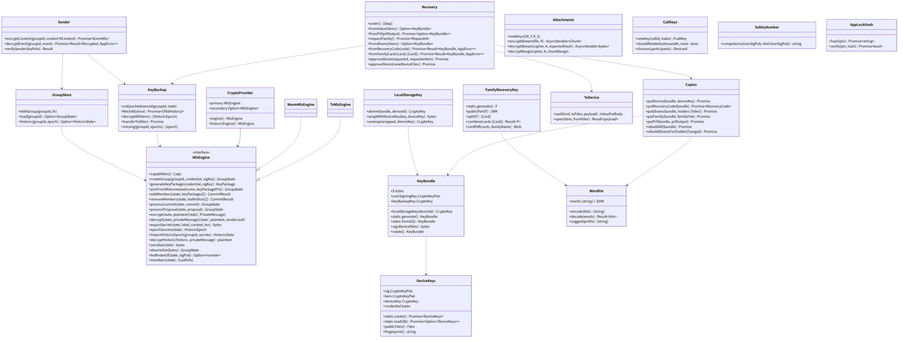

# web-crypto（ウェブ・基盤。MLS、端末の鍵、鍵バンドルと回復、鍵のバックアップ、添付と通話の鍵）

## 受ける節
- [第12章 5.2 群の暗号（MLS）](../../../../docs/jp/design/12_基本設計書_データと暗号化.md#52-群の暗号mls)（群の暗号：グループ、leaf、スイート、部品の 2 系統、KeyPackage の補充、Commit、Welcome、端末宛メールボックス、送信者の認証、TOFU と警告、安全番号、追加と退出）、[第12章 5.3 端末の鍵（DD-12-3）](../../../../docs/jp/design/12_基本設計書_データと暗号化.md#53-端末の鍵dd-12-3)（端末の鍵、端末鍵、端末の保存の鍵）、[第12章 5.4 鍵バンドルと回復（DD-12-4、DD-12-5）](../../../../docs/jp/design/12_基本設計書_データと暗号化.md#54-鍵バンドルと回復dd-12-4dd-12-5)（鍵バンドル `S`、導出、コピー (a)〜(e)、回復の順序、`S` の交代）、[第12章 5.5 新しい端末の参加（第3章と往復）](../../../../docs/jp/design/12_基本設計書_データと暗号化.md#55-新しい端末の参加第3章と往復)（新しい端末の参加の鍵の側）、[第12章 5.6 鍵のバックアップ（履歴）（DD-12-6）](../../../../docs/jp/design/12_基本設計書_データと暗号化.md#56-鍵のバックアップ履歴dd-12-6)（鍵のバックアップ）、[第12章 5.7 メッセージと添付（第4章・第5章と往復）](../../../../docs/jp/design/12_基本設計書_データと暗号化.md#57-メッセージと添付第4章第5章と往復) の暗号化の手順（ファイルの鍵、チャンク、AAD、ハッシュ）、[第12章 5.11 通話（DD-12-11。第6章と往復）](../../../../docs/jp/design/12_基本設計書_データと暗号化.md#511-通話dd-12-11第6章と往復) の鍵の生成と配布の規則（SDK への渡しは web-calls）、[第12章 12 データの形式（本章が定めるもの）](../../../../docs/jp/design/12_基本設計書_データと暗号化.md#12-データの形式本章が定めるもの)（形式）、[第12章 13 失敗の扱い](../../../../docs/jp/design/12_基本設計書_データと暗号化.md#13-失敗の扱い) の鍵に関する行
- [第3章 4.1 パスキーの登録（DD-3-4）](../../../../docs/jp/design/03_基本設計書_認証_構成員_端末.md#41-パスキーの登録dd-3-4) の PRF の扱い（コピー (e)）、[第3章 4.4 新しい端末の追加（DD-3-7）](../../../../docs/jp/design/03_基本設計書_認証_構成員_端末.md#44-新しい端末の追加dd-3-7)（承認の鍵の側）、[第3章 4.6 回復（パスキーを失った）](../../../../docs/jp/design/03_基本設計書_認証_構成員_端末.md#46-回復パスキーを失った)（回復）、[第3章 4.7 アプリのロック（DD-3-8）](../../../../docs/jp/design/03_基本設計書_認証_構成員_端末.md#47-アプリのロックdd-3-8) の暗証番号のハッシュ（Argon2id。WASM）
- [第10章 10 語表（DD-10-9）](../../../../docs/jp/design/10_基本設計書_画面.md#10-語表dd-10-9)（語表の規則と符号化：25 語、検査語）
- [第7章 5.1 表示の流れ](../../../../docs/jp/design/07_基本設計書_通知.md#51-表示の流れ) の「MLS の状態で復号（Web Locks）」、[第8章 3.4 保存（DD-8-4）](../../../../docs/jp/design/08_基本設計書_iPhoneとPCのシェル.md#34-保存dd-8-4) の `mls_state`、`keys` の表
- 全体実装設計書 2.2（MLS は画面と SW の両方のバンドル）、2.5（錠）、4.6（鍵のバックアップの中身と `importHistoricEpoch`）、I-14

- [第12章 6.4 端末の保存](../../../../docs/jp/design/12_基本設計書_データと暗号化.md#64-端末の保存)（端末の保存の暗号化の鍵。取り消された端末の保存の消去は web-sync）
## 依存
- 下：[web-core](web-core.md)（`Db`、`Locks`、`Channel`、`Api`、`AppError`）。部品：TypeScript の MLS の実装（一次。vendoring の可能性）、Rust の MLS の WASM（二次）、WebCrypto（P-256、AES-GCM、HKDF、AES-KW はなし：鍵の包みは AES-GCM）、hash-wasm（Argon2id）、shamir-secret-sharing（GF(256)）、HPKE（RFC 9180。一次の MLS の実装が持つ HPKE を使う。無ければ自前の最小：DHKEM P-256 + HKDF-SHA256 + AES-128-GCM）。
- 依存の逆転：`MlsEngine` を本ブロックが定義し、2 つの実装を持つ（`CryptoProvider` で切り替え。全体実装設計書 2.8）。
- 上：web-sync（暗号化と復号）、web-push（SW の復号）、web-media（添付の鍵）、web-calls（通話の鍵）、web-ui（回復の画面、安全番号）。

## クラス図

```mermaid
classDiagram
  class MlsEngine {
    <<interface>>
    +capabilities() Caps
    +createGroup(groupId, credential, sigKey) GroupState
    +generateKeyPackage(credential, sigKey) KeyPackage
    +joinFromWelcome(welcome, keyPackagePriv) GroupState
    +addMembers(state, keyPackages[]) CommitResult
    +removeMembers(state, leafIndices[]) CommitResult
    +processCommit(state, commit) GroupState
    +processProposal(state, proposal) GroupState
    +encrypt(state, plaintext) (state', PrivateMessage)
    +decrypt(state, privateMessage) (state', plaintext, senderLeaf)
    +exportSecret(state, label, context, len) bytes
    +epochSecrets(state) HistoricEpoch
    +importHistoricEpoch(groupId, secrets) HistoricState
    +decryptHistoric(historic, privateMessage) plaintext
    +serialize(state) bytes
    +deserialize(bytes) GroupState
    +leafIndexOf(state, sigPub) Option~number~
    +members(state) [LeafInfo]
  }
  class TsMlsEngine
  class WasmMlsEngine
  class CryptoProvider {
    +primary MlsEngine
    +secondary Option~MlsEngine~
    +engine() MlsEngine
    +historicEngine() MlsEngine
  }
  class DeviceKeys {
    +sig CryptoKeyPair
    +kem CryptoKeyPair
    +deviceKey CryptoKey
    +credential bytes
    +static create() Promise~DeviceKeys~
    +static load(db) Promise~Option~DeviceKeys~~
    +publicFdev() Fdev
    +fingerprint() string
  }
  class KeyBundle {
    +S bytes
    +userSigningKey CryptoKeyPair
    +keyBackupKey CryptoKey
    +localStorageKey(deviceId) CryptoKey
    +static generate() KeyBundle
    +static fromS(S) KeyBundle
    +signDevice(fdev) bytes
    +rotate() KeyBundle
  }
  class Copies {
    +putDevice(bundle, deviceKey) Promise
    +putRecoveryCode(bundle) Promise~RecoveryCode~
    +putShares(bundle, holders [Fdev]) Promise
    +putFamily(bundle, familyPub) Promise
    +putPrf(bundle, prfOutput) Promise
    +rebuildAll(bundle) Promise
    +rebuildSharesFor(holderChanged) Promise
  }
  class Recovery {
    +order() [Step]
    +fromInbox(items) Option~KeyBundle~
    +fromPrf(prfOutput) Promise~Option~KeyBundle~~
    +requestFamily() Promise~RequestId~
    +fromShares(items) Option~KeyBundle~
    +fromRecoveryCode(code) Promise~Result~KeyBundle, AppError~~
    +fromFamilyCards(cards [Card]) Promise~Result~KeyBundle, AppError~~
    +approveShare(requestId, requesterKem) Promise
    +approveDevice(newDeviceFdev) Promise
  }
  class FamilyRecoveryKey {
    +static generate() F
    +publicPart(F) JWK
    +split(F) [Card]
    +combine(cards [Card]) Result~F~
    +cardPdf(cards, familyName) Blob
  }
  class Wordlist {
    +words [string] = 2048
    +encode(bits) [string]
    +decode(words) Result~bits~
    +suggest(prefix) [string]
  }
  class KeyBackup {
    +onEpochAdvanced(groupId, state)
    +fetchAll(since) Promise~[FkbHistory]~
    +decryptAll(items) [HistoricEpoch]
    +transferTo(fdev) Promise
    +missing(groupId, epochs) [epoch]
  }
  class GroupStore {
    +withGroup(groupId, fn)
    +load(groupId) Option~GroupState~
    +historic(groupId, epoch) Option~HistoricState~
  }
  class Sender {
    +encryptContent(groupId, content ftContent) Promise~EventMls~
    +decryptEvent(groupId, event) Promise~Result~Decrypted, AppError~~
    +verifySender(leafInfo) Result
  }
  class ToDevice {
    +seal(kind, toFdev, payload) InboxPutBody
    +open(item, fromFdev) Result~payload~
  }
  class Attachments {
    +newKeys() (K_f, K_t)
    +encryptStream(file, K) AsyncIterable~Chunk~
    +decryptStream(cipher, K, expectedHash) AsyncIterable~bytes~
    +decryptRange(cipher, K, chunkRange)
  }
  class CallKeys {
    +newKey(callId, index) FcallKey
    +shouldRotate(lastIssuedAt, now) bool
    +chooser(participants) DeviceId
  }
  class SafetyNumber {
    +compute(myUserSigPub, theirUserSigPub) string
  }
  class LocalStorageKey {
    +derive(bundle, deviceId) CryptoKey
    +wrapWithDeviceKey(key, deviceKey) bytes
    +unwrap(wrapped, deviceKey) CryptoKey
  }
  class AppLockHash {
    +hash(pin) Promise~string~
    +verify(pin, hash) Promise~bool~
  }
  TsMlsEngine ..|> MlsEngine
  WasmMlsEngine ..|> MlsEngine
  CryptoProvider --> MlsEngine
  KeyBundle ..> DeviceKeys
  Copies ..> KeyBundle
  Copies ..> Wordlist
  Recovery ..> Copies
  Recovery ..> KeyBackup
  Recovery ..> ToDevice
  FamilyRecoveryKey ..> Wordlist
  KeyBackup ..> MlsEngine
  GroupStore ..> MlsEngine
  Sender ..> GroupStore
  Sender ..> KeyBackup
  LocalStorageKey ..> KeyBundle
```

図の元の文（mermaid）

クラス図の注記（図の各メンバーの説明。仕様の節と番号を含む）

|クラス|メンバー|注記|
|---|---|---|
|MlsEngine|`+capabilities() Caps`|{historic: bool}|
|MlsEngine|`+addMembers(state, keyPackages[]) CommitResult`|{state', commit, welcome, groupInfo}|
|MlsEngine|`+exportSecret(state, label, context, len) bytes`|family-talk/v1/history|
|MlsEngine|`+epochSecrets(state) HistoricEpoch`|{epoch, tree_hash, encryption_secret, sender_data_secret, confirmed_transcript_hash}（全体実装設計書 4.6）|
|MlsEngine|`+importHistoricEpoch(groupId, secrets) HistoricState`|復号専用（一次だけ）|
|MlsEngine|`+members(state) [LeafInfo]`|leaf index、credential（device_id、user_id）、sig pub|
|CryptoProvider|`+engine() MlsEngine`|設定 or 試験で切り替え|
|CryptoProvider|`+historicEngine() MlsEngine`|capabilities.historic を持つ方|
|DeviceKeys|`+sig CryptoKeyPair`|P-256 ECDSA、抽出不可（IndexedDB keys）|
|DeviceKeys|`+kem CryptoKeyPair`|P-256 ECDH、抽出不可|
|DeviceKeys|`+deviceKey CryptoKey`|AES-256-GCM、抽出不可。Android はシェルが包んだ物を JS ブリッジから（web-shell Platform.unwrapDeviceKey）|
|DeviceKeys|`+credential bytes`|MLS の basic credential（device_id、user_id）|
|DeviceKeys|`+publicFdev() Fdev`|fdev/1（user_sig は KeyBundle が付ける）|
|DeviceKeys|`+fingerprint() string`|承認の画面|
|KeyBundle|`+S bytes`|256 ビット（記憶の上。IndexedDB には端末鍵で包んで）|
|KeyBundle|`+userSigningKey CryptoKeyPair`|HKDF(S, "family-talk/v1/user-signing") → P-256 の秘密鍵（RFC 6979 の手順で決定的）|
|KeyBundle|`+keyBackupKey CryptoKey`|HKDF(S, "family-talk/v1/key-backup")|
|KeyBundle|`+localStorageKey(deviceId) CryptoKey`|HKDF(S, "family-talk/v1/local-storage", salt = device_id)|
|KeyBundle|`+signDevice(fdev) bytes`|user_sig|
|KeyBundle|`+rotate() KeyBundle`|鍵を作り直す（S'）。全系統のコピーを作り直し、鍵のバックアップを S' で暗号化し直す（Copies.rebuildAll）|
|Copies|`+putDevice(bundle, deviceKey) Promise`|(a) fkb/1 kind=device。AES-256-GCM|
|Copies|`+putRecoveryCode(bundle) Promise~RecoveryCode~`|(b) 128 ビット → base32 26 文字 + 検査 2 文字（CRC-16）→ 4 文字 × 7。Argon2id(m=64MiB,t=3,p=4, salt=user_id) → 包み。ハッシュを PutHash|
|Copies|`+putShares(bundle, holders [Fdev]) Promise`|(c) Shamir 2-of-(n-1)、片を各代表の端末の kem へ HPKE。n ≤ 10。構成員 2 人以下は (b)(d) 必須|
|Copies|`+putFamily(bundle, familyPub) Promise`|(d) F の公開部（HPKE）へ|
|Copies|`+putPrf(bundle, prfOutput) Promise`|(e) PRF の出力から HKDF → AES-256-GCM|
|Copies|`+rebuildAll(bundle) Promise`|端末・代表の端末・公開部が変わった時、S の交代|
|Copies|`+rebuildSharesFor(holderChanged) Promise`|keybundle.changed(kinds: [share])|
|Recovery|`+order() [Step]`|1 既存の端末、(e) PRF、2 家族に頼む、3 回復コード、4 家族回復鍵|
|Recovery|`+fromInbox(items) Option~KeyBundle~`|既存の端末からの HPKE の転送（kind=keybundle）|
|Recovery|`+requestFamily() Promise~RequestId~`|POST /me/recovery/request|
|Recovery|`+fromShares(items) Option~KeyBundle~`|2 片で復元|
|Recovery|`+fromRecoveryCode(code) Promise~Result~KeyBundle, AppError~~`|検査文字 → Argon2id → GET verify（10 回/日 KEY-008）→ 復号|
|Recovery|`+fromFamilyCards(cards [Card]) Promise~Result~KeyBundle, AppError~~`|2 枚の語 → F → コピー (d) を復号。POST /family/recovery-key/use（記録と知らせ）|
|Recovery|`+approveShare(requestId, requesterKem) Promise`|自分の片を相手の kem へ HPKE → inbox|
|Recovery|`+approveDevice(newDeviceFdev) Promise`|承認：user_sig、S と鍵のバックアップの中身を HPKE で inbox へ、各グループに Add|
|FamilyRecoveryKey|`+static generate() F`|256 ビット|
|FamilyRecoveryKey|`+publicPart(F) JWK`|HKDF(F) → HPKE の鍵対の公開部|
|FamilyRecoveryKey|`+split(F) [Card]`|2-of-3。各片 256 ビット + 番号 2 ビット + しきい値 2 ビット → 11 ビット × 24 語 + 検査語 1 語（25 語。5 語 × 5 行）|
|FamilyRecoveryKey|`+combine(cards [Card]) Result~F~`|検査語で誤りの行を示す|
|FamilyRecoveryKey|`+cardPdf(cards, familyName) Blob`|印刷（web-ui が出す）|
|Wordlist|`+words [string] = 2048`|api/schemas/wordlist.json（NRSD）。先頭 2 文字で一意|
|KeyBackup|`+onEpochAdvanced(groupId, state)`|engine.epochSecrets → keyBackupKey で AES-256-GCM → PUT /me/keybackup/{group}/{epoch}（既にあれば 204）|
|KeyBackup|`+transferTo(fdev) Promise`|承認の時：復号済みの中身を HPKE で inbox へ（分割）|
|KeyBackup|`+missing(groupId, epochs) [epoch]`|復元の後の欠けの検出|
|GroupStore|`+withGroup(groupId, fn)`|Locks "mls:<group_id>" → load（IndexedDB mls_state、端末の保存の鍵で復号）→ fn(state) → store → Channel.post(mls, groupId)。画面のコピーの無効化|
|GroupStore|`+historic(groupId, epoch) Option~HistoricState~`|鍵のバックアップから作った復号専用の状態（記憶の上のキャッシュ）|
|Sender|`+encryptContent(groupId, content ftContent) Promise~EventMls~`|ft.event.mls/1：ciphertext + 平文の欄（mentions、relates_to、attachments、schema_inner、silent）|
|Sender|`+decryptEvent(groupId, event) Promise~Result~Decrypted, AppError~~`|現在の状態で復号。epoch が過去なら historic。無ければ「鍵を待つ」|
|Sender|`+verifySender(leafInfo) Result`|leaf の sig pub が本人の署名鍵で署名されているか（fusr/1 を TOFU で固定。変化は警告）|
|ToDevice|`+seal(kind, toFdev, payload) InboxPutBody`|HPKE（DHKEM P-256、HKDF-SHA256、AES-128-GCM）で相手の kem へ。本人の署名鍵または端末の署名鍵で署名|
|Attachments|`+encryptStream(file, K) AsyncIterable~Chunk~`|64 KiB、AES-256-GCM、nonce = 番号 11 バイト + 最終フラグ 1 バイト、AAD = 番号。先頭に版。暗号文全体の SHA-256|
|Attachments|`+decryptStream(cipher, K, expectedHash) AsyncIterable~bytes~`|ハッシュを確かめてから（または流しながら最後に）|
|Attachments|`+decryptRange(cipher, K, chunkRange)`|動画の Range 再生（web-media）|
|CallKeys|`+newKey(callId, index) FcallKey`|fcall-key/1：256 ビット、index 0〜255（巡回）|
|CallKeys|`+shouldRotate(lastIssuedAt, now) bool`|参加が増えた時：10 秒以内なら既存|
|CallKeys|`+chooser(participants) DeviceId`|識別子が最小の端末が配る|
|SafetyNumber|`+compute(myUserSigPub, theirUserSigPub) string`|60 桁（2 人の公開鍵から）|
|AppLockHash|`+hash(pin) Promise~string~`|Argon2id（hash-wasm。m=64MiB,t=3,p=4）|

## 公開操作（このブロックが所有する操作。番号は B-220〜）
|番号|操作（上の図）|使う側|由来|
|---|---|---|---|
|B-220|`MlsEngine`（定義）、`CryptoProvider`|本ブロック、試験（T-L3-01 の 2 系統）|[第12章 5.2 群の暗号（MLS）](../../../../docs/jp/design/12_基本設計書_データと暗号化.md#52-群の暗号mls)、全体実装設計書 2.8|
|B-221|`DeviceKeys`（作成、読み、`publicFdev`、`fingerprint`）|web-ui（参加、端末の追加、一覧の指紋）、web-shell（Android の端末鍵の包み）、web-sync（登録 `PUT /me/devices/{id}/keys`）|[第12章 5.3 端末の鍵（DD-12-3）](../../../../docs/jp/design/12_基本設計書_データと暗号化.md#53-端末の鍵dd-12-3)、[第3章 4.4 新しい端末の追加（DD-3-7）](../../../../docs/jp/design/03_基本設計書_認証_構成員_端末.md#44-新しい端末の追加dd-3-7)|
|B-222|`KeyBundle`、`Copies`、`Recovery`、`FamilyRecoveryKey`、`Wordlist`|web-ui（参加 3、回復の 4 段、承認、カードの印刷、「鍵を作り直す」）、web-sync（承認の後の Add）|[第12章 5.4 鍵バンドルと回復（DD-12-4、DD-12-5）](../../../../docs/jp/design/12_基本設計書_データと暗号化.md#54-鍵バンドルと回復dd-12-4dd-12-5)、[第12章 5.5 新しい端末の参加（第3章と往復）](../../../../docs/jp/design/12_基本設計書_データと暗号化.md#55-新しい端末の参加第3章と往復)、[第3章 4.6 回復（パスキーを失った）](../../../../docs/jp/design/03_基本設計書_認証_構成員_端末.md#46-回復パスキーを失った)、[第10章 10 語表（DD-10-9）](../../../../docs/jp/design/10_基本設計書_画面.md#10-語表dd-10-9)|
|B-223|`KeyBackup`（`onEpochAdvanced`、`fetchAll`、`decryptAll`、`transferTo`、`missing`）|web-sync（epoch が進んだ時、新しい端末の履歴の同期）|[第12章 5.6 鍵のバックアップ（履歴）（DD-12-6）](../../../../docs/jp/design/12_基本設計書_データと暗号化.md#56-鍵のバックアップ履歴dd-12-6)、全体実装設計書 4.6|
|B-224|`GroupStore::withGroup`、`load`、`historic`|web-sync、web-push（SW の復号）|全体実装設計書 2.5|
|B-225|`Sender`（`encryptContent`、`decryptEvent`、`verifySender`）|web-sync、web-push（SW）、web-ui（安全番号の警告の表示）|[第12章 5.7 メッセージと添付（第4章・第5章と往復）](../../../../docs/jp/design/12_基本設計書_データと暗号化.md#57-メッセージと添付第4章第5章と往復)、[第12章 5.2 群の暗号（MLS）](../../../../docs/jp/design/12_基本設計書_データと暗号化.md#52-群の暗号mls)|
|B-226|`ToDevice`（`seal`、`open`）|web-sync（inbox の処理）、web-crypto（回復）、web-calls（鍵の補助）、web-ui（スタンプの削除の求め）|[第12章 5.2 群の暗号（MLS）](../../../../docs/jp/design/12_基本設計書_データと暗号化.md#52-群の暗号mls)|
|B-227|`Attachments`（鍵、ストリームの暗号化と復号、Range）|web-media|[第12章 5.7 メッセージと添付（第4章・第5章と往復）](../../../../docs/jp/design/12_基本設計書_データと暗号化.md#57-メッセージと添付第4章第5章と往復)|
|B-228|`CallKeys`|web-calls|[第12章 5.11 通話（DD-12-11。第6章と往復）](../../../../docs/jp/design/12_基本設計書_データと暗号化.md#511-通話dd-12-11第6章と往復)|
|B-229|`SafetyNumber`|web-ui（設定 > プライバシー）|[第12章 5.2 群の暗号（MLS）](../../../../docs/jp/design/12_基本設計書_データと暗号化.md#52-群の暗号mls)|
|B-230|`LocalStorageKey`、`AppLockHash`|web-core `Db` の暗号化の鍵（web-sync・web-media が値を暗号化する時）、web-shell（ロック）|[第12章 5.3 端末の鍵（DD-12-3）](../../../../docs/jp/design/12_基本設計書_データと暗号化.md#53-端末の鍵dd-12-3)、[第3章 4.7 アプリのロック（DD-3-8）](../../../../docs/jp/design/03_基本設計書_認証_構成員_端末.md#47-アプリのロックdd-3-8)|

## アルゴリズム（差し替え点）
|interface|実装|切り替え|由来|
|---|---|---|---|
|`MlsEngine`|一次：TypeScript の実装（MIT）。二次：Rust の実装の WASM（Apache-2.0 OR MIT）|`CryptoProvider`（設定・試験）。履歴の復号は一次だけ|[第12章 5.2 群の暗号（MLS）](../../../../docs/jp/design/12_基本設計書_データと暗号化.md#52-群の暗号mls)、[第14章 13.1 代替の表](../../../../docs/jp/design/14_基本設計書_開発基盤.md#131-代替の表)|
|HPKE|一次の MLS の実装の HPKE（無ければ自前の最小）|固定|[第12章 5.2 群の暗号（MLS）](../../../../docs/jp/design/12_基本設計書_データと暗号化.md#52-群の暗号mls)|
|Argon2id|hash-wasm（m=64 MiB、t=3、p=4）|固定（RFC 9106 第 2 推奨）|[第12章 5.4 鍵バンドルと回復（DD-12-4、DD-12-5）](../../../../docs/jp/design/12_基本設計書_データと暗号化.md#54-鍵バンドルと回復dd-12-4dd-12-5)、[第3章 4.7 アプリのロック（DD-3-8）](../../../../docs/jp/design/03_基本設計書_認証_構成員_端末.md#47-アプリのロックdd-3-8)|
|Shamir|GF(256)（shamir-secret-sharing。Apache-2.0）|固定|[第12章 5.4 鍵バンドルと回復（DD-12-4、DD-12-5）](../../../../docs/jp/design/12_基本設計書_データと暗号化.md#54-鍵バンドルと回復dd-12-4dd-12-5)|
|添付の暗号|AES-256-GCM、64 KiB のチャンク|固定（先頭の版で将来の切り替え）|[第12章 5.7 メッセージと添付（第4章・第5章と往復）](../../../../docs/jp/design/12_基本設計書_データと暗号化.md#57-メッセージと添付第4章第5章と往復)|

## データ設計（このブロックが形を持つ記録）
|記録|形|欄|由来|
|---|---|---|---|
|IndexedDB `keys`|key-value|`device_sig CryptoKeyPair`、`device_kem CryptoKeyPair`、`device_key CryptoKey`（Android は無し：シェルが持つ）、`S_wrapped bytes`（端末鍵で AES-256-GCM）、`local_storage_key_wrapped`、`user_sig_pub JWK`、`known_user_sig_pubs {user_id → JWK}`（TOFU）、`recovery_code_shown_at`|[第12章 5.3 端末の鍵（DD-12-3）](../../../../docs/jp/design/12_基本設計書_データと暗号化.md#53-端末の鍵dd-12-3)、[第8章 3.4 保存（DD-8-4）](../../../../docs/jp/design/08_基本設計書_iPhoneとPCのシェル.md#34-保存dd-8-4)|
|IndexedDB `mls_state`|`group_id → bytes`|`engine.serialize` の出力を端末の保存の鍵で AES-256-GCM。`epoch`、`updated_at` を平文の欄に|[第8章 3.4 保存（DD-8-4）](../../../../docs/jp/design/08_基本設計書_iPhoneとPCのシェル.md#34-保存dd-8-4)|
|記憶の上 `historic`|`(group_id, epoch) → HistoricState`|鍵のバックアップから作る。再起動で作り直す|全体実装設計書 4.6|
|回復コード|文字列|base32（RFC 4648、小文字なし）26 文字 + 検査 2 文字（CRC-16 の上位）→ 4 文字 × 7 区切り|[第12章 12 データの形式（本章が定めるもの）](../../../../docs/jp/design/12_基本設計書_データと暗号化.md#12-データの形式本章が定めるもの)|
|カード|`fcard/1`|片の番号（1〜3）、しきい値 2、25 語（5 語 × 5 行）、検査語|[第12章 12 データの形式（本章が定めるもの）](../../../../docs/jp/design/12_基本設計書_データと暗号化.md#12-データの形式本章が定めるもの)、[第10章 10 語表（DD-10-9）](../../../../docs/jp/design/10_基本設計書_画面.md#10-語表dd-10-9)|
|`fkb/1`、`fkb-history/1`、`fdev/1`、`fusr/1`、`fatt/1`、`fcall-key/1`|api/schemas|第12章 12（本ブロックは生成した型を使う）|[第12章 12 データの形式（本章が定めるもの）](../../../../docs/jp/design/12_基本設計書_データと暗号化.md#12-データの形式本章が定めるもの)|
