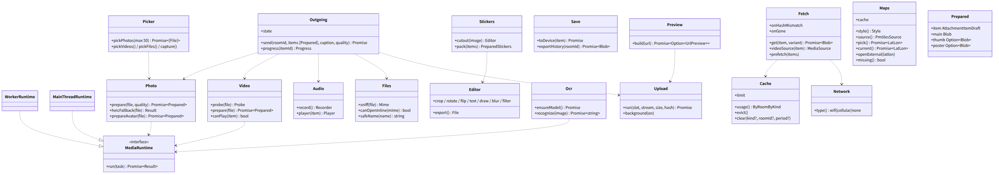

# web-media（ウェブ・業務。写真・動画・音声・ファイルの処理、アップロードと取得、キャッシュ、地図、プレビュー）

## 受ける節

- [第5章 3 添付の項目（`ft.content.attachment_item/1`）](../../../../docs/jp/design/05_基本設計書_メディア.md#3-添付の項目ftcontentattachment_item1)（添付の項目の形の生成）
- [第5章 4.1 写真（DD-5-2）](../../../../docs/jp/design/05_基本設計書_メディア.md#41-写真dd-5-2)（写真）
- [第5章 4.2 動画（DD-5-3）](../../../../docs/jp/design/05_基本設計書_メディア.md#42-動画dd-5-3)（動画）
- [第5章 4.3 音声（DD-5-4）](../../../../docs/jp/design/05_基本設計書_メディア.md#43-音声dd-5-4)（音声）
- [第5章 4.4 ファイル（DD-5-5）](../../../../docs/jp/design/05_基本設計書_メディア.md#44-ファイルdd-5-5)（ファイル）
- [第5章 4.5 加工と文字の抽出（DD-5-11）](../../../../docs/jp/design/05_基本設計書_メディア.md#45-加工と文字の抽出dd-5-11)（加工と文字の抽出）
- [第5章 5.1 アップロード（DD-5-6）](../../../../docs/jp/design/05_基本設計書_メディア.md#51-アップロードdd-5-6)（アップロードの端末の側）
- [第5章 5.2 取得（DD-5-7）](../../../../docs/jp/design/05_基本設計書_メディア.md#52-取得dd-5-7)（取得、自動の取り込み、回線の判定、キャッシュ、端末への保存）
- [第5章 5.3 再生できない形式](../../../../docs/jp/design/05_基本設計書_メディア.md#53-再生できない形式)（再生できない形式）
- [第5章 6 アルバム（DD-5-8）](../../../../docs/jp/design/05_基本設計書_メディア.md#6-アルバムdd-5-8)（アルバムの一括のアップロード。イベントの形は web-sync）
- [第5章 8.2 位置の送信と表示](../../../../docs/jp/design/05_基本設計書_メディア.md#82-位置の送信と表示)（地図の表示とキャッシュ）
- [第5章 8.1 データと配信](../../../../docs/jp/design/05_基本設計書_メディア.md#81-データと配信) のクライアントの側（スタイル、フォント、タイルの取得）
- [第5章 9 数値の一覧（config.yaml の「メディア」）](../../../../docs/jp/design/05_基本設計書_メディア.md#9-数値の一覧configyaml-のメディア)（数値）
- [第5章 10 失敗の扱い](../../../../docs/jp/design/05_基本設計書_メディア.md#10-失敗の扱い)（失敗）
- [第4章 5.6 URL のプレビュー（DD-4-7）](../../../../docs/jp/design/04_基本設計書_トークとメッセージ.md#56-url-のプレビューdd-4-7)（URL のプレビューの取得と同梱）
- [第4章 5.9 スタンプ（DD-4-10、DD-4-11）](../../../../docs/jp/design/04_基本設計書_トークとメッセージ.md#59-スタンプdd-4-10dd-4-11) の切り抜きと絵柄の形（512×512 WebP、アニメーション）
- [第4章 4.2 一覧（DD-4-13）](../../../../docs/jp/design/04_基本設計書_トークとメッセージ.md#42-一覧dd-4-13) の履歴の書き出し（テキスト + ファイル）
- [第12章 5.7 メッセージと添付（第4章・第5章と往復）](../../../../docs/jp/design/12_基本設計書_データと暗号化.md#57-メッセージと添付第4章第5章と往復) の 1〜5（変換、鍵、暗号化、スロット、本文の順）
- [第12章 5.10 URL のプレビュー（DD-12-9。第4章と往復）](../../../../docs/jp/design/12_基本設計書_データと暗号化.md#510-url-のプレビューdd-12-9第4章と往復)（プレビューの画像の暗号化し直し）
- [第8章 3.4 保存（DD-8-4）](../../../../docs/jp/design/08_基本設計書_iPhoneとPCのシェル.md#34-保存dd-8-4)（OPFS `media/`、`cache/`、`maps/`）
- [第8章 4 iPhone の制約の補い方（DD-8-6）](../../../../docs/jp/design/08_基本設計書_iPhoneとPCのシェル.md#4-iphone-の制約の補い方dd-8-6) の 3 行（HEIC、Share Target、背景の処理）
- [第9章 9 メディア（DD-9-9）](../../../../docs/jp/design/09_基本設計書_Androidのシェル.md#9-メディアdd-9-9) のシェルの側との JS ブリッジ（写真ピッカー、保存、`UploadService`、回線）
- [第1章 8.6 日本語のファイル名と文字](../../../../docs/jp/design/01_基本設計書_全体構成.md#86-日本語のファイル名と文字)（ファイル名の NFC、OS で使えない文字）
- 全体実装設計書 2.2（MediaWorker）、2.3（アップロード 4 本）、2.6（記憶の予算）、2.8（`MediaRuntime`）、3.2（添付の送る側・受ける側）

## 依存

- 下：
  - [web-core](web-core.md)（`Api`、`Db`、`Settings`、`AppError`）
  - [web-crypto](web-crypto.md)（`Attachments`）
  - [web-sync](web-sync.md)（`SendQueue.enqueue`、`Events`、`AttachmentResolver` の実装、`Relations.albumItems`）
- 部品：
  - mediabunny（MPL-2.0）、WebCodecs、OffscreenCanvas、MediaRecorder
  - OCR の部品（Apache-2.0。WASM）と日本語の学習データ
  - maplibre-gl と pmtiles（地図）
  - budoux は web-ui が持つ
- 依存の逆転：`MediaRuntime`（Worker と主スレッドの切り替え）を本ブロックが定義。シェルの機能（ピッカー、保存、背景のアップロード、回線）は web-shell の `Platform` を通す。

## クラス図

```mermaid
classDiagram
  class MediaRuntime {
    <<interface>>
    +run(task) Promise~Result~
  }
  class WorkerRuntime
  class MainThreadRuntime
  class Picker {
    +pickPhotos(max 50) Promise~[File]~
    +pickVideos() / pickFiles() / capture()
  }
  class Photo {
    +prepare(file, quality) Promise~Prepared~
    +heicFallback(file) Result
    +prepareAvatar(file) Promise~Prepared~
  }
  class Video {
    +probe(file) Probe
    +prepare(file) Promise~Prepared~
    +canPlay(item) bool
  }
  class Audio {
    +record() Recorder
    +player(item) Player
  }
  class Files {
    +sniff(file) Mime
    +canOpenInline(mime) bool
    +safeName(name) string
  }
  class Editor {
    +crop / rotate / flip / text / draw / blur / filter
    +export() File
  }
  class Ocr {
    +ensureModel() Promise
    +recognize(image) Promise~string~
  }
  class Outgoing {
    +send(roomId, items [Prepared], caption, quality) Promise
    +progress(itemId) Progress
    +state
  }
  class Upload {
    +run(slot, stream, size, hash) Promise
    +background(on)
  }
  class Fetch {
    +get(item, variant) Promise~Blob~
    +videoSource(item) MediaSource
    +prefetch(items)
    +onHashMismatch
    +onGone
  }
  class Cache {
    +limit
    +usage() ByRoomByKind
    +evict()
    +clear(kind?, roomId?, period?)
  }
  class Network {
    +type() wifi|cellular|none
  }
  class Save {
    +toDevice(item) Promise
    +exportHistory(roomId) Promise~Blob~
  }
  class Preview {
    +build(url) Promise~Option~UrlPreview~~
  }
  class Stickers {
    +cutout(image) Editor
    +pack(items) PreparedStickers
  }
  class Maps {
    +style() Style
    +source() PmtilesSource
    +cache
    +pick() Promise~LatLon~
    +current() Promise~LatLon~
    +openExternal(latlon)
    +missing() bool
  }
  class Prepared {
    +item AttachmentItemDraft
    +main Blob
    +thumb Option~Blob~
    +poster Option~Blob~
  }
  WorkerRuntime ..|> MediaRuntime
  MainThreadRuntime ..|> MediaRuntime
  Photo ..> MediaRuntime
  Video ..> MediaRuntime
  Ocr ..> MediaRuntime
  Outgoing ..> Photo
  Outgoing ..> Video
  Outgoing ..> Audio
  Outgoing ..> Files
  Outgoing ..> Upload
  Fetch ..> Cache
  Fetch ..> Network
  Preview ..> Upload
  Stickers ..> Editor
  Picker ..> Photo
```

図の元の文（mermaid）

クラス図の注記（図の各メンバーの説明。仕様の節と番号を含む）

|クラス|メンバー|注記|
|---|---|---|
|MediaRuntime|`+run(task) Promise~Result~`|decode、resize、thumbnail、blurhash、transcode、probe、ocr、segment|
|WorkerRuntime|`（クラス全体）`|Dedicated Worker + OffscreenCanvas + WebCodecs|
|MainThreadRuntime|`（クラス全体）`|OffscreenCanvas が無い環境（PC の古いブラウザ。iOS は 16.4 から 2D を持つので当たらない）|
|Picker|`+pickPhotos(max 50) Promise~[File]~`|`<input multiple>` の accept は `image/jpeg,image/png,image/gif,image/webp,image/heic,image/heif,image/avif`（`image/*` を書かない。iPhone は OS が HEIC を JPEG に変換して渡す。第5章 4.1）。動画は `video/mp4,video/quicktime,video/webm`。シェルの写真ピッカー（Platform）/ capture / 共有の受け口|
|Photo|`+prepare(file, quality) Promise~Prepared~`|次の順。1. 復号（createImageBitmap imageOrientation: from-image。効かなければ EXIF を読んで回転）。2. 画素数 1 億の上限。3. 長辺 1,600/2,560/無圧縮（20 MB 超は高画質へ）。4. 加工。5. JPEG 85（オリジナルは APP1 を落とす）。6. サムネイル 320/1,280。7. BlurHash 4×3|
|Photo|`+heicFallback(file) Result`|Android の ImageDecoder が無ければ「この写真は送れません（形式）」|
|Photo|`+prepareAvatar(file) Promise~Prepared~`|プロフィールの写真：512×512 の JPEG、サムネイル 128（第3章 6。S-03）|
|Video|`+probe(file) Probe`|mediabunny で demux：avc1、プロファイル、解像度、fps、mp4a|
|Video|`+prepare(file) Promise~Prepared~`|範囲内：無変換（faststart の並べ替えだけ）。範囲外で VideoEncoder がある時：復号、1080p に縮小、H.264 Constrained Baseline（avc1.42E0 と level。isConfigSupported が偽か出力が 10 秒止まれば原本。第5章 DD-5-3）6 Mbps 60fps で符号化、AAC を通す、MP4 faststart の順。進捗。電池 20% 未満は確認。変換できない：原本 + playable_hint: original。ポスター 1,280（1 秒目）、BlurHash、長さ|
|Video|`+canPlay(item) bool`|canPlayType / MediaSource.isTypeSupported|
|Audio|`+record() Recorder`|MediaRecorder（audio/mp4、audio/webm;codecs=opus の順に試す）。30 分で停止。AnalyserNode から波形 64 点|
|Audio|`+player(item) Player`|1x/1.5x/2x、途中から、出口（Android はシェル）|
|Files|`+sniff(file) Mime`|魔法数（画像・動画・音声・PDF・zip・Office）。不明は application/octet-stream|
|Files|`+canOpenInline(mime) bool`|PDF・画像・動画・音声だけ。SVG/HTML/実行可能は保存のみ|
|Files|`+safeName(name) string`|NFC。OS で使えない文字は _ に置き換える|
|Editor|`+crop / rotate / flip / text / draw / blur / filter`|canvas。元に戻す（段階）|
|Ocr|`+ensureModel() Promise`|初回に家族のサーバーから学習データ（約 15 MB）。失敗は「あとで」|
|Outgoing|`+send(roomId, items [Prepared], caption, quality) Promise`|項目ごとに、鍵（Attachments.newKeys）、暗号化のストリーム、スロット（POST /media/slots。配列）、Upload の順。全部が完了したら ft.content.attachments/1 を SendQueue.enqueue|
|Outgoing|`+progress(itemId) Progress`|項目と全体（バイト）、残り時間|
|Outgoing|`+state`|selected、processing、encrypted、uploading、done、failed のいずれか|
|Upload|`+run(slot, stream, size, hash) Promise`|4 本並列、8 MiB ずつ PATCH（Upload-Offset）。サムネイル・ポスターを先に。完了で Upload-Complete と X-Content-SHA256。MEDIA-003 なら HEAD で位置を取り直す。MEDIA-004 なら最初から。24 時間でスロットの取り直し|
|Upload|`+background(on)`|シェル：Platform.uploadInBackground。iPhone/PC：「開いたままにしてください」|
|Fetch|`+get(item, variant) Promise~Blob~`|variant は thumb、poster、full のいずれか。OPFS media/ にあればそれ。無ければ GET /media/{id}（Range 可）、ハッシュの照合、復号（Attachments.decryptStream）の順に行い、cache/ に復号済みを置く（セッションの間）|
|Fetch|`+videoSource(item) MediaSource`|大きい動画：Range で必要な分だけ取り、チャンク単位で復号しながら再生（Attachments.decryptRange）。MediaSource が使えなければ全体を取って Blob URL|
|Fetch|`+prefetch(items)`|web-sync AttachmentResolver：自動の取り込みの表（Wi-Fi/モバイル × 種類）に従う|
|Fetch|`+onHashMismatch`|破棄して 1 回だけ取り直す。それでも合わなければ「壊れています」|
|Fetch|`+onGone`|404 なら「容量の整理で消えました」（本文の印）|
|Cache|`+limit`|空きの 20%（設定）|
|Cache|`+evict()`|古い順に本体を消す（サムネイルは残す）。estimate() 90% でも|
|Network|`+type() wifi\|cellular\|none`|navigator.connection（Chrome）、シェル（Platform）の順に見る。無ければ wifi とみなし、設定で切り替え|
|Save|`+toDevice(item) Promise`|iPhone：共有シート、PC：ダウンロード、Android：Platform.saveToGallery。初回に「家族の外に出す時は…」|
|Save|`+exportHistory(roomId) Promise~Blob~`|[日時] 名前: 本文。写真は [写真] またはファイルを同梱（zip）。OS の共有へ|
|Preview|`+build(url) Promise~Option~UrlPreview~~`|POST /preview の後、画像は staged を取得し（`GET /media/preview/{staged_id}`）、Attachments で暗号化してスロットに置き直す。結果は ft.content.url_preview/1|
|Stickers|`+cutout(image) Editor`|手動：なぞって囲む、消しゴム（OS の切り抜きの持ち込みは共有の受け口）|
|Stickers|`+pack(items) PreparedStickers`|512×512 WebP。アニメーションは 2 秒・1 MB|
|Maps|`+style() Style`|同梱のスタイル（日本語のラベル優先）、フォント、スプライト|
|Maps|`+source() PmtilesSource`|/maps/<版>/base.pmtiles（Range、forward auth の Cookie）。版は `GET /media/config` の `maps_version`（第2章 5.6）|
|Maps|`+cache`|OPFS maps/。200 MB（設定）|
|Maps|`+pick() Promise~LatLon~`|地図で地点を選ぶ（長押し）|
|Maps|`+current() Promise~LatLon~`|geolocation（許可）|
|Maps|`+openExternal(latlon)`|OS の地図（利用者の操作）|
|Maps|`+missing() bool`|「地図は準備中です」|
|Prepared|`+item AttachmentItemDraft`|ft.content.attachment_item/1 の欄（id/key/hash は送信時に埋まる）|

## 公開操作（このブロックが所有する操作。番号は B-260〜）

|番号|操作（上の図）|使う側|由来|
|---|---|---|---|
|B-260|`MediaRuntime`（定義）、`WorkerRuntime`、`MainThreadRuntime`|本ブロック、web-calls（ぼかしの分割の推論は同じ Worker を使う）|全体実装設計書 2.2、2.8|
|B-261|`Picker`、`Photo`、`Video`、`Audio`、`Files`、`Editor`、`Ocr`|web-ui（送信の画面、加工、録音、文字の抽出）|[第5章 4 端末での処理](../../../../docs/jp/design/05_基本設計書_メディア.md#4-端末での処理)|
|B-262|`Outgoing`（`send`、`progress`、`state`）|web-ui（送信、アルバムの一括、プロフィールの写真、スタンプのパック）|[第5章 5.1 アップロード（DD-5-6）](../../../../docs/jp/design/05_基本設計書_メディア.md#51-アップロードdd-5-6)、[第12章 5.7 メッセージと添付（第4章・第5章と往復）](../../../../docs/jp/design/12_基本設計書_データと暗号化.md#57-メッセージと添付第4章第5章と往復)|
|B-263|`Upload`（`background`）|本ブロック、web-shell（シェルの `UploadService` の合図）|[第5章 5.1 アップロード（DD-5-6）](../../../../docs/jp/design/05_基本設計書_メディア.md#51-アップロードdd-5-6)、[第9章 9 メディア（DD-9-9）](../../../../docs/jp/design/09_基本設計書_Androidのシェル.md#9-メディアdd-9-9)|
|B-264|`Fetch`（`get`、`videoSource`、`prefetch`、`onGone`）。web-sync の `AttachmentResolver` の実装|web-ui（表示、再生）、web-sync、web-push（通知にサムネイルは出さない：使わない）|[第5章 5.2 取得（DD-5-7）](../../../../docs/jp/design/05_基本設計書_メディア.md#52-取得dd-5-7)、[第5章 5.3 再生できない形式](../../../../docs/jp/design/05_基本設計書_メディア.md#53-再生できない形式)|
|B-265|`Cache`（`usage`、`evict`、`clear`、`limit`）|web-ui（設定 > データと容量）|[第5章 5.2 取得（DD-5-7）](../../../../docs/jp/design/05_基本設計書_メディア.md#52-取得dd-5-7)、[第5章 9 数値の一覧（config.yaml の「メディア」）](../../../../docs/jp/design/05_基本設計書_メディア.md#9-数値の一覧configyaml-のメディア)|
|B-266|`Network::type`|本ブロック、web-calls（データの節約の判定）|[第5章 5.2 取得（DD-5-7）](../../../../docs/jp/design/05_基本設計書_メディア.md#52-取得dd-5-7)|
|B-267|`Save`（`toDevice`、`exportHistory`）|web-ui|[第5章 5.2 取得（DD-5-7）](../../../../docs/jp/design/05_基本設計書_メディア.md#52-取得dd-5-7)、[第4章 4.2 一覧（DD-4-13）](../../../../docs/jp/design/04_基本設計書_トークとメッセージ.md#42-一覧dd-4-13)|
|B-268|`Preview::build`|web-ui（入力欄の URL）|[第4章 5.6 URL のプレビュー（DD-4-7）](../../../../docs/jp/design/04_基本設計書_トークとメッセージ.md#56-url-のプレビューdd-4-7)、[第12章 5.10 URL のプレビュー（DD-12-9。第4章と往復）](../../../../docs/jp/design/12_基本設計書_データと暗号化.md#510-url-のプレビューdd-12-9第4章と往復)|
|B-269|`Stickers`|web-ui（スタンプの作成）|[第4章 5.9 スタンプ（DD-4-10、DD-4-11）](../../../../docs/jp/design/04_基本設計書_トークとメッセージ.md#59-スタンプdd-4-10dd-4-11)|
|B-270|`Maps`|web-ui（位置の送信と表示、全画面の地図）|[第5章 8 地図（DD-5-10）](../../../../docs/jp/design/05_基本設計書_メディア.md#8-地図dd-5-10)|

## アルゴリズム（差し替え点）

|事項|実装|切り替え|由来|
|---|---|---|---|
|写真の向き|`createImageBitmap(imageOrientation: "from-image")`。効かない端末（T-M-01）は EXIF の向きを読んで回転|実測で切り替え（`Photo` の中の 1 か所）|[第5章 4.1 写真（DD-5-2）](../../../../docs/jp/design/05_基本設計書_メディア.md#41-写真dd-5-2)、[第5章 10 失敗の扱い](../../../../docs/jp/design/05_基本設計書_メディア.md#10-失敗の扱い)|
|動画の変換|WebCodecs（VideoEncoder）+ mediabunny。無ければ原本（`playable_hint: original`）|端末の能力で自動|[第5章 4.2 動画（DD-5-3）](../../../../docs/jp/design/05_基本設計書_メディア.md#42-動画dd-5-3)|
|録音の形式|`audio/mp4`、`audio/webm;codecs=opus` の順|端末の能力で自動|[第5章 4.3 音声（DD-5-4）](../../../../docs/jp/design/05_基本設計書_メディア.md#43-音声dd-5-4)|
|大きい動画の再生|MediaSource + Range + チャンク復号。無ければ全体を Blob|端末の能力で自動|[第5章 5.2 取得（DD-5-7）](../../../../docs/jp/design/05_基本設計書_メディア.md#52-取得dd-5-7)|
|回線の判定|`navigator.connection`、シェル、既定の Wi-Fi の順|端末で自動|[第5章 5.2 取得（DD-5-7）](../../../../docs/jp/design/05_基本設計書_メディア.md#52-取得dd-5-7)|
|OCR|Apache-2.0 の部品（WASM）。学習データは家族のサーバーから|固定|[第5章 4.5 加工と文字の抽出（DD-5-11）](../../../../docs/jp/design/05_基本設計書_メディア.md#45-加工と文字の抽出dd-5-11)|

## データ設計（このブロックが形を持つ記録）

|記録|形|欄|由来|
|---|---|---|---|
|OPFS `media/<media_id>`|ファイル|暗号文のまま（取得した物）|[第8章 3.4 保存（DD-8-4）](../../../../docs/jp/design/08_基本設計書_iPhoneとPCのシェル.md#34-保存dd-8-4)|
|OPFS `cache/<media_id>.<variant>`|ファイル|復号済みの一時（セッションごとに消す）|[第8章 3.4 保存（DD-8-4）](../../../../docs/jp/design/08_基本設計書_iPhoneとPCのシェル.md#34-保存dd-8-4)|
|OPFS `maps/<版>/<range-key>`|ファイル|PMTiles の取得済みの範囲（200 MB）|[第5章 8.2 位置の送信と表示](../../../../docs/jp/design/05_基本設計書_メディア.md#82-位置の送信と表示)|
|OPFS `ocr/jpn.traineddata`|ファイル|学習データ（約 15 MB）|[第5章 4.5 加工と文字の抽出（DD-5-11）](../../../../docs/jp/design/05_基本設計書_メディア.md#45-加工と文字の抽出dd-5-11)|
|IndexedDB `media_index`|表|`media_id PK`、`room_id`、`kind`、`variant_cached {thumb, poster, full}`、`size`、`last_used_at`、`gone bool`|[第5章 5.2 取得（DD-5-7）](../../../../docs/jp/design/05_基本設計書_メディア.md#52-取得dd-5-7)|
|`ft.content.attachment_item/1`|api/schemas|第5章 3 の形（`id`、`kind`、`name`、`mime`、`size`、`hash`、`key`、`w`、`h`、`duration`、`thumb`、`poster`、`blurhash`、`playable_hint`、`waveform`、`quality`、`created_at`）|[第5章 3 添付の項目（`ft.content.attachment_item/1`）](../../../../docs/jp/design/05_基本設計書_メディア.md#3-添付の項目ftcontentattachment_item1)|
|`Progress`|構造|`{item_done, item_total, bytes_done, bytes_total, eta_sec}`|[第5章 5.1 アップロード（DD-5-6）](../../../../docs/jp/design/05_基本設計書_メディア.md#51-アップロードdd-5-6)|
