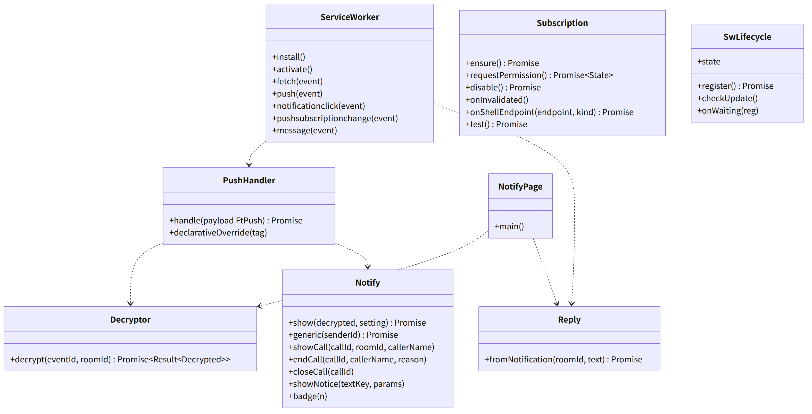
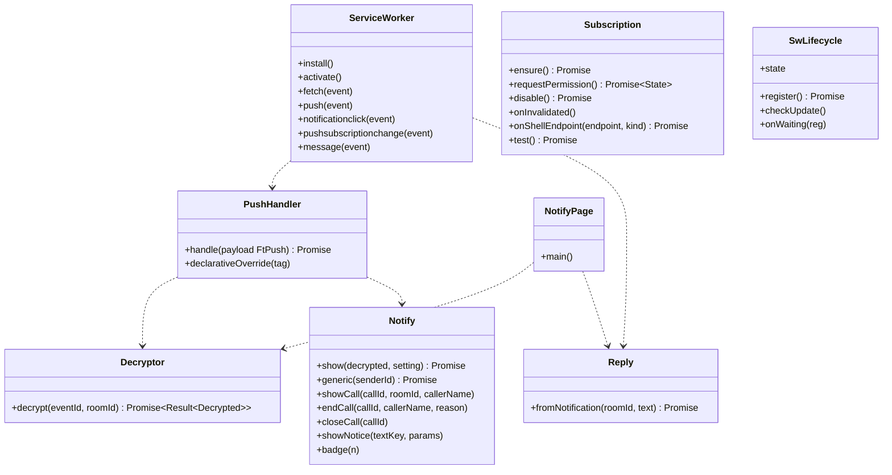

# web-push（ウェブ・業務。Service Worker、push の復号と表示、購読、`notify.html` の入口、SW の更新）

## 受ける節

- [第8章 3.2 Service Worker](../../../../docs/jp/design/08_基本設計書_iPhoneとPCのシェル.md#32-service-worker) の Service Worker の責務の表
  - プリキャッシュ、ナビゲーション、API、push
  - notificationclick、pushsubscriptionchange、更新、メッセージ
- [第8章 3.3 ホーム画面への追加（DD-8-2、DD-8-3）](../../../../docs/jp/design/08_基本設計書_iPhoneとPCのシェル.md#33-ホーム画面への追加dd-8-2dd-8-3) の standalone での通知の許可
- [第8章 5 更新とオフライン（DD-8-9）](../../../../docs/jp/design/08_基本設計書_iPhoneとPCのシェル.md#5-更新とオフラインdd-8-9)（更新の促し、オフライン）
- [第8章 8 失敗の扱い](../../../../docs/jp/design/08_基本設計書_iPhoneとPCのシェル.md#8-失敗の扱い)（SW の失敗）
- [第7章 4 購読](../../../../docs/jp/design/07_基本設計書_通知.md#4-購読)（購読の登録・確認・更新・失効・解除の端末の側）
- [第7章 5.1 表示の流れ](../../../../docs/jp/design/07_基本設計書_通知.md#51-表示の流れ)（表示の流れ：取得、復号、`showNotification`、バッジ、10 秒、宣言型の置き換え）
- [第7章 5.2 内容の表示（設定）](../../../../docs/jp/design/07_基本設計書_通知.md#52-内容の表示設定)（内容の表示の 3 択の文）
- [第7章 5.3 バッジ](../../../../docs/jp/design/07_基本設計書_通知.md#53-バッジ)（バッジの端末の側）
- [第7章 5.4 通知からの返信](../../../../docs/jp/design/07_基本設計書_通知.md#54-通知からの返信)（PC の返信のアクション）
- [第7章 7 着信の通知（DD-7-7）](../../../../docs/jp/design/07_基本設計書_通知.md#7-着信の通知dd-7-7) の端末の側（着信の通知の文と tag、`call_end` の置き換え）
- [第7章 8 届かない時（DD-7-8）](../../../../docs/jp/design/07_基本設計書_通知.md#8-届かない時dd-7-8)（届かない時：起動時の同期は web-sync）
- [第7章 10 初回の案内（DD-7-10）](../../../../docs/jp/design/07_基本設計書_通知.md#10-初回の案内dd-7-10)（初回の案内の順）
- [第7章 11 数値の一覧（config.yaml の「通知」）](../../../../docs/jp/design/07_基本設計書_通知.md#11-数値の一覧configyaml-の通知) の復号の待ち
- [第2章 7 通知の中身（第7章）](../../../../docs/jp/design/02_基本設計書_境界.md#7-通知の中身第7章)（通知の中身の形）
- [第12章 5.8 通知（DD-12-10。第7章・第9章と往復）](../../../../docs/jp/design/12_基本設計書_データと暗号化.md#58-通知dd-12-10第7章第9章と往復)（通知の復号の設計）
- [第9章 5 通知（DD-9-5）](../../../../docs/jp/design/09_基本設計書_Androidのシェル.md#5-通知dd-9-5) の `DecryptHost` が呼ぶ `/notify.html` の側（`push` と `reply` の受け口）
- 全体実装設計書 2.2（SW と `/notify.html`）、2.5（SW の錠と 10 秒）、3.2（購読、SW）

## 依存

- 下：
  - [web-core](web-core.md)（`Db`、`Locks`、`Channel`、`Api`、`Session`、`Text`、`Version`）
  - [web-crypto](web-crypto.md)（`Sender.decryptEvent`、`GroupStore`、`ToDevice`）
  - [web-sync](web-sync.md)：`Ingest.applyEvent`、`Users`（表示名）、`Rooms`（名前、未読）、`SendQueue.enqueue`（直接返信）
- 部品：手書きの SW（ビルドは Vite）、Push API、Notifications API、Badging API。
- 上：web-ui（通知の許可のボタン、設定、更新の促し）、web-shell（JS ブリッジの `push` イベントを `/notify.html` の入口に渡す）。

## クラス図

図の元の文（mermaid）

クラス図の注記（図の各メンバーの説明。仕様の節と番号を含む）

|クラス|メンバー|注記|
|---|---|---|
|ServiceWorker|`+install()`|プリキャッシュ（ビルド時の資産の一覧。版ごとのキャッシュ名）|
|ServiceWorker|`+activate()`|古い版のキャッシュを消す。clients.claim|
|ServiceWorker|`+fetch(event)`|/、`/r/*`、`/d/*`、`/i/*`、`/settings/*` は index を返す（ネットワークが無ければキャッシュ）。`/api/*` はネットワークのみ。添付・地図・manifest は触らない|
|ServiceWorker|`+push(event)`|`event.data` があれば `event.data.json()`、無ければ（宣言型。iOS 18.4 以上）`event.notification.data` を `ft.push/1` として読み、event.waitUntil(PushHandler.handle(data)) 10 秒|
|ServiceWorker|`+notificationclick(event)`|clients.matchAll で開いている画面を探し、focus して /r/&lt;room_id&gt;（data.kind が call なら /call/&lt;call_id&gt;。第6章 4.1）。無ければ openWindow。action=reply（PC）は Reply|
|ServiceWorker|`+pushsubscriptionchange(event)`|新しい購読を PUT /me/devices/{id}/push|
|ServiceWorker|`+message(event)`|画面との postMessage（skipWaiting の指示、復号の結果の共有）|
|PushHandler|`+handle(payload FtPush) Promise`|kind で分岐：message は Decryptor の後に Notify.show、call は `GET /calls/{call_id}` で `ringing` を確かめてから Notify.showCall（終わっていれば Notify.endCall(最後の状態)。第7章 7）、call_end は Notify.endCall(reason)、notice は `GET /me/notices/{event_id}` で中身を取って Notify.showNotice（第2章 7）。必ず 1 回 showNotification（iOS の規則）。10 秒の期限で汎用の本文（call_end の閉じる待ちだけは 30 秒まで。第7章 7）|
|PushHandler|`+declarativeOverride(tag)`|宣言型（`event.notification` あり）では、提案の通知を出させないために必ず同じ tag で showNotification を 1 回出す（時間内に出せば提案の通知は出ない。出せなければ OS が提案の通知を出す）|
|Decryptor|`+decrypt(eventId, roomId) Promise~Result~Decrypted~~`|GET /rooms/{id}/events/{eid}（401 なら汎用）の後に web-sync Ingest.applyEvent。epoch が端末より新しければ Commit を先に取り込み、web-crypto Sender.decryptEvent（Locks mls:&lt;room&gt;）で復号してコピーに取り込む。10 秒に収まらなければ汎用の本文|
|Notify|`+show(decrypted, setting) Promise`|第7章 5.2 の 3 択：title（送信者／トーク名／家族の名前）、body（冒頭 100 文字。種類の印 [写真] 等）、tag = room_id、icon、badge、data{room_id}。同じトークは「n 件の新着」に置き換え（PC は tag で置き換わる。iPhone は置き換わらないので、`getNotifications({tag})` で前の通知を閉じてから出す。表示から 30 秒の内の物は閉じられず並ぶ。第7章 5.2、H-7-8）。renotify は置かない（WebKit は実装しない）。PC は actions reply。出した通知の tag と時刻を IndexedDB `settings.push.shown` に書く|
|Notify|`+generic(senderId) Promise`|「{name}さんからメッセージ」（表示名は端末のコピー。無ければ家族の名前）|
|Notify|`+showNotice(textKey, params)`|title は家族の名前、body は第10章 9.4 の 1 文目（notices.json の `text_key`。params を埋める）。tag は `notice`。warning と error は画面でバナーにもなる（web-ui）|
|Notify|`+showCall(callId, roomId, callerName)`|「{name}さんから着信」「応答するには開いてください」。tag = call:&lt;call_id&gt;。3 回の push のたびに出す（iPhone 18.2 以降は別の通知として並び、毎回鳴る。第7章 DD-7-7）。出した時刻を `settings.push.shown` に書く|
|Notify|`+endCall(callId, callerName, reason)`|call_end：closeCall の後に、reason が missed なら「{name}さんからの着信」「不在着信」（音あり）、answered・declined・cancelled なら同じ title で「終わりました」（silent）。1 回は必ず showNotification（iOS の規則）|
|Notify|`+closeCall(callId)`|`getNotifications({tag: "call:" + callId})` の通知を閉じる。iPhone は表示から 30 秒は閉じられない（26.4 以降）ので、`settings.push.shown` の時刻から 30 秒に足りない分を待ってから閉じる（最長 20 秒。push の処理の 30 秒の内）。画面（web-ui）がアプリの起動と前面化で同じ処理を呼ぶ（Channel）。第7章 7、H-7-8|
|Notify|`+badge(n)`|navigator.setAppBadge（SW と画面）。app_badge の値と /rooms の合計|
|Subscription|`+ensure() Promise`|起動のたび：getSubscription で確かめ、無ければ `subscribe({userVisibleOnly, applicationServerKey})` して PUT /me/devices/{id}/push（`window.navigator.pushManager` があれば `declarative: true`）。endpoint の変化は PUT。VAPID の版が GET /me/push/vapid と違えば unsubscribe してから subscribe|
|Subscription|`+requestPermission() Promise~State~`|standalone で最初のトークのボタン（web-ui）|
|Subscription|`+disable() Promise`|DELETE|
|Subscription|`+onInvalidated()`|device.changed を受けたら次の起動で再登録|
|Subscription|`+onShellEndpoint(endpoint, kind) Promise`|シェルのイベント pushEndpoint（G-07。Platform.on）：PUT /me/devices/{id}/push（kind: unifiedpush）。endpoint が変わるたび|
|Subscription|`+test() Promise`|POST /me/devices/{id}/push/test|
|Reply|`+fromNotification(roomId, text) Promise`|PC の action=reply の文を web-sync SendQueue.enqueue に渡す（既読は付けない）|
|NotifyPage|`+main()`|/notify.html：web-core、web-crypto、web-sync の最小と本クラス。画面の部品を含まない。シェルからのイベント push{payload} を Decryptor で復号し、結果を命令 notifyResult{title, body, room_id, sender_id, kind, badge} で返す（G-06）。イベント reply{room_id, text} は Reply で送り、終わったら命令 replyDone{room_id, ok} を返す|
|SwLifecycle|`+register() Promise`|navigator.serviceWorker.register('/sw.js')。失敗は設定に表示して再試行|
|SwLifecycle|`+checkUpdate()`|起動のたび registration.update() と /version|
|SwLifecycle|`+onWaiting(reg)`|「新しい版があります。再読み込みしますか」（通話中・送信中は出さない）。応じたら skipWaiting して reload|
|SwLifecycle|`+state`|installing、waiting、active のいずれか|

## 公開操作（このブロックが所有する操作。番号は B-320〜）

|番号|操作（上の図）|使う側|由来|
|---|---|---|---|
|B-320|`ServiceWorker`（`sw.js` の全ハンドラ）|ブラウザ（登録は `SwLifecycle`）|[第8章 3.2 Service Worker](../../../../docs/jp/design/08_基本設計書_iPhoneとPCのシェル.md#32-service-worker)|
|B-321|`PushHandler`、`Decryptor`、`Notify`|本ブロック（SW と `NotifyPage`）、web-calls（前面なら呼び出し画面：`Notify.showCall` の前に `Channel` で画面に問う）|[第7章 5.1 表示の流れ](../../../../docs/jp/design/07_基本設計書_通知.md#51-表示の流れ)、[第7章 7 着信の通知（DD-7-7）](../../../../docs/jp/design/07_基本設計書_通知.md#7-着信の通知dd-7-7)、[第12章 5.8 通知（DD-12-10。第7章・第9章と往復）](../../../../docs/jp/design/12_基本設計書_データと暗号化.md#58-通知dd-12-10第7章第9章と往復)|
|B-322|`Subscription`（`ensure`、`requestPermission`、`disable`、`onShellEndpoint`、`test`）|web-ui（通知の許可のボタン、設定 > 通知）、web-shell（Android はシェルの `registerPush` の結果を `PUT` に渡す）|[第7章 4 購読](../../../../docs/jp/design/07_基本設計書_通知.md#4-購読)、[第7章 10 初回の案内（DD-7-10）](../../../../docs/jp/design/07_基本設計書_通知.md#10-初回の案内dd-7-10)|
|B-323|`Reply::fromNotification`|本ブロック（SW）、and-push 経由の `NotifyPage`|[第7章 5.4 通知からの返信](../../../../docs/jp/design/07_基本設計書_通知.md#54-通知からの返信)|
|B-324|`NotifyPage::main`（`/notify.html` の入口。JS ブリッジの `push`／`reply` を受け、`notifyResult`／`replyDone` を返す）|and-push `DecryptHost`（web-shell の JS ブリッジを通す）|[第9章 5 通知（DD-9-5）](../../../../docs/jp/design/09_基本設計書_Androidのシェル.md#5-通知dd-9-5)、全体実装設計書 2.2|
|B-325|`SwLifecycle`（`register`、`checkUpdate`、`onWaiting`、`state`）|web-ui（更新の促しのダイアログ）、web-shell|[第8章 5 更新とオフライン（DD-8-9）](../../../../docs/jp/design/08_基本設計書_iPhoneとPCのシェル.md#5-更新とオフラインdd-8-9)|

## アルゴリズム（差し替え点）

|事項|実装|切り替え|由来|
|---|---|---|---|
|復号の期限|10 秒（設定「復号の待ち」）。期限で汎用の本文|設定|[第7章 5.1 表示の流れ](../../../../docs/jp/design/07_基本設計書_通知.md#51-表示の流れ)、[第7章 11 数値の一覧（config.yaml の「通知」）](../../../../docs/jp/design/07_基本設計書_通知.md#11-数値の一覧configyaml-の通知)|
|宣言型|`window.navigator.pushManager` の有無で `declarative` を判定（iOS 18.4 以上）。SW が時間内に通知を出せば提案の通知は出ない|端末の能力で自動|[第7章 3 経路（DD-7-1、DD-7-2）](../../../../docs/jp/design/07_基本設計書_通知.md#3-経路dd-7-1dd-7-2)、[第2章 7 通知の中身（第7章）](../../../../docs/jp/design/02_基本設計書_境界.md#7-通知の中身第7章)|
|同じトークの置き換え|`tag = room_id`、本文「n 件の新着」|固定|[第7章 5.2 内容の表示（設定）](../../../../docs/jp/design/07_基本設計書_通知.md#52-内容の表示設定)|
|PC の返信のアクション|`Notification.maxActions > 0` のブラウザだけ|端末の能力で自動|[第7章 5.4 通知からの返信](../../../../docs/jp/design/07_基本設計書_通知.md#54-通知からの返信)|
|SW の更新|`skipWaiting` は画面の確認の後。通話中・送信中は出さない|固定|[第8章 3.2 Service Worker](../../../../docs/jp/design/08_基本設計書_iPhoneとPCのシェル.md#32-service-worker)、[第8章 5 更新とオフライン（DD-8-9）](../../../../docs/jp/design/08_基本設計書_iPhoneとPCのシェル.md#5-更新とオフラインdd-8-9)|

## データ設計（このブロックが形を持つ記録）

|記録|形|欄|由来|
|---|---|---|---|
|Cache Storage `ft-<版>`|キャッシュ|ビルド時の資産の一覧（JS、CSS、WASM、フォント、絵柄、音、index、notify.html）|[第8章 3.2 Service Worker](../../../../docs/jp/design/08_基本設計書_iPhoneとPCのシェル.md#32-service-worker)|
|IndexedDB `settings.push`|key-value|`subscription_endpoint`、`vapid_version`、`declarative bool`、`permission_asked_at`、`notify_content_mode`（名前と本文／名前のみ／なし）、`shown`（SW が出した通知の tag と時刻の表。閉じる時の 30 秒の判定。1 日で消す）|[第7章 4 購読](../../../../docs/jp/design/07_基本設計書_通知.md#4-購読)、[第7章 5.2 内容の表示（設定）](../../../../docs/jp/design/07_基本設計書_通知.md#52-内容の表示設定)|
|通知の `data`|JSON|`{room_id, event_id?, call_id?, kind}`|[第8章 3.2 Service Worker](../../../../docs/jp/design/08_基本設計書_iPhoneとPCのシェル.md#32-service-worker)|
|JS ブリッジの `push` の結果（`/notify.html` からシェルへ）|`ft.bridge/1` の `notifyResult`|`{title, body, room_id, sender_id, kind, badge}`|[第9章 5 通知（DD-9-5）](../../../../docs/jp/design/09_基本設計書_Androidのシェル.md#5-通知dd-9-5)|
