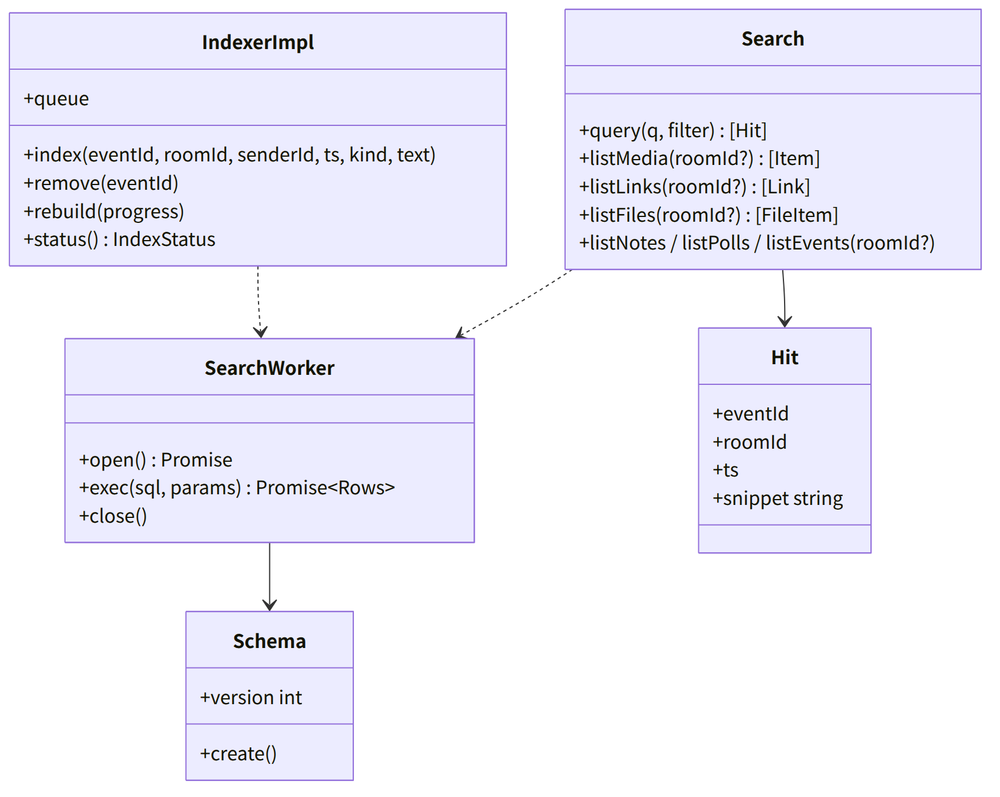
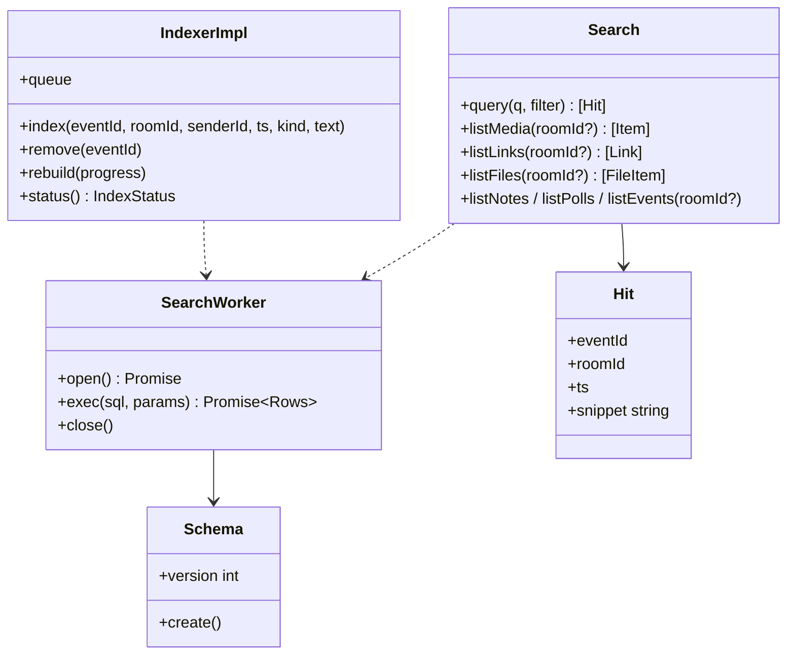

# web-search（ウェブ・業務。端末の検索の索引と一覧）

## 受ける節
- [第4章 5.7 検索と一覧（DD-4-8）](../../../../docs/jp/design/04_基本設計書_トークとメッセージ.md#57-検索と一覧dd-4-8)（端末の索引の形、検索の画面の条件、一覧、新しい端末の索引の作成）、[第4章 4.2 一覧（DD-4-13）](../../../../docs/jp/design/04_基本設計書_トークとメッセージ.md#42-一覧dd-4-13) の「端末から消す」の索引からの削除
- [第12章 5.9 検索（DD-12-8。第4章と往復）](../../../../docs/jp/design/12_基本設計書_データと暗号化.md#59-検索dd-12-8第4章と往復)（SQLite の WASM、FTS5 trigram、Intl.Segmenter、索引は暗号化しない、背景の作成、サーバーは検索の API を持たない）
- [第8章 3.4 保存（DD-8-4）](../../../../docs/jp/design/08_基本設計書_iPhoneとPCのシェル.md#34-保存dd-8-4)（OPFS `search.sqlite`。再作成可）
- 全体実装設計書 2.2（SearchWorker は Worker 必須）、2.3（索引は 1 本、遅延を許す）、3.2（索引の状態）

## 依存
- 下：[web-core](web-core.md)（`Db`、`Settings`）、[web-sync](web-sync.md)（`Indexer` の実装、`Events`／`Rooms`／`Users` のコピーの読み）。部品：@sqlite.org/sqlite-wasm（opfs-sahpool）。
- 依存の逆転：web-sync の `Indexer` を実装。
- 上：web-ui（検索と一覧の画面）。

## クラス図

図の元の文（mermaid）

クラス図の注記（図の各メンバーの説明。仕様の節と番号を含む）

|クラス|メンバー|注記|
|---|---|---|
|SearchWorker|`+open() Promise`|Worker の中で sqlite3 を opfs-sahpool で開く。失敗（OPFS 不可）は索引なし（検索は「この端末では使えません」）|
|Schema|`+create()`|messages(event_id PK, room_id, sender_id, ts, kind, text, text_seg); messages_fts (FTS5 trigram, content=messages); links(event_id, url, title); files(event_id, media_id, kind, name, size); meta(key, value)|
|IndexerImpl|`+index(eventId, roomId, senderId, ts, kind, text)`|web-sync Indexer。text_seg = Intl.Segmenter(ja, word) の語を空白区切り。リンクとファイルの表も|
|IndexerImpl|`+remove(eventId)`|削除済みの印、端末から消す|
|IndexerImpl|`+rebuild(progress)`|全イベントを復号済みの中身から（新しい端末、索引の壊れ）。背景。進み具合を表示|
|IndexerImpl|`+queue`|1 本。取り込みより遅れてよい|
|IndexerImpl|`+status() IndexStatus`|building \| ready \| rebuilding、indexed、total|
|Search|`+query(q, filter) [Hit]`|FTS5 trigram（3 文字以上）または text_seg の LIKE（2 文字以下）。期間、トーク、送信者。新しい順。該当の箇所の強調（snippet）|
|Search|`+listMedia(roomId?) [Item]`|写真・動画|
|Search|`+listNotes / listPolls / listEvents(roomId?)`|kind で|

## 公開操作（このブロックが所有する操作。番号は B-280〜）
|番号|操作（上の図）|使う側|由来|
|---|---|---|---|
|B-280|`IndexerImpl`（web-sync の `Indexer` の実装。`status`）|web-sync、web-ui（索引の進み）|[第4章 5.7 検索と一覧（DD-4-8）](../../../../docs/jp/design/04_基本設計書_トークとメッセージ.md#57-検索と一覧dd-4-8)、[第12章 5.9 検索（DD-12-8。第4章と往復）](../../../../docs/jp/design/12_基本設計書_データと暗号化.md#59-検索dd-12-8第4章と往復)|
|B-281|`Search`（`query`、`listMedia`、`listLinks`、`listFiles`、`listNotes`、`listPolls`、`listEvents`）|web-ui（検索の画面、一覧）|[第4章 5.7 検索と一覧（DD-4-8）](../../../../docs/jp/design/04_基本設計書_トークとメッセージ.md#57-検索と一覧dd-4-8)|

## アルゴリズム（差し替え点）
|事項|実装|切り替え|由来|
|---|---|---|---|
|全文検索|FTS5 trigram（3 文字以上）、2 文字以下は `text_seg` の語の一致|固定|[第12章 5.9 検索（DD-12-8。第4章と往復）](../../../../docs/jp/design/12_基本設計書_データと暗号化.md#59-検索dd-12-8第4章と往復)|
|分かち書き|`Intl.Segmenter("ja", {granularity: "word"})`。無いブラウザ（古い PC）は trigram だけ|端末の能力で自動|[第12章 5.9 検索（DD-12-8。第4章と往復）](../../../../docs/jp/design/12_基本設計書_データと暗号化.md#59-検索dd-12-8第4章と往復)|
|OPFS の経路|opfs-sahpool（Worker）。使えなければ索引なし|端末の能力で自動（T-M-01）|[第12章 5.9 検索（DD-12-8。第4章と往復）](../../../../docs/jp/design/12_基本設計書_データと暗号化.md#59-検索dd-12-8第4章と往復)|

## データ設計（このブロックが形を持つ記録）
|記録|形|欄|由来|
|---|---|---|---|
|OPFS `search.sqlite`|SQLite|`messages`、`messages_fts`（FTS5 trigram、`content=messages`）、`links`、`files`、`meta`（`schema_version`、`last_indexed_pos`）。暗号化しない（第12章 H-12-8）|[第4章 5.7 検索と一覧（DD-4-8）](../../../../docs/jp/design/04_基本設計書_トークとメッセージ.md#57-検索と一覧dd-4-8)、[第12章 5.9 検索（DD-12-8。第4章と往復）](../../../../docs/jp/design/12_基本設計書_データと暗号化.md#59-検索dd-12-8第4章と往復)|
