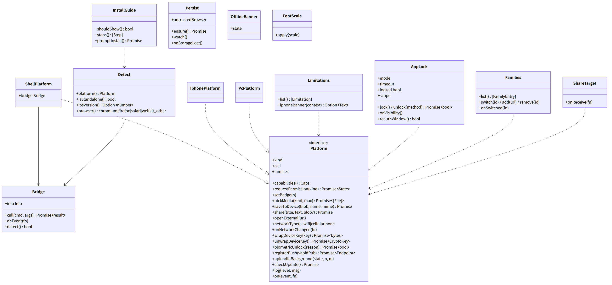
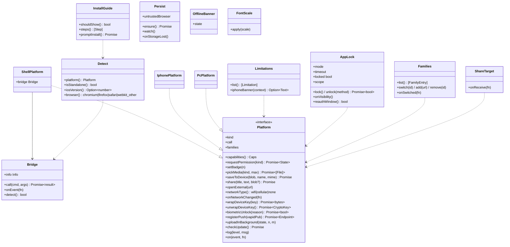

# web-shell（ウェブ・業務。端末の種類の判定、JS ブリッジのクライアント、iPhone と PC の案内、アプリのロック、persist、家族の切り替え）

## 受ける節
- [第8章 3.3 ホーム画面への追加（DD-8-2、DD-8-3）](../../../../docs/jp/design/08_基本設計書_iPhoneとPCのシェル.md#33-ホーム画面への追加dd-8-2dd-8-3)（ホーム画面への追加の検出と案内、Android のブラウザの案内、PC の `beforeinstallprompt`、WebKit 以外）、[第8章 3.4 保存（DD-8-4）](../../../../docs/jp/design/08_基本設計書_iPhoneとPCのシェル.md#34-保存dd-8-4) の `persist()` と容量の逼迫の判定、[第8章 3.5 権限（DD-8-5）](../../../../docs/jp/design/08_基本設計書_iPhoneとPCのシェル.md#35-権限dd-8-5)（権限を求める時：通知は web-push、カメラ・マイクは web-calls、位置は web-media。本ブロックは「求める時」の規則の判定）、[第8章 4 iPhone の制約の補い方（DD-8-6）](../../../../docs/jp/design/08_基本設計書_iPhoneとPCのシェル.md#4-iphone-の制約の補い方dd-8-6)（iPhone の制約の補い方の表の判定と案内の置き場）、[第8章 5 更新とオフライン（DD-8-9）](../../../../docs/jp/design/08_基本設計書_iPhoneとPCのシェル.md#5-更新とオフラインdd-8-9) のオフラインのバナー、[第8章 7 PC のブラウザ（DD-8-7）](../../../../docs/jp/design/08_基本設計書_iPhoneとPCのシェル.md#7-pc-のブラウザdd-8-7)（PC のブラウザの差の判定と「できないこと」の一覧）、[第8章 8 失敗の扱い](../../../../docs/jp/design/08_基本設計書_iPhoneとPCのシェル.md#8-失敗の扱い) の `persist()` の拒否と保存が消えた時
- [第9章 4.2 JS ブリッジの命令](../../../../docs/jp/design/09_基本設計書_Androidのシェル.md#42-js-ブリッジの命令)（JS ブリッジの命令とイベントのクライアントの側）、[第9章 4.1 設定](../../../../docs/jp/design/09_基本設計書_Androidのシェル.md#41-設定) のユーザーエージェント（`FamilyTalkShell/<版>` でシェルを検出）、[第9章 8 鍵保管庫と生体認証（DD-9-8）](../../../../docs/jp/design/09_基本設計書_Androidのシェル.md#8-鍵保管庫と生体認証dd-9-8) の端末鍵の包み（`wrapDeviceKey`／`unwrapDeviceKey`）と `biometricUnlock`、[第9章 11 複数の家族（DD-9-11）](../../../../docs/jp/design/09_基本設計書_Androidのシェル.md#11-複数の家族dd-9-11) の家族の切り替えの画面の側、[第9章 9 メディア（DD-9-9）](../../../../docs/jp/design/09_基本設計書_Androidのシェル.md#9-メディアdd-9-9) の共有の受け口と回線
- [第3章 4.7 アプリのロック（DD-3-8）](../../../../docs/jp/design/03_基本設計書_認証_構成員_端末.md#47-アプリのロックdd-3-8)（アプリのロック：方式、時間切れ、失敗の回数、かかる範囲）、[第3章 10 複数の家族（DD-3-16。O-04 の確認）](../../../../docs/jp/design/03_基本設計書_認証_構成員_端末.md#10-複数の家族dd-3-16o-04-の確認)（複数の家族：iPhone と PC は別のオリジン）
- [第10章 7 案内と明示の置き場（DD-10-7）](../../../../docs/jp/design/10_基本設計書_画面.md#7-案内と明示の置き場dd-10-7) の案内の置き場（ホーム画面の追加、Android の初回、できないこと、iPhone の制約）、[第10章 11 シェルの画面（DD-10-10）](../../../../docs/jp/design/10_基本設計書_画面.md#11-シェルの画面dd-10-10) のシェルの画面（WebView の側の文言）
- 全体実装設計書 2.8（`Platform`）、3.2（アプリのロック）、I-14、I-15

- [第14章 4 対応する OS とブラウザの最低要件](../../../../docs/jp/design/14_基本設計書_開発基盤.md#4-対応する-os-とブラウザの最低要件)（対応する OS とブラウザの最低要件の判定）、[第12章 6.4 端末の保存](../../../../docs/jp/design/12_基本設計書_データと暗号化.md#64-端末の保存) の PC の行（「このブラウザを信頼しない」の設定）
## 依存
- 下：[web-core](web-core.md)（`Settings`、`Db`、`Startup`、`Text`、`Channel`）、[web-crypto](web-crypto.md)（`AppLockHash`、`DeviceKeys`（端末鍵の包み）、`KeyBundle`）、[api](api.md)（`ft.bridge/1` の生成した型）。
- 依存の逆転：`Platform` を本ブロックが定義し、`ShellPlatform`（Android の JS ブリッジ）、`IphonePlatform`、`PcPlatform` が実装。
- 上：web-ui、web-media、web-calls、web-push、web-sync（回線の復帰）。

## クラス図

図の元の文（mermaid）

クラス図の注記（図の各メンバーの説明。仕様の節と番号を含む）

|クラス|メンバー|注記|
|---|---|---|
|Platform|`+kind`|iphone_standalone \| iphone_browser \| android_shell \| android_browser \| pc|
|Platform|`+capabilities() Caps`|第8章 4・7 の表の判定の結果：push、backgroundNotify、install、screenShare、blur、notifyActions、sinkId、badge、pip、wakeLock、heicDecode、shareTarget、opfsSync|
|Platform|`+wrapDeviceKey(key) Promise~bytes~`|シェルだけ。他は identity|
|Platform|`+biometricUnlock(reason) Promise~bool~`|シェル：BiometricPrompt。他：WebAuthn get()（web-ui が呼ぶ）|
|Platform|`+registerPush(vapidPub) Promise~Endpoint~`|シェルだけ|
|Platform|`+call`|callStarted/callEnded/callState/getAudioRoutes/setAudioRoute/enterPip/keepAwake（シェルだけ。他は no-op）|
|Platform|`+families`|list/switch/add/remove（シェルだけ）|
|Platform|`+on(event, fn)`|push、callAnswered、callDeclined、callEndedByOs、audioRouteChanged、pipChanged、networkChanged、fontScaleChanged、backPressed、familySwitched、sessionNeeded、updateAvailable|
|Bridge|`+call(cmd, args) Promise~result~`|{id, cmd, args} → WebMessageListener（シェル）→ {id, ok, result\|error}。未知の命令は SHELL-001。応答がなければ 10 秒で AppError|
|Bridge|`+onEvent(fn)`|{event, data}|
|Bridge|`+detect() bool`|window の listener の有無 + UA の FamilyTalkShell/<版>|
|Bridge|`+info Info`|getInfo：シェルの版、OS、WebView の版、fontScale、家族の識別子、配布元の種類|
|Detect|`+platform() Platform`|display-mode、UA、JS ブリッジの有無（第8章 3.3 の表）|
|Detect|`+iosVersion() Option~number~`|案内の図の 2 種（16〜17、18 以上）|
|InstallGuide|`+shouldShow() bool`|iphone_browser：参加の後と起動のたび。android_browser：APK の案内。pc：beforeinstallprompt があれば設定に「アプリとしてインストール」|
|InstallGuide|`+steps() [Step]`|図と文（OS の版ごと）|
|InstallGuide|`+promptInstall() Promise`|PC|
|Limitations|`+list() [Limitation]`|capabilities から「この端末・ブラウザでできないこと」（設定 > ヘルプ）|
|Limitations|`+iphoneBanner(context) Option~Text~`|通話の開始時のバナーなど|
|AppLock|`+mode`|none \| biometric \| pin|
|AppLock|`+timeout`|immediate \| 1m \| 5m \| 1h \| off|
|AppLock|`+lock() / unlock(method) Promise~bool~`|biometric：Platform.biometricUnlock または WebAuthn get()（web-ui）。pin：AppLockHash.verify。失敗 5 回で 1 分、以後倍、10 回で Db.wipe + ログアウト + 本人の他の端末に知らせ（device.changed は取り消しの経路：サーバーの /me/devices/{id} DELETE を自分で呼ぶ）|
|AppLock|`+onVisibility()`|背景から戻った時に timeout を判定|
|AppLock|`+reauthWindow() bool`|解除から 5 分以内（再認証の代わり。第3章 4.5）|
|AppLock|`+scope`|画面の表示の前。通知と着信の応答は外|
|Persist|`+ensure() Promise`|初回に navigator.storage.persist()。結果を settings。拒否は案内|
|Persist|`+watch()`|estimate() 90% → web-media Cache.evict|
|Persist|`+onStorageLost()`|sync.pos も keys も無い → 新しい端末として承認（web-ui）|
|Persist|`+untrustedBrowser`|設定「このブラウザを信頼しない」（PC。第12章 6.4、第3章 4.7）：セッションの終了（visibilitychange hidden + 一定時間、または明示のログアウト）で Db::wipe（鍵バンドルも）。次回は新しい端末|
|Families|`+list() [FamilyEntry]`|シェル：Platform.families.list。iPhone/PC：1 つ（別のオリジン）|
|ShareTarget|`+onReceive(fn)`|シェルの共有の受け口（画像、動画、テキスト、ファイル）→ web-ui の「送る」画面|
|OfflineBanner|`+state`|online \| offline \| server_unreachable \| readonly|
|FontScale|`+apply(scale)`|シェルの fontScale / iOS の -apple-system-body / PC の 4 段 → html の font-size|

## 公開操作（このブロックが所有する操作。番号は B-340〜）
|番号|操作（上の図）|使う側|由来|
|---|---|---|---|
|B-340|`Platform`（定義）と 3 つの実装、`Detect`|web-media（ピッカー、保存、共有、回線）、web-calls（通話の JS ブリッジ、PiP、Wake Lock、音声の経路）、web-push（`registerPush`、バッジ）、web-crypto（端末鍵の包み）、web-ui（案内の分岐）|[第9章 4.2 JS ブリッジの命令](../../../../docs/jp/design/09_基本設計書_Androidのシェル.md#42-js-ブリッジの命令)、[第8章 3.3 ホーム画面への追加（DD-8-2、DD-8-3）](../../../../docs/jp/design/08_基本設計書_iPhoneとPCのシェル.md#33-ホーム画面への追加dd-8-2dd-8-3)、全体実装設計書 2.8|
|B-341|`Bridge`（`call`、`onEvent`、`detect`、`info`）|本ブロック（`ShellPlatform`）、web-push `NotifyPage`（`push`／`reply` の受け口）|[第9章 4.2 JS ブリッジの命令](../../../../docs/jp/design/09_基本設計書_Androidのシェル.md#42-js-ブリッジの命令)、I-15|
|B-342|`InstallGuide`、`Limitations`|web-ui（案内の画面、設定 > ヘルプ、バナー）|[第8章 3.3 ホーム画面への追加（DD-8-2、DD-8-3）](../../../../docs/jp/design/08_基本設計書_iPhoneとPCのシェル.md#33-ホーム画面への追加dd-8-2dd-8-3)、[第8章 4 iPhone の制約の補い方（DD-8-6）](../../../../docs/jp/design/08_基本設計書_iPhoneとPCのシェル.md#4-iphone-の制約の補い方dd-8-6)、[第8章 7 PC のブラウザ（DD-8-7）](../../../../docs/jp/design/08_基本設計書_iPhoneとPCのシェル.md#7-pc-のブラウザdd-8-7)、[第10章 7 案内と明示の置き場（DD-10-7）](../../../../docs/jp/design/10_基本設計書_画面.md#7-案内と明示の置き場dd-10-7)|
|B-343|`AppLock`（`lock`、`unlock`、`mode`、`timeout`、`reauthWindow`、`scope`）|web-ui（ロックの画面、設定 > プライバシー、再認証の判定）|[第3章 4.7 アプリのロック（DD-3-8）](../../../../docs/jp/design/03_基本設計書_認証_構成員_端末.md#47-アプリのロックdd-3-8)、[第3章 4.5 再認証を要する操作](../../../../docs/jp/design/03_基本設計書_認証_構成員_端末.md#45-再認証を要する操作)|
|B-344|`Persist`（`ensure`、`watch`、`onStorageLost`）|web-ui（起動）、web-media（容量）|[第8章 3.4 保存（DD-8-4）](../../../../docs/jp/design/08_基本設計書_iPhoneとPCのシェル.md#34-保存dd-8-4)、[第8章 8 失敗の扱い](../../../../docs/jp/design/08_基本設計書_iPhoneとPCのシェル.md#8-失敗の扱い)|
|B-345|`Families`、`ShareTarget`、`OfflineBanner`、`FontScale`|web-ui|[第9章 11 複数の家族（DD-9-11）](../../../../docs/jp/design/09_基本設計書_Androidのシェル.md#11-複数の家族dd-9-11)、[第9章 9 メディア（DD-9-9）](../../../../docs/jp/design/09_基本設計書_Androidのシェル.md#9-メディアdd-9-9)、[第8章 5 更新とオフライン（DD-8-9）](../../../../docs/jp/design/08_基本設計書_iPhoneとPCのシェル.md#5-更新とオフラインdd-8-9)、[第10章 3.2 字と形](../../../../docs/jp/design/10_基本設計書_画面.md#32-字と形)|

## アルゴリズム（差し替え点）
|事項|実装|切り替え|由来|
|---|---|---|---|
|端末の種類|`display-mode` のメディアクエリ + UA + JS ブリッジの有無|固定|[第8章 3.3 ホーム画面への追加（DD-8-2、DD-8-3）](../../../../docs/jp/design/08_基本設計書_iPhoneとPCのシェル.md#33-ホーム画面への追加dd-8-2dd-8-3)|
|ロックの失敗|5 回で 1 分、以後倍、10 回で消去|固定|[第3章 4.7 アプリのロック（DD-3-8）](../../../../docs/jp/design/03_基本設計書_認証_構成員_端末.md#47-アプリのロックdd-3-8)|
|文字の大きさ|シェル：`fontScale`。iOS：`-apple-system-body`（効かなければ 4 段）。PC：4 段|実測で切り替え（T-M-02）|[第10章 3.2 字と形](../../../../docs/jp/design/10_基本設計書_画面.md#32-字と形)|
|JS ブリッジの応答の期限|10 秒|固定|[第9章 4.2 JS ブリッジの命令](../../../../docs/jp/design/09_基本設計書_Androidのシェル.md#42-js-ブリッジの命令)|

## データ設計（このブロックが形を持つ記録）
|記録|形|欄|由来|
|---|---|---|---|
|IndexedDB `settings.app_lock`|JSON|`{mode, timeout, pin_hash?, failures, locked_until?, last_unlock_at}`（端末ごと。サーバーに同期しない）|[第3章 4.7 アプリのロック（DD-3-8）](../../../../docs/jp/design/03_基本設計書_認証_構成員_端末.md#47-アプリのロックdd-3-8)|
|IndexedDB `settings.platform`|JSON|`{kind, capabilities, install_guide_shown_at, limitations_ack}`|[第8章 3.3 ホーム画面への追加（DD-8-2、DD-8-3）](../../../../docs/jp/design/08_基本設計書_iPhoneとPCのシェル.md#33-ホーム画面への追加dd-8-2dd-8-3)|
|JS ブリッジの命令・イベント|`ft.bridge/1`|第9章 4.2 の表（api/schemas から生成）|[第9章 4.2 JS ブリッジの命令](../../../../docs/jp/design/09_基本設計書_Androidのシェル.md#42-js-ブリッジの命令)|
