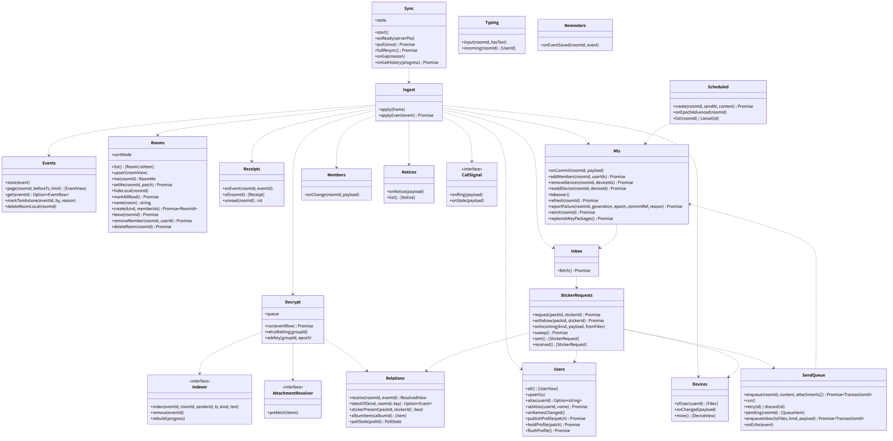
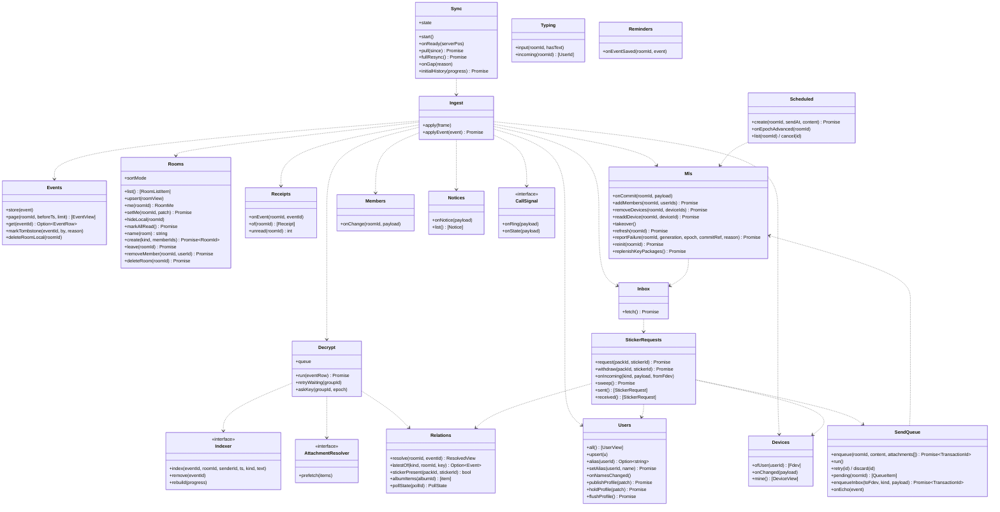

# web-sync（ウェブ・業務。イベントの取り込み、関係の解決、トークの一覧、送信のキュー、既読、構成員の変化、履歴の同期）

## 受ける節

- [第4章 3.1 種類](../../../../docs/jp/design/04_基本設計書_トークとメッセージ.md#31-種類)（中身の種類。復号後の形の扱い）
- [第4章 3.2 関係の規則](../../../../docs/jp/design/04_基本設計書_トークとメッセージ.md#32-関係の規則)（関係の適用：返信、編集、リアクション、投票、出欠、取消、転送）
- [第4章 4.1 種類と状態](../../../../docs/jp/design/04_基本設計書_トークとメッセージ.md#41-種類と状態) の端末の側（追加待ちの引き継ぎ、Commit を行う端末）
- [第4章 4.2 一覧（DD-4-13）](../../../../docs/jp/design/04_基本設計書_トークとメッセージ.md#42-一覧dd-4-13)（一覧：並び、未読、端末から消す、すべて既読、並べ替え）
- [第4章 5.1 送信（DD-4-14）](../../../../docs/jp/design/04_基本設計書_トークとメッセージ.md#51-送信dd-4-14)（送信のキュー）
- [第4章 5.2 受信と表示](../../../../docs/jp/design/04_基本設計書_トークとメッセージ.md#52-受信と表示)（受信と表示の順、鍵を待つ、関係の適用、10 件の束）
- [第4章 5.4 既読と入力中（DD-4-4、DD-4-5）](../../../../docs/jp/design/04_基本設計書_トークとメッセージ.md#54-既読と入力中dd-4-4dd-4-5)（既読の送り方、入力中の送り方）
- [第4章 5.5 メンションと通知なし送信（DD-4-6）](../../../../docs/jp/design/04_基本設計書_トークとメッセージ.md#55-メンションと通知なし送信dd-4-6)（メンションの欄と通知なし）
- [第4章 5.8 投票、ノート、予定、予約送信（DD-4-9）](../../../../docs/jp/design/04_基本設計書_トークとメッセージ.md#58-投票ノート予定予約送信dd-4-9) の端末の側（投票の締切の判定、出欠、予定のリマインドの端末の予約、予約送信の作り直し）
- [第4章 5.9 スタンプ（DD-4-10、DD-4-11）](../../../../docs/jp/design/04_基本設計書_トークとメッセージ.md#59-スタンプdd-4-10dd-4-11) のパックのイベントと、削除の求め（送り方と送り直し、応じられたことの判定と取り下げ、受けた求め）
- [第4章 5.10 ミュートと管理者の対処（DD-4-12）](../../../../docs/jp/design/04_基本設計書_トークとメッセージ.md#510-ミュートと管理者の対処dd-4-12)（ミュートの設定のコピー）
- [第4章 6 家族全員のトーク（DD-4-16）](../../../../docs/jp/design/04_基本設計書_トークとメッセージ.md#6-家族全員のトークdd-4-16)（家族全員のトークのイベントの扱い）
- [第4章 8 失敗の扱い](../../../../docs/jp/design/04_基本設計書_トークとメッセージ.md#8-失敗の扱い)（失敗）
- [第2章 6 イベント（WebSocket と同期）](../../../../docs/jp/design/02_基本設計書_境界.md#6-イベントwebsocket-と同期)（イベントの種類ごとの処理）
- [第2章 5.9 同期（第4章、第7章）](../../../../docs/jp/design/02_基本設計書_境界.md#59-同期第4章第7章)（`/sync` の初回と差分）
- [第2章 11 競合の規則（R-2-2-5）](../../../../docs/jp/design/02_基本設計書_境界.md#11-競合の規則r-2-2-5)（競合の端末の側）
- [第2章 13 失敗の扱い](../../../../docs/jp/design/02_基本設計書_境界.md#13-失敗の扱い)（410 の全差分）
- [第1章 7.3 構成員の参加](../../../../docs/jp/design/01_基本設計書_全体構成.md#73-構成員の参加) の 7
- [第1章 7.4 メッセージの送信と配信](../../../../docs/jp/design/01_基本設計書_全体構成.md#74-メッセージの送信と配信)
- [第1章 7.7 新しい端末の追加と紛失](../../../../docs/jp/design/01_基本設計書_全体構成.md#77-新しい端末の追加と紛失) の 3〜4
- [第1章 7.11 回線の切断と再接続（端末）](../../../../docs/jp/design/01_基本設計書_全体構成.md#711-回線の切断と再接続端末)
- [第12章 5.5 新しい端末の参加（第3章と往復）](../../../../docs/jp/design/12_基本設計書_データと暗号化.md#55-新しい端末の参加第3章と往復)（新しい端末の参加 1〜5 の端末の側）
- [第12章 5.2 群の暗号（MLS）](../../../../docs/jp/design/12_基本設計書_データと暗号化.md#52-群の暗号mls) の追加と退出・休眠（Remove を行う端末）
- [第12章 5.6 鍵のバックアップ（履歴）（DD-12-6）](../../../../docs/jp/design/12_基本設計書_データと暗号化.md#56-鍵のバックアップ履歴dd-12-6) の履歴の復号
- [第12章 5.7 メッセージと添付（第4章・第5章と往復）](../../../../docs/jp/design/12_基本設計書_データと暗号化.md#57-メッセージと添付第4章第5章と往復) の編集・予約送信
- [第12章 13 失敗の扱い](../../../../docs/jp/design/12_基本設計書_データと暗号化.md#13-失敗の扱い) の「鍵のバックアップに無い」の求め
- [第3章 5.1 端末の状態](../../../../docs/jp/design/03_基本設計書_認証_構成員_端末.md#51-端末の状態)（取り消された端末の保存の消去）
- [第3章 8 構成の変化（DD-3-11、DD-3-12）](../../../../docs/jp/design/03_基本設計書_認証_構成員_端末.md#8-構成の変化dd-3-11dd-3-12) の端末の側（停止の画面、再開）
- [第3章 6 アカウントとプロフィール（DD-3-14）](../../../../docs/jp/design/03_基本設計書_認証_構成員_端末.md#6-アカウントとプロフィールdd-3-14)（プロフィールのイベントと `user.changed`）
- [第8章 3.4 保存（DD-8-4）](../../../../docs/jp/design/08_基本設計書_iPhoneとPCのシェル.md#34-保存dd-8-4)（`events`、`rooms`、`users`、`devices`、`receipts`、`queue` の表）
- [第8章 5 更新とオフライン（DD-8-9）](../../../../docs/jp/design/08_基本設計書_iPhoneとPCのシェル.md#5-更新とオフラインdd-8-9) のオフライン
- 全体実装設計書 2.3（キュー、復号、索引の順）、3.2（キューの項目、イベントのコピー、同期）、4.2、I-13

## 依存

- 下：
  - [web-core](web-core.md)（`Api`、`WsClient`、`Db`、`Locks`、`Session`、`Clock`）
  - [web-crypto](web-crypto.md)
    - `Sender`、`GroupStore`、`KeyBackup`、`ToDevice`、`DeviceKeys`
    - `Recovery.approveDevice`、`MlsEngine` 経由の Add/Remove
  - [web-shell](web-shell.md)（`Platform.updateNameCache`）
- 依存の逆転：`Indexer`（復号済みの本文を索引へ）を本ブロックが定義し、web-search が実装する。`AttachmentResolver`（添付の記述から表示用の取得）は web-media が実装。`CallSignal`（`call.ring`、`call.state` の通知先）は web-calls が実装。
- 上：web-ui、web-push（SW は `Ingest.applyEvent` の最小を使う）、web-media、web-calls、web-search。

## クラス図

図の元の文（mermaid）

クラス図の注記（図の各メンバーの説明。仕様の節と番号を含む）

|クラス|メンバー|注記|
|---|---|---|
|Sync|`+start()`|Startup の後：Db の sync.pos を読み、WsClient.connect で受けた ready{pos} と比べる。ready の方が大きければ `/sync?since` で取り、queue を再送する。ready の方が小さければ fullResync（サーバーが復元で戻った。第2章 6.3）。`/sync` の応答の pos（続きが無ければ利用者の最新。他の端末宛ての行を含む）を sync.pos に保存する|
|Sync|`+pull(since) Promise`|`GET /sync?since=&limit=`。NET-005（410）なら fullResync|
|Sync|`+fullResync() Promise`|/sync（since なし）、rooms、各 room の events（before/after）と receipts（GET）、/me/notices、/me/inbox、/me/keybackup の順に取る。コピーは保持し event_id で重複を除く|
|Sync|`+onGap(reason)`|sync.gap{restore}（サーバーの復元。本人の全端末に届く）で fullResync。queue の未送信は再送（Idempotency-Key で二重にならない）。保持の外はイベントではなく pull の 410|
|Sync|`+state`|connected、longpoll、offline、resyncing のいずれか|
|Sync|`+initialHistory(progress) Promise`|新しい端末：全トークの履歴の取得、復号（KeyBackup）、索引の順。最新から画面に要る範囲を先に（7 日以上の不在）|
|Ingest|`+apply(frame)`|pos の順。pos の飛びは他の端末宛ての行の分で欠けではないので、飛びで pull しない（取りこぼしは再接続の時に Sync.start が `/sync?since=` で埋める。第2章 6.1）。種類ごとの渡し先：room.event は Events.store の後に Decrypt。room.receipt は Receipts。room.member は Members。room.settings と room.me は Rooms。room.mls は Mls.onCommit。room.scheduled。device.inbox は Inbox.fetch。device.changed は Devices（公開鍵の更新、自分の端末の承認・取り消し、保護者の承認、片のコピーの追加）。user.changed は Users（fields に signing_key があれば web-crypto Sender の TOFU の警告と known_user_sig_pubs の更新）。keybundle.changed は web-crypto Copies.rebuildAll（kinds に family）か Recovery（自分の端末の分の取り直し）。recovery.request と recovery.used は web-ui の求めの画面。call.ring と call.state は CallSignal。session.revoked は Session.onRevoked。notice は Notices。sync.gap は Sync.onGap|
|Ingest|`+applyEvent(event) Promise`|SW も使う最小（Events.store、Decrypt、Relations）。イベントの epoch が端末の mls_state より新しければ、先に `GET /rooms/{id}/mls/commits`（since_epoch）を取り Mls.onCommit で取り込む（SW でも同じ。第7章 5.1）|
|Events|`+store(event)`|IndexedDB events（暗号文のまま + 平文の欄）。重複は event_id|
|Events|`+markTombstone(eventId, by, reason)`|本文とコピーを消し「取り消しました」|
|Events|`+deleteRoomLocal(roomId)`|端末から消す（hidden_before_pos）|
|Decrypt|`+run(eventRow) Promise`|web-crypto Sender.decryptEvent で復号し、中身を端末の保存の鍵で暗号化して events.content に置く。失敗は state = waiting_key。Indexer.index。AttachmentResolver.prefetch（サムネイル）|
|Decrypt|`+retryWaiting(groupId)`|room.mls、鍵のバックアップの到着、historic の追加で再試行|
|Decrypt|`+askKey(groupId, epoch)`|鍵のバックアップに無ければ、本人の他の端末と家族の端末に転送を頼む（ToDevice kind=key_request。応答は key_backup。第12章 5.2 の表）|
|Decrypt|`+queue`|トークごとに直列、トーク間は 4 並列|
|Relations|`+resolve(roomId, eventId) ResolvedView`|replace（最新）、annotation（リアクションの集計、投票・出欠の本人の最新）、reply（元の冒頭。元が削除済みの印なら「取り消されたメッセージ」）、forward の印、redaction（削除済みの印）|
|Relations|`+latestOf(kind, roomId, key) Option~Event~`|room_settings（key 無し）、profile（key は user_id）、sticker_pack（key は pack_id）の「取り消されていない最新が有効」（第4章 3.1。関係 replace ではなく、同じ key の新しいイベント）。album は albumItems（和集合）|
|Relations|`+stickerPresent(packId, stickerId) bool`|端末のコピーの中で、取り消されていない `sticker_pack` のイベント（同じ pack_id の全部の版）に sticker_id が 1 つでも残っているか。第4章 5.9 の応じられたことの判定（求めた端末と受けた端末が同じ規則）|
|Relations|`+albumItems(albumId) [item]`|id の和集合、removed_ids|
|Relations|`+pollState(pollId) PollState`|締切は端末が判定。遅れて届いた票（締切前の ts）は有効|
|Rooms|`+list() [RoomListItem]`|並び：ピン留め、お気に入り、最新の順。未読の数。最後の本文の冒頭（種類は「[写真]」等）。入力中|
|Rooms|`+setMe(roomId, patch) Promise`|PUT /rooms/{id}/me|
|Rooms|`+sortMode`|recent、unread、favorite のいずれか|
|Rooms|`+name(room) string`|dm は相手の表示名（別名を優先）、group は room_settings の最新、self は「自分用メモ」、family は家族の名前|
|Rooms|`+create(kind, memberIds) Promise~RoomId~`|POST /rooms の後、作成者の端末が Mls.addMembers|
|Rooms|`+leave(roomId) Promise`|退出（第10章 12 の取り返しがつく確認ダイアログの後）。DELETE /rooms/{id}/members/{自分}。自分の leaf の Remove は他の構成員の端末が行う（RFC 9420 12.4。自分では作れない）ので、応答の後は room.member の left（または removed）を待たずに、そのトークを一覧から外し Events.deleteRoomLocal と web-crypto GroupStore の破棄を行う（第12章 9。再追加されれば鍵のバックアップと同期で戻る。第4章 8）|
|Rooms|`+removeMember(roomId, userId) Promise`|作成者・管理者が構成員を外す。DELETE /rooms/{id}/members/{uid}。応答の後、サーバーが流す room.member{device_id, pending_remove}（その人の端末ごと）を Members.onChange が受け、Mls.takeover が自分の端末で Remove の Commit を作る（最初に処理した端末。切れていれば他の構成員の端末が引き継ぐ。第4章 4.1）。pending_remove の人は一覧に「外す処理中」として残り、removed で消える|
|Rooms|`+deleteRoom(roomId) Promise`|グループの削除（作成者・管理者。第10章 12 の取り返しがつかない確認ダイアログの後）。DELETE /rooms/{id}。全構成員に room.member{removed} が届き、各端末は Members.onChange でそのトークを捨てる（下）。自分の端末も同じ経路で捨てる（応答で先に捨てない：他の端末と同じ 1 つの経路）|
|Users|`+all() [UserView]`|表示名、別名、アイコン（profile の最新）、役割、状態、子ども|
|Users|`+setAlias(userId, name) Promise`|PUT /me/aliases/{id}|
|Users|`+publishProfile(patch) Promise`|写真、背景、ひとことを家族全員のトークへ `ft.content.profile/1` で送る（第3章 6、DD-3-14）。添付は web-media が上げた後の attachment_item。SendQueue.enqueue|
|Users|`+holdProfile(patch) Promise`|参加と設置の時の写真（第3章 3.1 の 3、3.3 の 2）。家族全員のトークに入る前は送れないので、端末の保存（IndexedDB `pending_profile`。端末の保存の鍵で暗号化）に置く|
|Users|`+flushProfile() Promise`|家族全員のトークの welcome を取り込んだ後（Ingest）と起動の時に呼ぶ。pending_profile があれば web-media で上げて publishProfile し、消す|
|Users|`+onNamesChanged()`|表示名か別名が変わった時：Platform.updateNameCache({user_id: 表示名}) をシェルに渡す（G-03。シェルでなければ何もしない）|
|Devices|`+ofUser(userId) [Fdev]`|E2EE の送信先|
|Devices|`+onChanged(payload)`|added/approved/guardian_approved/revoked/renamed。自分の端末の revoked なら Session.onRevoked と Db.wipe。自分の端末の guardian_approved なら web-crypto Recovery.approveDevice（自己承認）をやり直す（第3章 4.4）。他の構成員の approved なら、その構成員が自分の片を持つ人（自分のコピー (c) の対象）であれば web-crypto Copies.addShareFor（新しい端末へ片を足す。第12章 5.4 (c)）|
|Receipts|`+onEvent(roomId, eventId)`|画面に出した時 read（公開）。位置の同期で read_private と fully_read。まとめて POST /rooms/{id}/receipts（1 秒に 1 回）|
|Receipts|`+of(roomId) [Receipt]`|既読の名前と時刻|
|Typing|`+input(roomId, hasText)`|5 秒ごとに typing: true、空で false（設定で自分の送信を止める）|
|Typing|`+incoming(roomId) [UserId]`|10 秒で消す|
|SendQueue|`+enqueue(roomId, content, attachments[]) Promise~TransactionId~`|家族ごとに 1 本（Locks "queue:&lt;family&gt;"）。暗号化（Sender.encryptContent）は送る直前（epoch の変化に追従）。画面に「送信中」|
|SendQueue|`+run()`|1 件ずつ POST /rooms/{id}/events（Idempotency-Key = transaction_id）。1,2,4,…,60 秒。ROOM-006 なら Mls.refresh で取り込み、作り直して再送。7 日で expired（「送れませんでした」：再送か破棄）|
|SendQueue|`+enqueueInbox(toFdev, kind, payload) Promise~TransactionId~`|queue の kind inbox（inbox_to に相手の端末と種類）。送る直前に web-crypto ToDevice.seal で包み `POST /devices/{did}/inbox`。再試行と 7 日の期限は event と同じ。KEY-001（宛先の端末の鍵が無い・取り消し済み）は失敗にせず捨てる（宛先が無くなった）。使うのは StickerRequests と、承認の時の転送の未送信（S-04 の G-14）|
|SendQueue|`+onEcho(event)`|自分の送信のエコーを受けたら sent（pos）|
|Mls|`+onCommit(roomId, payload)`|payload の `generation` が自分の世代より新しければ再初期化（第12章 5.2 の復旧の 2）：そのグループの現在の状態を捨て（過去の epoch の受信専用の状態は残す）、Welcome を待つ（inbox）。同じ世代なら `GET /rooms/{id}/mls/commits?since_epoch=`（自分の epoch）で取り、各項目の `commit_ref` が `room.mls` の値と合うことを確かめ、GroupStore.withGroup(processCommit) で順に取り込む（Commit は PublicMessage。第12章 5.2）。Welcome は inbox から。epoch が進んだら KeyBackup.onEpochAdvanced。Decrypt.retryWaiting。自分の leaf が Remove されていれば（processCommit の結果）そのグループの状態を捨てる。processCommit が失敗したら reportFailure（下）|
|Mls|`+addMembers(roomId, userIds) Promise`|各端末の KeyPackage を取り（KEY-006 は補充の警告。有効期間が今の時刻を外れていれば捨てて取り直す。第12章 5.2）、MlsEngine.commit（Add。Commit は PublicMessage、Welcome は ratchet_tree 付き）の後に POST /rooms/{id}/mls/commit {epoch, commit, welcome}（KEY-007 なら最新（世代と epoch）を取り込んで作り直し。KEY-009 なら `/mls/epoch` を取り直して作り直し、記録する）。Welcome はサーバーがメールボックスへ置く。Add と Remove の申告は無い（サーバーが Commit を読む）|
|Mls|`+readdDevice(roomId, deviceId) Promise`|再参加待ちの端末（room.member の pending_readd、`/mls/epoch` の pending_readd）を引き継いだ時：その端末の leaf の番号（MlsEngine.members）と新しい KeyPackage（`POST /users/{uid}/devices/{did}/keypackage`）で、Remove と Add を 1 つの Commit にする（MlsEngine.commit。第12章 5.2 の復旧の 1）。送り方は addMembers と同じ。KeyPackage が取れなければ（KEY-001。使い切りも最後の手段も無い）Remove だけの Commit を送る。サーバーがその端末を追加待ちに替え、端末が KeyPackage を置いた後に takeover の端末の追加待ちの経路で Add する|
|Mls|`+takeover()`|起動時と room.member(pending_*) の時：追加待ち・削除待ち・再参加待ちを自分が引き継ぐか（第4章 4.1 の引き継ぎの規則：最初に処理した端末。サーバーは判定せず `/mls/epoch` と room.member で待ちを示すだけ）。削除待ちのうち自分の端末の分は作れない（自分の leaf の Remove を含む Commit は不正。RFC 9420 12.4）。`/mls/epoch` の `commit_possible` が偽（leaf を持ち削除待ちでも再参加待ちでもない承認済みの端末が無い。停止中の人の端末の leaf は数えない。自分も leaf を持たない）なら、待ちを引き継ぐ代わりに reinit（第12章 5.2 の (d)。再参加待ちでなくてよい）。端末の追加待ち（`/mls/epoch` の pending_add_devices、room.member の device_id 付き pending_add）も同じ規則で、その端末の KeyPackage を取って Add（自分の端末の待ちは自分では解けない）。再参加待ちは readdDevice。引き継げるのはサーバーの世代と epoch にある端末だけ（自分が再参加待ちか世代が古ければ引き継がない）。起動時に、自分が構成員で leaf の無いグループがあれば `POST /me/mls/rejoin`（第12章 5.5）。起動時に自分が再参加待ちのグループ（`/mls/epoch` の pending_readd に自分）があれば、保存した `reinit_allowed_at` を過ぎていれば reinit|
|Mls|`+refresh(roomId) Promise`|/mls/epoch と commit の差分を取り込む。世代が自分より新しければ onCommit と同じ（状態を捨てて Welcome を待つ）|
|Mls|`+reportFailure(roomId, generation, epoch, commitRef, reason) Promise`|Commit か Welcome を処理できなかった時（第12章 5.2 の復旧の 1）。1. refresh で取りこぼしを全部取り込み直し、それで通れば終わり。2. 通らなければ `POST /rooms/{id}/mls/reject {generation, epoch, commit_ref, reason}`（reason は MlsEngine の失敗の種類：signature、membership_tag、confirmation_tag、proposals、path、tree、welcome、lifetime、other）。KEY-007 なら世代が変わっているので refresh。3. そのグループの現在の状態を捨て（GroupStore。受信専用の過去の状態は残す）、応答の `reinit_allowed_at` を IndexedDB の `mls_readd` に置き、その時刻の timer を組む（SW にはこの処理を置かない。画面の側だけ）。4. Welcome が届けば joinFromWelcome で戻り、`mls_readd` を消す。取りこぼした epoch の本文は Decrypt が鍵のバックアップと key_request で読む（第12章 13）。Welcome の処理に失敗した時も同じ（reason welcome）|
|Mls|`+reinit(roomId) Promise`|`reinit_allowed_at` を過ぎてまだ再参加待ちなら、または `/mls/epoch` の `commit_possible` が偽なら、`POST /rooms/{id}/mls/reinit`（第12章 5.2 の復旧の 2。後者は (d) で直ちに許される）。応答の group_id で MlsEngine.createGroup（自分が leaf 0）し、takeover で入るべき端末を Add する（サーバーが全端末を追加待ちにしている）。KEY-013 の too_early なら allowed_at で組み直す。not_pending なら `/mls/epoch` を取り直す（判定と端末の状態の変化（停止、承認）が前後し得る。第12章 5.2 の (d)）：`commit_possible` が偽ならもう一度 reinit、真なら他の端末の Commit を待つ（takeover の規則）。自分が再参加待ちで Welcome が来ていれば（inbox）joinFromWelcome。limit ならそのグループを「この端末では読めない」（web-ui。KEY-013 の文言）にして止め、アプリの更新（web-shell）を待つ。更新の後に再開する|
|Mls|`+replenishKeyPackages() Promise`|残数 < 10 で補充（20 + 最後の手段）。KeyPackage は MLSMessage の base64url|
|Inbox|`+fetch() Promise`|`GET /me/inbox?since` で取り、ToDevice.open で開いて種類で渡し、最後に DELETE。渡し先（第12章 5.2 の表）：welcome は Mls（包まれていないので open を通さず、Welcome の MLSMessage をそのまま joinFromWelcome へ。失敗すれば Mls.reportFailure(reason welcome)）。keybundle、key_backup、share は web-crypto Recovery。key_request は web-crypto KeyBackup.answerRequest。call_key_request と call_key は web-calls Keys。sticker_remove_request と sticker_remove_withdrawal は StickerRequests.onIncoming（開いた中身と送り手の fdev を渡す）|
|StickerRequests|`+request(packId, stickerId) Promise`|「削除を求める」（第4章 5.9）。自分が作成者のパックは呼ばない（web-ui がその場で消す）。sticker_requests に direction sent の行（requester_id は自分、requested_at は今、last_sent_at は今）を置き、その時点の作成者（パックの最新の版の creator）と管理者（Users.all の役割。停止中は除く）の承認済みと休眠の端末（Devices.ofUser）ごとに SendQueue.enqueueInbox（kind sticker_remove_request、`ft.content.sticker_remove_request/1`）。同じ（pack_id、sticker_id）の行が既にあれば何もしない|
|StickerRequests|`+withdraw(packId, stickerId) Promise`|取り下げ：direction sent の行を消し、同じ宛先の決め方で kind sticker_remove_withdrawal を enqueueInbox。知らせは出ない（第12章 5.2）|
|StickerRequests|`+onIncoming(kind, payload, fromFdev)`|受けた求め。payload.requester_id が fromFdev.user_id と違えば捨てる（記録する）。sticker_remove_request は direction received の行を（requester_id、pack_id、sticker_id）で 1 件にまとめて置く（requested_at は payload の値、last_received_at は今）。sticker_remove_withdrawal は同じ鍵の行を消す。求めた人がタグされているかは確かめない。置いた後に sweep|
|StickerRequests|`+sweep() Promise`|起動、前面化（web-shell Platform の前面化の合図）、`sticker_pack` と `ft.event.redaction/1` の取り込み（Decrypt、Events.markTombstone）の後に呼ぶ。全行について Relations.stickerPresent が偽なら消す（応じられた。第4章 5.9）。direction sent で last_sent_at から 7 日が過ぎていれば、request と同じ宛先の決め方で今の作成者と管理者の端末へ同じ中身（requested_at は変えない）を enqueueInbox し last_sent_at を今にする。同じ端末へは送り直すたびに 1 件（受けた端末が 1 件にまとめる）|
|StickerRequests|`+sent() [StickerRequest]`|出した求めの一覧（web-ui の「削除の求め」）|
|StickerRequests|`+received() [StickerRequest]`|受けた求めの一覧（求めた人、pack_id、sticker_id、requested_at）|
|Members|`+onChange(roomId, payload)`|room.member（added、removed、left、pending_add、pending_remove）を Rooms の構成員に反映。device_id 付きは構成員の一覧を変えず Mls.takeover へ（pending_remove は端末の取り消し・削除・休眠・退出・外し。引き継いだ端末が Mls.removeDevices で Remove の Commit。自分の端末の分は自分では解けない）。user_id が自分で change が removed か left なら、そのトークを一覧から外し、Events.deleteRoomLocal、web-crypto GroupStore の破棄、Decrypt の待ちの破棄を行う（外し・退出・グループの削除のどれでも同じ扱い。第12章 9）。その後にそのトークの Welcome が inbox に届いても捨てる（`/mls/epoch` が ROOM-001 か ROOM-002）。SystemEvent の表示は Events|
|Scheduled|`+create(roomId, sendAt, content) Promise`|現在の epoch で暗号化して POST /rooms/{id}/scheduled|
|Scheduled|`+onEpochAdvanced(roomId)`|自分の予約が古い epoch なら作り直す（次にオンラインの時）|
|Reminders|`+onEventSaved(roomId, event)`|自分の端末が `ft.content.event/1` を作った・変えた・取り消した時：前の予約を `Scheduled.cancel`、`remind_before` の値ごとに `Scheduled.create`（`ft.content.reminder/1`）。受け取りは通常のトークのイベントと通知（第4章 5.8。端末の中の予約は持たない）|
|Notices|`+onNotice(payload)`|notice のイベントを web-ui の知らせの一覧（IndexedDB notices）に置く。管理者向けは管理者だけ|

## 公開操作（このブロックが所有する操作。番号は B-240〜）

|番号|操作（上の図）|使う側|由来|
|---|---|---|---|
|B-240|`Sync`（`start`、`pull`、`fullResync`、`onGap`、`state`、`initialHistory`）|web-ui（起動、オフラインのバナー、履歴の同期の進み）、web-shell（回線の復帰）|[第2章 5.9 同期（第4章、第7章）](../../../../docs/jp/design/02_基本設計書_境界.md#59-同期第4章第7章)、[第1章 7.11 回線の切断と再接続（端末）](../../../../docs/jp/design/01_基本設計書_全体構成.md#711-回線の切断と再接続端末)、[第12章 5.5 新しい端末の参加（第3章と往復）](../../../../docs/jp/design/12_基本設計書_データと暗号化.md#55-新しい端末の参加第3章と往復)|
|B-241|`Ingest::apply`、`applyEvent`|web-core `WsClient`（配線は web-ui）、web-push（SW の push の後の取り込み）|[第2章 6.2 イベントの一覧（asyncapi.yaml の `channels`）](../../../../docs/jp/design/02_基本設計書_境界.md#62-イベントの一覧asyncapiyaml-の-channels)|
|B-242|`Events`、`Relations`、`Rooms`（`leave`、`removeMember`、`deleteRoom` を含む）、`Users`、`Devices`、`Receipts`、`Typing`、`Notices`（画面のコピーの読み書き。`Users` はプロフィールの送信を含む）|web-ui、web-push（通知の表示名）、web-search（一覧）、web-media（添付の記述）|[第4章 4 トーク](../../../../docs/jp/design/04_基本設計書_トークとメッセージ.md#4-トーク)、[第4章 5.2 受信と表示](../../../../docs/jp/design/04_基本設計書_トークとメッセージ.md#52-受信と表示)、[第4章 3.2 関係の規則](../../../../docs/jp/design/04_基本設計書_トークとメッセージ.md#32-関係の規則)、[第4章 5.4 既読と入力中（DD-4-4、DD-4-5）](../../../../docs/jp/design/04_基本設計書_トークとメッセージ.md#54-既読と入力中dd-4-4dd-4-5)|
|B-243|`Decrypt`（`run`、`retryWaiting`、`askKey`）|本ブロック、web-push（SW は `run` の同期版）|[第4章 5.2 受信と表示](../../../../docs/jp/design/04_基本設計書_トークとメッセージ.md#52-受信と表示)、[第12章 13 失敗の扱い](../../../../docs/jp/design/12_基本設計書_データと暗号化.md#13-失敗の扱い)|
|B-244|`SendQueue`（`enqueue`、`retry`、`discard`、`pending`）|web-ui（送信、再送・破棄）、web-media（添付の完了の後に `enqueue`）、web-push（SW の直接返信は `enqueue` の最小：Android は `/notify.html`）|[第4章 5.1 送信（DD-4-14）](../../../../docs/jp/design/04_基本設計書_トークとメッセージ.md#51-送信dd-4-14)|
|B-245|`Mls`（`addMembers`、`removeDevices`、`takeover`、`refresh`、`replenishKeyPackages`）|web-ui（グループの作成と構成員の追加・退出、端末の承認の後の Add）、web-crypto `Recovery.approveDevice`、web-shell（起動時の `takeover`）|[第4章 4.1 種類と状態](../../../../docs/jp/design/04_基本設計書_トークとメッセージ.md#41-種類と状態)、[第12章 5.2 群の暗号（MLS）](../../../../docs/jp/design/12_基本設計書_データと暗号化.md#52-群の暗号mls)、[第12章 5.5 新しい端末の参加（第3章と往復）](../../../../docs/jp/design/12_基本設計書_データと暗号化.md#55-新しい端末の参加第3章と往復)|
|B-249|`StickerRequests`（`request`、`withdraw`、`sent`、`received`、`sweep`）|web-ui（スタンプの削除の求めの画面、タグの通知の「削除を求める」、起動時と前面化の `sweep`）|[第4章 5.9 スタンプ（DD-4-10、DD-4-11）](../../../../docs/jp/design/04_基本設計書_トークとメッセージ.md#59-スタンプdd-4-10dd-4-11)、[第12章 5.2 群の暗号（MLS）](../../../../docs/jp/design/12_基本設計書_データと暗号化.md#52-群の暗号mls)|
|B-246|`Inbox::fetch`|本ブロック（`device.inbox`）、web-ui（起動時）|[第12章 5.2 群の暗号（MLS）](../../../../docs/jp/design/12_基本設計書_データと暗号化.md#52-群の暗号mls)|
|B-247|`Scheduled`、`Reminders`|web-ui|[第4章 5.8 投票、ノート、予定、予約送信（DD-4-9）](../../../../docs/jp/design/04_基本設計書_トークとメッセージ.md#58-投票ノート予定予約送信dd-4-9)|
|B-248|`Indexer`、`AttachmentResolver`、`CallSignal`（定義）|web-search、web-media、web-calls（実装）|[第4章 5.7 検索と一覧（DD-4-8）](../../../../docs/jp/design/04_基本設計書_トークとメッセージ.md#57-検索と一覧dd-4-8)、[第5章 5.2 取得（DD-5-7）](../../../../docs/jp/design/05_基本設計書_メディア.md#52-取得dd-5-7)、[第6章 4 開始と着信（DD-6-3、DD-6-4）](../../../../docs/jp/design/06_基本設計書_通話.md#4-開始と着信dd-6-3dd-6-4)|

## アルゴリズム（差し替え点）

|事項|実装|切り替え|由来|
|---|---|---|---|
|表示の順|トークの中はサーバーの `ts`。取り込みは pos|固定|[第4章 5.2 受信と表示](../../../../docs/jp/design/04_基本設計書_トークとメッセージ.md#52-受信と表示)|
|未読の数|正はサーバー（`/rooms` の unread）。端末は同期の間だけ同じ規則で進める（`fully_read` より後の件数。system、receipt、typing、通話の記録、削除済みの印、annotation、自分の送信を除く）|固定|[第4章 4.2 一覧（DD-4-13）](../../../../docs/jp/design/04_基本設計書_トークとメッセージ.md#42-一覧dd-4-13)|
|追加待ちの引き継ぎ|最初に処理した端末。`room.member(pending_add)` を受けた端末は乱数の待ち（0〜3 秒）の後に `/mls/epoch` を見て未処理なら Commit（KEY-007 で負けたら諦める）。構成員（pending_add）と端末（pending_add_devices）で同じ|固定|[第4章 4.1 種類と状態](../../../../docs/jp/design/04_基本設計書_トークとメッセージ.md#41-種類と状態)|
|履歴の同期の順|最新の 7 日分を先に、残りは後から（背景）|固定|[第1章 7.11 回線の切断と再接続（端末）](../../../../docs/jp/design/01_基本設計書_全体構成.md#711-回線の切断と再接続端末)|
|復号の並列|トークごと直列、トーク間 4|固定|全体実装設計書 2.3|

## データ設計（このブロックが形を持つ記録）

|記録|形|欄|由来|
|---|---|---|---|
|IndexedDB `events`|表|`event_id PK`、`room_id`、`pos`、`ts`、`schema`、`sender_id`、`sender_device_id`、`epoch`、`ciphertext`、`plain`（平文の欄）、`content_enc`（復号済みの中身を端末の保存の鍵で暗号化）、`state`（received、decrypted、waiting_key、failed、tombstone）、`relates_to`、`local_hidden`。索引 (room_id, ts)、(room_id, state)|[第8章 3.4 保存（DD-8-4）](../../../../docs/jp/design/08_基本設計書_iPhoneとPCのシェル.md#34-保存dd-8-4)|
|IndexedDB `rooms`|表|`room_id PK`、`kind`、`members[]`、`me RoomMe`、`unread`、`last_pos`、`last_event_at`、`last_preview`（種類と冒頭）、`epoch`、`creator_id`、`settings_latest`（名前、アイコン、説明、pinned）|[第8章 3.4 保存（DD-8-4）](../../../../docs/jp/design/08_基本設計書_iPhoneとPCのシェル.md#34-保存dd-8-4)、[第4章 4.2 一覧（DD-4-13）](../../../../docs/jp/design/04_基本設計書_トークとメッセージ.md#42-一覧dd-4-13)|
|IndexedDB `pending_profile`|key-value（1 件）|写真の縮小した物と背景、ひとこと（端末の保存の鍵で暗号化。送れたら消す）|[第3章 6 アカウントとプロフィール（DD-3-14）](../../../../docs/jp/design/03_基本設計書_認証_構成員_端末.md#6-アカウントとプロフィールdd-3-14)|
|IndexedDB `users`、`devices`|表|`UserSummary` + `profile_latest`、`alias`；`Fdev` + `state`|[第8章 3.4 保存（DD-8-4）](../../../../docs/jp/design/08_基本設計書_iPhoneとPCのシェル.md#34-保存dd-8-4)|
|IndexedDB `receipts`|表|`(room_id, user_id)` ごとに `{read, read_private?, fully_read?, at}`|[第4章 5.4 既読と入力中（DD-4-4、DD-4-5）](../../../../docs/jp/design/04_基本設計書_トークとメッセージ.md#54-既読と入力中dd-4-4dd-4-5)|
|IndexedDB `queue`|表|`transaction_id PK`、`kind`（event、inbox）、`room_id?`、`content_enc`（中身。端末の保存の鍵）、`attachments[]`（media id、鍵は中身の中）、`inbox_to?`（kind=inbox：相手の端末と種類。承認の時の鍵バンドルと鍵のバックアップの転送の未送信。S-04）、`state`（queued、sending、sent、failed、expired）、`attempts`、`next_at`、`created_at`、`pos?`|[第4章 5.1 送信（DD-4-14）](../../../../docs/jp/design/04_基本設計書_トークとメッセージ.md#51-送信dd-4-14)、[第8章 3.4 保存（DD-8-4）](../../../../docs/jp/design/08_基本設計書_iPhoneとPCのシェル.md#34-保存dd-8-4)|
|IndexedDB `sticker_requests`|表|`key PK`（direction、requester_id、pack_id、sticker_id の連結）、`direction`（sent、received）、`requester_id`、`pack_id`、`sticker_id`、`requested_at`、`last_sent_at?`（sent）、`last_received_at?`（received）。中身は端末の保存の鍵で暗号化（第8章 3.4）。応じられた時（Relations.stickerPresent が偽）と取り下げで消す|[第4章 5.9 スタンプ（DD-4-10、DD-4-11）](../../../../docs/jp/design/04_基本設計書_トークとメッセージ.md#59-スタンプdd-4-10dd-4-11)、[第8章 3.4 保存（DD-8-4）](../../../../docs/jp/design/08_基本設計書_iPhoneとPCのシェル.md#34-保存dd-8-4)|
|IndexedDB `notices`|表|`id`、`kind`、`level`、`text_key`、`params`、`at`、`read`|[第7章 9 システムの知らせ（DD-7-9）](../../../../docs/jp/design/07_基本設計書_通知.md#9-システムの知らせdd-7-9)|
|`EventView`／`ResolvedView`|構造|画面が描く形：本文（最新）、編集済み、リアクション（絵文字ごとの user_id の一覧）、返信の元の冒頭、添付の記述、投票の集計、出欠、削除済みの印、鍵待ち|[第4章 5.2 受信と表示](../../../../docs/jp/design/04_基本設計書_トークとメッセージ.md#52-受信と表示)|
