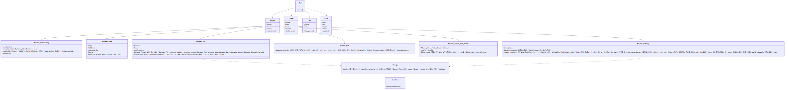

# web-ui（ウェブ・画面。構成員向けの全画面、ルーティング、文言、見た目、見やすさ）

## 受ける節

- [第10章 3 見た目（DD-10-1）](../../../../docs/jp/design/10_基本設計書_画面.md#3-見た目dd-10-1)（見た目：配色のトークン、字と形）
- [第10章 4 画面の一覧と遷移（DD-10-3）](../../../../docs/jp/design/10_基本設計書_画面.md#4-画面の一覧と遷移dd-10-3)（画面の一覧と遷移、戻る、深いリンク）
- [第10章 5 主要な画面](../../../../docs/jp/design/10_基本設計書_画面.md#5-主要な画面)（主要な画面：一覧、トーク、通話中、設定）
- [第10章 6 操作の慣行（DD-10-5）](../../../../docs/jp/design/10_基本設計書_画面.md#6-操作の慣行dd-10-5)（操作の慣行、二重送信の防止、確認ダイアログ）
- [第10章 7 案内と明示の置き場（DD-10-7）](../../../../docs/jp/design/10_基本設計書_画面.md#7-案内と明示の置き場dd-10-7)（案内と明示の置き場）
- [第10章 8 設定の分類と項目（DD-10-4）](../../../../docs/jp/design/10_基本設計書_画面.md#8-設定の分類と項目dd-10-4)（設定の分類と項目）
- [第10章 9 文言（DD-10-8）](../../../../docs/jp/design/10_基本設計書_画面.md#9-文言dd-10-8)（文言の規則、エラーの文言のエラーコード表、言語）
- [第10章 12 知らせと確認ダイアログ](../../../../docs/jp/design/10_基本設計書_画面.md#12-知らせと確認ダイアログ)（知らせと確認ダイアログ）
- [第10章 14 失敗の扱い](../../../../docs/jp/design/10_基本設計書_画面.md#14-失敗の扱い)（失敗）
- [第10章 2 目的と範囲](../../../../docs/jp/design/10_基本設計書_画面.md#2-目的と範囲) の受ける要件（R-10-*）
  - 見やすさの数値：本文 16 px、行間 1.5、200%、320 px、44×44、コントラスト、reduced-motion、4 段 + OS
  - 読み上げ：feed、article、log、status
- [第3章 3.1 初回の管理者（DD-3-1）](../../../../docs/jp/design/03_基本設計書_認証_構成員_端末.md#31-初回の管理者dd-3-1)（初回の管理者の画面）
- [第3章 3.3 参加の流れ（DD-3-3）](../../../../docs/jp/design/03_基本設計書_認証_構成員_端末.md#33-参加の流れdd-3-3)（参加の 3 画面）
- [第3章 4 ログインと認証](../../../../docs/jp/design/03_基本設計書_認証_構成員_端末.md#4-ログインと認証)（ログイン、QR、承認、回復の 4 段、再設定、ロック、再認証）
- [第3章 5.2 一覧と取り消し](../../../../docs/jp/design/03_基本設計書_認証_構成員_端末.md#52-一覧と取り消し)（端末の一覧）
- [第3章 6 アカウントとプロフィール（DD-3-14）](../../../../docs/jp/design/03_基本設計書_認証_構成員_端末.md#6-アカウントとプロフィールdd-3-14)（プロフィール）
- [第3章 8.3 抹消（本人の求め。DD-3-15）](../../../../docs/jp/design/03_基本設計書_認証_構成員_端末.md#83-抹消本人の求めdd-3-15)（抹消の画面）
- [第3章 9 子ども（DD-3-13。O-09 の結論）](../../../../docs/jp/design/03_基本設計書_認証_構成員_端末.md#9-子どもdd-3-13o-09-の結論)（子どもの画面、保護者の設定）
- [第4章 4.2 一覧（DD-4-13）](../../../../docs/jp/design/04_基本設計書_トークとメッセージ.md#42-一覧dd-4-13)（一覧）
- [第4章 5 メッセージの操作](../../../../docs/jp/design/04_基本設計書_トークとメッセージ.md#5-メッセージの操作)（メッセージの操作の画面：送信、受信、長押し、既読、メンション、プレビュー、検索、投票・ノート・予定、スタンプ、ミュート）
- [第5章 4 端末での処理](../../../../docs/jp/design/05_基本設計書_メディア.md#4-端末での処理)（送信の画面の 3 択、加工）
- [第5章 5.2 取得（DD-5-7）](../../../../docs/jp/design/05_基本設計書_メディア.md#52-取得dd-5-7)（データと容量の画面）
- [第5章 6 アルバム（DD-5-8）](../../../../docs/jp/design/05_基本設計書_メディア.md#6-アルバムdd-5-8)（アルバム）
- [第5章 8.2 位置の送信と表示](../../../../docs/jp/design/05_基本設計書_メディア.md#82-位置の送信と表示)（地図の画面）
- [第6章 4 開始と着信（DD-6-3、DD-6-4）](../../../../docs/jp/design/06_基本設計書_通話.md#4-開始と着信dd-6-3dd-6-4)〜[第6章 5 通話中（DD-6-5、DD-6-6、DD-6-7）](../../../../docs/jp/design/06_基本設計書_通話.md#5-通話中dd-6-5dd-6-6dd-6-7)（呼び出し、着信、通話中、小窓）
- [第6章 6 記録（DD-6-8）](../../../../docs/jp/design/06_基本設計書_通話.md#6-記録dd-6-8)（通話の一覧）
- [第7章 10 初回の案内（DD-7-10）](../../../../docs/jp/design/07_基本設計書_通知.md#10-初回の案内dd-7-10)（通知の許可の画面）
- [第7章 5.2 内容の表示（設定）](../../../../docs/jp/design/07_基本設計書_通知.md#52-内容の表示設定)（通知の設定）
- [第8章 3.3 ホーム画面への追加（DD-8-2、DD-8-3）](../../../../docs/jp/design/08_基本設計書_iPhoneとPCのシェル.md#33-ホーム画面への追加dd-8-2dd-8-3)（追加の案内の画面）
- [第12章 7 読める人の明示（DD-12-14。第10章と往復）](../../../../docs/jp/design/12_基本設計書_データと暗号化.md#7-読める人の明示dd-12-14第10章と往復)（明示の画面）
- [第12章 8 外へ送る情報の一覧（DD-12-14、R-12-5-1。第1章 4.2 と一致）](../../../../docs/jp/design/12_基本設計書_データと暗号化.md#8-外へ送る情報の一覧dd-12-14r-12-5-1第1章-42-と一致)（外へ送る情報の一覧の画面）
- [第13章 7 公開リポジトリの文書（DD-13-1、DD-13-9）](../../../../docs/jp/design/13_基本設計書_配布と更新.md#7-公開リポジトリの文書dd-13-1dd-13-9)（このアプリについて、免責）
- 全体実装設計書 2.7（`AppError` を 2 文と番号で示す）、3.2（`AppState` ごとの画面）

- [第1章 10.8 言語](../../../../docs/jp/design/01_基本設計書_全体構成.md#108-言語)（言語：日本語のみ、文言は鍵）

## 依存

- 下：
  - [web-sync](web-sync.md)
  - [web-media](web-media.md)
  - [web-search](web-search.md)
  - [web-calls](web-calls.md)
  - [web-push](web-push.md)
  - [web-shell](web-shell.md)（+ それらの下の web-core、web-crypto）
- 部品：React 19、React Aria Components、TanStack Virtual、budoux、maplibre-gl（地図の部品は web-media が包む）。
- 上：なし（web-admin は本ブロックの部品を使う）。
- 画面は状態を持たない：全部の状態は web-core `Startup.state`、web-sync のコピー、web-calls `CallSession.state` のコピー。

## クラス図（画面の側の構造。TypeScript のモジュール）

```mermaid
classDiagram
  class App {
    +render()
  }
  class Router {
    +routes
    +back()
    +deepLink(url)
  }
  class Theme {
    +tokens
    +fonts
    +scale
    +motion
    +backgrounds
  }
  class I18n {
    +ja Json
    +t(key, params)
    +rules
  }
  class A11y {
    +feed
    +live
    +targets
    +labels
    +keyboard
  }
  class Screens_Onboarding {
    +InviteLanding
    +Join1_Name / Join2_Passkey / Join3_RecoveryCode
    +InstallGuide（iPhone）/ NotifyPermission / Disclosure（明示）/ DataHandling（取扱い）/ AndroidApkGuide
    +SetupAdmin
  }
  class Screens_Auth {
    +Login
    +AddDevice
    +ApproveDevice
    +Recover
    +ResetLink / Reauth / AppLockScreen（生体／6 桁）
  }
  class Screens_Talk {
    +RoomList
    +Room
    +LongPressMenu
    +Compose_Photos（3 択、束、加工）/ Compose_File / Compose_Location / Compose_Contact / Compose_Poll / Compose_Note / Compose_Event / Compose_Sticker / Compose_Schedule / Forward
    +ReadBy / Info / Search / MediaList / NewRoom（1 対 1／グループ：名前、構成員）/ RoomSettings（名前、アイコン、通知、背景）/ Export
  }
  class Screens_Call {
    +Outgoing / Incoming（応答、拒否、音声だけで応答）/ InCall（グリッド／フォーカス／リスト、品質、操作、終了、その他）/ MiniWindow / CallList / EmergencyNotice（初回の確かめ）/ IphoneLockBanner
  }
  class Screens_Album_Map_Sticker {
    +Albums / Album / AlbumCreate / BulkSave
    +MapFull / MapPick
    +StickerCreate（写真、切り抜き、文字と落書き、名前、パックの順）/ StickerPacks / RemoveRequest
  }
  class Screens_Settings {
    +SettingsHome
    +GuardianApprovals（保護者の承認）/ TransferAccept（引き継ぎの承認）
    +Account / Devices（一覧、追加、取り消し、他のすべてからログアウト）/ Notifications / Talk / Media / Calls / Privacy（明示、取扱い、外へ送る一覧、ロック、通知を出さない人、安全番号）/ Appearance / Storage（使用量、削除）/ Help（できないこと、iPhone の制約、緊急通報、手順書、問い合わせ、紙の確認）/ About（版、更新の確認、ライセンス、第三者の表示、免責、収集しない旨）/ Guardian（子の設定）/ Erase
  }
  class Dialogs {
    +Confirm（取り返しがつく）/ ConfirmDestructive（赤、失うもの、再認証）/ Banner / Toast（2 秒、status）/ Empty / Progress（%、残り、中断）/ NoticeList
  }
  class ErrorView {
    +render(err AppError)
  }
  App --> Router
  App ..> Theme
  App ..> I18n
  App ..> A11y
  Router --> Screens_Onboarding
  Router --> Screens_Auth
  Router --> Screens_Talk
  Router --> Screens_Call
  Router --> Screens_Album_Map_Sticker
  Router --> Screens_Settings
  Screens_Talk ..> Dialogs
  Screens_Settings ..> Dialogs
  Dialogs ..> ErrorView
```

図の元の文（mermaid）

クラス図の注記（図の各メンバーの説明。仕様の節と番号を含む）

|クラス|メンバー|注記|
|---|---|---|
|App|`+render()`|Startup.state で分岐：Unreachable（読める範囲 + バナー）、ServerInitial（/setup/admin）、LoggedOut（Login）、Unapproved（Recover）、WaitingKeys（「家族の誰かが開くと受け取れます」）、Locked（AppLockScreen）、UpdateRequired（UpdateScreen）、Suspended（「停止されています。管理者：{admin}」）、ServerReadOnly（バナー）、Normal（Router）|
|Router|`+routes`|/ 一覧、/r/:id トーク、/r/:id/search、/r/:id/media、/r/:id/map、/new、/calls、/call/:id、/albums、/albums/:id、`/settings/*`、`/stickers/*`、/i/:token、/d/:code、`/welcome/*`、/setup/admin/:token、/login、`/recover/*`、/auth/reset/:token、`/admin/*`（web-admin）|
|Router|`+back()`|左上の ← と OS の戻る（シェルの backPressed）は同じ。タブは履歴に積まない|
|Router|`+deepLink(url)`|通知のタップ /r/&lt;id&gt;、招待 /i/&lt;token&gt;、端末の追加 /d/&lt;code&gt;|
|Theme|`+tokens`|第10章 3.1 の 9 トークン（明／暗）。prefers-contrast、forced-colors|
|Theme|`+fonts`|第10章 3.2 の並び。system-ui は使わない|
|Theme|`+scale`|本文 16 px、4 段 + OS（web-shell FontScale）|
|Theme|`+motion`|prefers-reduced-motion / 設定で止める|
|Theme|`+backgrounds`|トークの背景（同梱の数種、自分の写真）|
|I18n|`+ja Json`|web/src/ui/i18n/ja.json：画面の鍵、err.&lt;code&gt;.what/next、通知の文、知らせの文、明示の文（第12章 7.1、7.2、8）、免責（第13章 7）|
|I18n|`+t(key, params)`|web-core Text の実体|
|I18n|`+rules`|第10章 9.1：です・ます、40 文字、技術の語の禁止（tools/forbidden_words が検査）、数 + 半角空白 + 単位、時刻の形（Intl）|
|A11y|`+feed`|メッセージの一覧は role=feed と article（aria-posinset/setsize、aria-busy）、日付は見出し|
|A11y|`+live`|新着と送信の状態は log と status。フォーカスを奪わない|
|A11y|`+targets`|44×44（Android 48 dp）。React Aria の target-size|
|A11y|`+labels`|アイコンだけのボタンにラベル|
|A11y|`+keyboard`|Enter でメニュー、矢印で束の中、Escape で閉じる|
|Screens_Onboarding|`+InviteLanding`|/i/:token：家族の名前と招待者、「参加する」。子ども区分の招待なら「保護者：{name}、{name}」（child.guardian_names。G-12）。AUTH-007 の理由|
|Screens_Onboarding|`+Join1_Name / Join2_Passkey / Join3_RecoveryCode`|参加の 3 画面。QR「スマートフォンで続ける」。回復コードの「書き留めた」必須|
|Screens_Onboarding|`+Disclosure（明示）/ DataHandling（取扱い）`|GET /family/disclosure を示し、「確認した」で POST /me/disclosure-ack {version}（G-09。第3章 3.1 の 7、3.3 の 6）|
|Screens_Onboarding|`+SetupAdmin`|/setup/admin/:token：家族の名前、名前と写真、パスキー、回復コード、カードの印刷（PDF）、明示、2 人目の管理者とバックアップの案内|
|Screens_Auth|`+Login`|条件付き UI（autocomplete=username webauthn）+ ボタン。シェルはボタンだけ|
|Screens_Auth|`+AddDevice`|/d/:code：QR と 8 文字。poll|
|Screens_Auth|`+ApproveDevice`|既存の端末：QR を読むか 8 文字を入力し、ロックを解除する。GET /auth/qr/{user_code}（G-13）で種類・名前・場所・指紋を示し、承認する|
|Screens_Auth|`+Recover`|4 段の案内（既存の端末、家族に頼む（求めの状態）、回復コード（検査文字の誤りの位置）、カード（語の候補、誤りの行））+ PRF|
|Screens_Talk|`+RoomList`|行（写真 48、名前、冒頭、時刻、未読）、検索、＋、長押し、並べ替え、空の案内。TanStack Virtual|
|Screens_Talk|`+Room`|上（名前と人数、通話、バナー：アナウンス／通話中／オフライン／鍵待ち）、本文（日付の見出し、吹き出し、既読、リアクション、束 10 件、各種類の描画、削除済みの印、システムの知らせ）、下（入力欄、＋、録音、送信。長押し：通知なし、予約）。新着のボタン。右スワイプで返信。メンションの候補|
|Screens_Talk|`+LongPressMenu`|上段リアクション 5 + ＋。下段は返信、転送、コピー、アナウンス、情報、編集、取消、削除の順|
|Screens_Settings|`+SettingsHome`|写真と名前、10 の分類、このアプリについて、管理者の画面（管理者）、保護者（子ども）|
|Screens_Settings|`+Account`|プロフィール、回復コード、パスキー、抹消の求め（POST /me/erase。再認証）と猶予の間の取り消し（DELETE /me/erase）|
|Screens_Settings|`+GuardianApprovals（保護者の承認）`|保護者の端末：子の端末の追加と抹消の求め（知らせから開く）。POST /me/guardian/approvals/{id}（G-17。再認証）|
|Screens_Settings|`+TransferAccept（引き継ぎの承認）`|指名された構成員：知らせから開き、POST /me/transfer/{id}/accept（G-18。再認証）|
|ErrorView|`+render(err AppError)`|what + next + 番号（小さく）。retryable は「もう一度」|

## 画面の収め方（画面 × 呼ぶ操作 × 受けるイベント × 開ける状態）

|画面|呼ぶ操作（公開操作の番号）|受けるイベント（web-sync 経由）|開ける `AppState`|
|---|---|---|---|
|InviteLanding、Join1〜3|web-core Api（`/invite-tokens/{token}`、accept）、web-crypto B-221/B-222、web-sync B-245（Add は招待者の側）、web-push B-322|—|LoggedOut|
|SetupAdmin|Api（`/setup/admin`）、B-221/B-222（カードの PDF）|—|ServerInitial|
|Disclosure、DataHandling|Api（`/family/disclosure`、`/me/disclosure-ack`）|—|Normal|
|Login、AddDevice、ApproveDevice、Recover、ResetLink|Api（`/auth/*`。ApproveDevice は `GET /auth/qr/{user_code}`）、B-222、B-245、B-343|`recovery.request`、`recovery.used`、`device.changed`|LoggedOut、Unapproved、Normal（ApproveDevice）|
|RoomList|B-242 `Rooms`、B-281 一覧|`room.*`、`user.changed`、`room.typing`|Normal|
|Room と Compose|B-242、B-244、B-262、B-268、B-247、B-304|`room.event`、`room.receipt`、`room.typing`、`room.member`|Normal|
|Search、MediaList|B-281|—|Normal|
|Call の画面|B-300〜B-304|`call.ring`、`call.state`（web-calls 経由）|Normal（着信は Locked でも応答）|
|Albums、Map、Sticker|B-242、B-262、B-264、B-269、B-270、B-226（削除の求め）|`room.event`|Normal|
|Settings の各画面|B-203、B-210、B-221、B-222、B-229、B-242、B-265、B-322、B-325、B-342、B-343、B-344|`device.changed`、`keybundle.changed`、`notice`|Normal、Locked（AppLockScreen）|
|GuardianApprovals、TransferAccept|Api（`/me/guardian/approvals/{id}`、`/me/transfer/{id}/accept`）、B-343（再認証）|`notice`|Normal|
|バナーと知らせ|B-240 `Sync.state`、B-345、B-325、B-242 `Notices`|`notice`、`sync.gap`、`session.revoked`|全部|

## 公開操作

- 本ブロックは画面の側であり、他のブロックに操作を提供しない。文言の表（P-8）の持ち主として `ja.json` を所有し、web-core `Text` と and-shell（Kotlin の資源に生成）が読む（B-602）。

## アルゴリズム（画面の側に残るもの）

|事項|実装|由来|
|---|---|---|
|仮想化|一覧とトークは TanStack Virtual（行の高さは文字の拡大で変わるため実測）|[第10章 5.1 トークの一覧](../../../../docs/jp/design/10_基本設計書_画面.md#51-トークの一覧)|
|文節の折り返し|budoux（見出しと短い本文）、URL は `overflow-wrap: anywhere`|[第10章 3.2 字と形](../../../../docs/jp/design/10_基本設計書_画面.md#32-字と形)|
|時刻の表示|今日 12:34、昨日 12:34、今年 10月13日、それ以前 2025年10月13日（Intl.DateTimeFormat ja-JP）|[第10章 9.1 規則](../../../../docs/jp/design/10_基本設計書_画面.md#91-規則)|
|写真の束|10 件ずつ、+n、横スワイプと矢印|[第10章 6 操作の慣行（DD-10-5）](../../../../docs/jp/design/10_基本設計書_画面.md#6-操作の慣行dd-10-5)|
|新着の追従|下にいれば自動、上にいれば「新着 n 件」|[第10章 5.2 トーク](../../../../docs/jp/design/10_基本設計書_画面.md#52-トーク)|

## データ設計（画面の側に置くもの）

|記録|形|欄|由来|
|---|---|---|---|
|`web/src/ui/i18n/ja.json`|JSON（P-8）|画面の鍵、`err.*`、通知、知らせ、明示、免責。鍵の一覧は `tools/errors_check` と `tools/forbidden_words` が検査|[第10章 9 文言（DD-10-8）](../../../../docs/jp/design/10_基本設計書_画面.md#9-文言dd-10-8)|
|`web/src/ui/theme/tokens.css`|CSS 変数|第10章 3.1 の 9 トークン × 明暗|[第10章 3.1 配色（トークン）](../../../../docs/jp/design/10_基本設計書_画面.md#31-配色トークン)|
|同梱の素材（P-7）|`web/public/assets/`|絵柄 32、着信音 3、アイコン（線）、背景の数種、案内の図（iOS 2 種、Android 4 画面）|[第10章 3.2 字と形](../../../../docs/jp/design/10_基本設計書_画面.md#32-字と形)、[第10章 7 案内と明示の置き場（DD-10-7）](../../../../docs/jp/design/10_基本設計書_画面.md#7-案内と明示の置き場dd-10-7)|
|端末だけの設定|web-core `Settings`（外観、文字の大きさ、アニメーション）|第10章 8 の「端末だけの設定」|[第10章 8 設定の分類と項目（DD-10-4）](../../../../docs/jp/design/10_基本設計書_画面.md#8-設定の分類と項目dd-10-4)|
