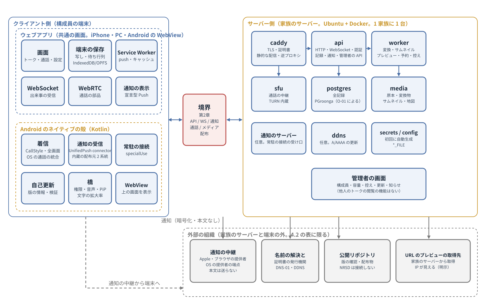
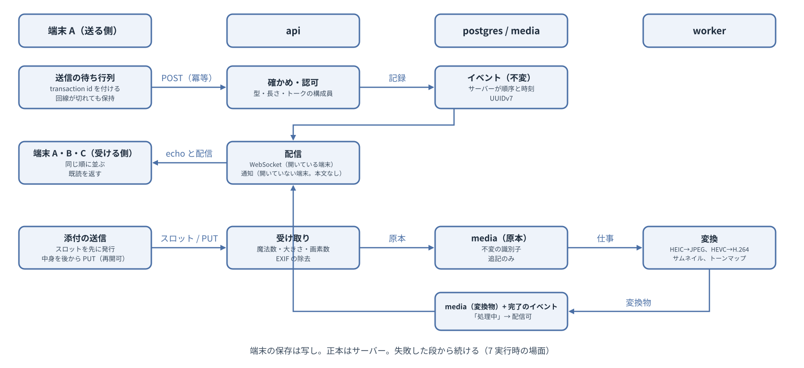
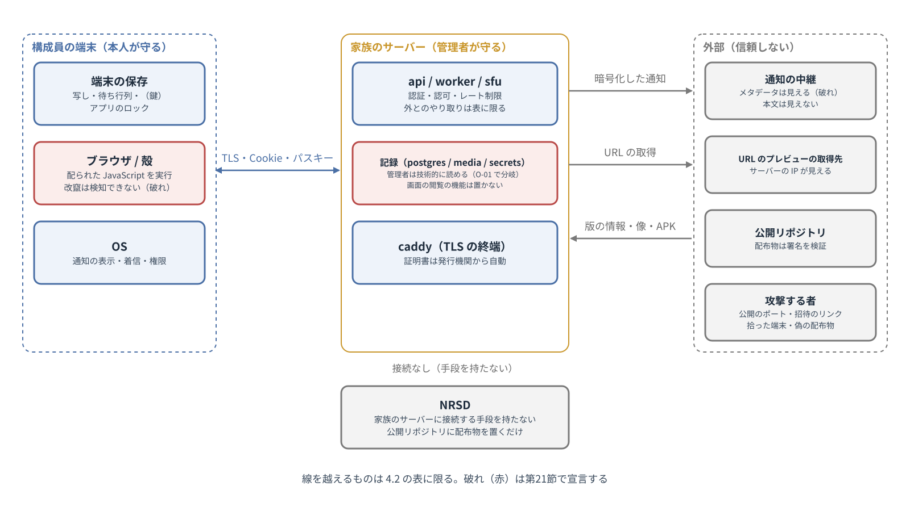

# 基本設計書 第1章 全体構成

家族専用の通信アプリ　第2版（案）　2026-10-13 · 石川宗  
株式会社流山ソフトウェア開発（NRSD）

© 2026 株式会社流山ソフトウェア開発（NRSD）担当開発者　石川宗　本書の著作権は、株式会社流山ソフトウェア開発（NRSD）に帰属します。本書が参照する第三者の規格、ソフトウェア、法令の解説等の権利は、各権利者に帰属します。

---

## 本書の位置付け

- 概要設計書 第1章「全体構成」を詳細化する。本章は全章の前提であり、他の章は本章の構成、データの所在、識別子、信頼の境界、横断の方針に従う。
- 本章の節の立て方は、ソフトの構成を書く公開のひな形 arc42（2026.10.2。調査資料 調査 H）の12の節に倣う。12の節は、目的と目標、制約、文脈と範囲、解決の方針、構成要素、実行時の場面、配置、横断の考え方、決定、品質の要求、危険、用語集。これに要件との対応、運営、章の依存、既知の制約の宣言、訂正を加える。本章は検討メモ「第1章 全体構成の検討」（NRSD の内部の検討の記録であり、本書とともには配らない。設計の根拠となる事実は本書の各節に出典とともに書いた）に基づく。
- 受ける決定は、概要設計書 第1章「受ける決定」と「設計計画書の決定から本書の要件への対応」による（本章には写さない）。本システムは**2つのシステム**（サーバー側とクライアント側）からなり、本章はその分け方と境界の置き場を定める。境界の中身は第2章「サーバーとクライアントの境界」が持つ。
- 記法：「［要実測］」は、送受信・実装で確かめる事項（想定と判定の基準を併記する）。「（初期値）」は、根拠となる外部の数値がなく、運用の開始時に置く値。「脅威 T-n」は 11.2 の一覧の番号。
- 用語は 16「用語集」にまとめる。

## 1. 設計上の決定の一覧

|番号|決定|理由|退けた案|
|---|---|---|---|
|DD-1-1|本システムは、サーバー側（家族のサーバー：api、worker、postgres、media、sfu、caddy）とクライアント側（iPhone と PC のウェブアプリ、Android のシェル + WebView）の2つのシステムからなり、1つの総合的な仕様（設計計画書、概要設計書、基本設計書）の上に成り立つ。境界は第2章が1か所で定義し、サーバー側とクライアント側の型をそこから生成する|設計計画書 第1章の文書体系、NRSD の指示（2つのシステム、境界は1か所）|境界を各機能の章に散らす案（食い違いが実装に写る）|
|DD-1-2|1つの家族に1つの家族のサーバーを置き、データとアカウントの単位をサーバーと一致させる。1人が複数の家族に属する場合は、端末が複数のサーバーを登録して切り替える（13.4）|設計計画書 D-2-2「家族だけで閉じる」、D-3-3「範囲は管理者が決める」、法務調査 L-1・L-3（複数の世帯に提供すると法の扱いが変わる）|1つのサーバーに複数の家族を置く案（管理者が他の家族のデータを持つ）|
|DD-1-3|記録の正本は家族のサーバーに置き、端末はコピー（キャッシュと送信のキュー）だけを持つ。新しい端末はログインすれば全記録を見られる|設計計画書 D-11-5「新しい端末でそれまでの連絡を見られる」、D-13-1「連絡の内容は家族のサーバーと端末にのみ置く」。家族には iPhone 1台だけの構成員がおり、「主の端末」を要する形を採れない（準拠の調査3 の3）|主の端末（スマートフォン）に正本を置き、他の端末へ写す形（一般的な通信アプリの主流。iPhone を主にできない）|
|DD-1-4|サーバー側は api（要求と応答、WebSocket、MLS の配送サービスと認証サービス、端末宛メールボックス、鍵バンドルと鍵のバックアップの保管、通知の送信と常駐の受け口、URL の取得の代理）と worker（添付の GC、バックアップ、監視、地図の更新、KEK の包み直し、DDNS、予約送信、通知の再送）を同じコンテナイメージの別のプロセスに分ける。添付の変換は行わない（第12章の結論により端末が行う。第5章）|バックアップと監視と GC は長い処理であり、API の応答を止めてはならない（品質の目標の2）。同じイメージにすることで配布と更新を1つにする（準拠の調査1 の1）|1プロセス（長い処理の間に応答が止まる）。別のイメージ（配布が2つになる）|
|DD-1-5|家族のサーバーと端末の外へ送るものは 4.2 の表に限り、表にない送信を行わない。NRSD の設備への送信は、公開リポジトリへの版の確認と配布物の取得を除いて存在しない|設計計画書 D-2-3、D-3-7「NRSD は接続する手段を持たない」、D-13-4、法務調査 L-1・L-14|利用の統計や不具合の報告を NRSD に送る案（D-3-7 に反する）|
|DD-1-6|メッセージその他の記録は不変のイベントとし、順序と時刻は家族のサーバーが付ける。端末は送信ごとに transaction id を付け、サーバーは同じ id の再送を1件として扱う|設計計画書 D-7-7「全員の画面で同じ順、二重に届かない」。公開のメッセージングのプロトコルの語彙（調査資料「準拠する標準規格」1）|端末の時刻で順序を決める案（時計のずれと二重）|
|DD-1-7|通知の中身に本文を入れない。端末が通知を受けたら家族のサーバーから取得して表示し、取得できない時は汎用の本文を出す|設計計画書 D-10-2、調査 I-01（iPhone の宣言型の Web Push）、調査 I-02（中継は本文を読めなくても宛先と時刻を見る）、法務調査 L-3|本文を入れる案（中継に本文が渡る。iPhone でも暗号化すれば取得が要る）|
|DD-1-8|識別子は UUIDv7（RFC 9562）とし、招待の token と端末の追加のコードは 128 ビット以上の乱数とする。利用者に番号を見せる場面を作らない|調査資料「準拠する標準規格」6。時系列に並ぶ主キーは索引と差分の同期に向く|連番（件数と順序が外に露出する）、ULID（公開の版のない仕様）|
|DD-1-9|時刻は家族のサーバーが付け（UTC、RFC 3339）、端末の時刻は表示と送信のキューの並びにだけ使う。家族のサーバーの機械は NTP で合わせる|10.7|端末の時刻を記録に使う案|
|DD-1-10|ログは標準出力に1行1件の JSON で出し、秘密（トークン、鍵、Cookie）と本文（メッセージ、添付）を書かない。構成員と端末の識別子は書く|自分で立てる同種のサーバーの慣行（準拠の調査1 の7）、12-factor、法務調査 L-3|ファイルのログ（コンテナの慣行に反する）、本文を書く案|
|DD-1-11|API のエラーは RFC 9457（Problem Details）の形にエラーコード表の番号（形と分類は 8.2）を加えて返し、文言はクライアントが番号で引く。エラーコード表は境界の一覧（第2章）に置く|言語と版をサーバーの応答に結び付けない。同じ番号で試験できる（試験の文書群）|文言をサーバーが返す案|
|DD-1-12|家族のサーバーのデータは /data の単一のボリュームに置き（postgres、media、secrets、config、maps、backups）、コンテナは非 root の固定の UID で動かす|準拠の調査1 の1・7（単一ボリューム、固定 UID、chown の手順）|用途別のバインドのマウント（手順が増える）|
|DD-1-13|バックアップは日次で自動で取り（DB のダンプ、メディア、設定、秘密を1つの暗号化したアーカイブ）、置き場は管理者が選び、3-2-1（3つのコピー、2種の媒体、1つは別の場所。US-CERT 2012）を手順書で勧める。更新の前に必ずバックアップを取る|設計計画書 D-14-4、準拠の調査1 の5、調査資料 調査 H 1.5（`pg_dump` はオンラインで一貫した書き出しができる）|手動のみ、暗号化なし|
|DD-1-14|版の互換は期間で宣言する：家族のサーバーは過去 12 か月に公開されたアプリを、アプリは過去 6 か月に公開されたサーバーを支える（初期値）。範囲外はそれぞれ更新を促す|準拠の調査1 の6（互換を期間で宣言する慣行）|無期限（試験できない）、同じ版のみ（更新の順序を強いる）|
|DD-1-15|家族のサーバーの状態は「設置の前」「初回（管理者なし）」「通常」「読み取り専用（マイグレーションの失敗、容量の枯渇）」「停止」の5つとし、アプリは状態に応じて使える範囲を示す|7（実行時の場面）、設計計画書 D-14-6|状態を持たず都度エラーを返す案|
|DD-1-17|認証とセッションは NIST SP 800-63B-4 の AAL2 を基準とし、パスキーを一次とする。セッションの寿命は AAL2 の値（全体 24 時間・無操作 1 時間）から逸脱して長く取り（絶対 90 日、無操作 30 日。初期値）、逸脱の理由（高齢者が長期間ログインし直さずに使う。設計計画書 D-11-3）を第3章に文書化する（ASVS 7.1.1）|調査資料 調査 H 1.1、1.3|AAL2 の値をそのまま使う案（毎日のログインを強いる）、AAL1（家族の連絡に対してフィッシング耐性が足りない）|
|DD-1-16|品質の目標の順は、記録を失わない・壊さない、いつでも届く、外に出さない、迷わない、同じ結果、運用が続く、の順とし、目標がぶつかる時は上を採る|2.3、設計計画書 第2.1節|順を決めない案（章ごとに判断がぶれる）、「外に出さない」を最上位にする案（記録を失う方が家族には取り返しがつかない）|

## 2. 目的と品質の目標

### 2.1 目的

- 本システムの目的は、家族が日常の連絡を取り合える状態を作ることである（設計計画書 第2章「目的および範囲」）。連絡の内容は外部の事業者に預けず、使い勝手は一般的な通信アプリと同じとし、文字、写真、動画、ファイル、音声、通話を使える。

### 2.2 利害関係者

|者|本システムとの関係|関心|
|---|---|---|
|構成員（大人）|毎日の連絡、写真と動画、通話|届く、見やすい、迷わない、記録が残る|
|構成員（高齢者）|同上。iPhone が多い|文字が大きい、手順が少ない、電話のように使える|
|構成員（子ども）|同上|親に見られる範囲が分かる|
|管理者|設置、招待、更新、バックアップ、相談の受け口|手順が少ない、知らせが来る、壊れても戻せる、他人の記録を読まない・読めない|
|NRSD（公開者）|ソフトウェアの公開、配布物の署名、Android の口座|データを受け取らない、責任の範囲、鍵を守る|
|外部の組織（プッシュ配信サービス、名前の解決、証明書の発行機関、公開リポジトリの運営者）|本システムが利用する基盤|—|
|第三者（攻撃する者、招待のリンクを手に入れた者、端末を拾った者）|脅威（11.2）|—|

### 2.3 品質の目標（優先の順）

|順|目標|ISO/IEC 25010:2023 の特性（調査資料 調査 H 1.8）|理由|
|---|---|---|---|
|1|家族の記録を失わず、壊さない|信頼性、安全性|家族の写真と会話は後から見返すことに価値があり、失えば取り返せない（設計計画書 D-2-1、D-8-6）|
|2|家族がいつでも連絡を取り合える（届く）|信頼性、性能の効率|通知と通話が届かなければ家族は元の通信アプリに戻る（設計計画書 D-2-1、第2.2節）|
|3|連絡の内容を家族の外に出さない|セキュリティ|設計計画書 D-2-3、D-3-7 が本システムの前提|
|4|技術者でない構成員が迷わず使える|使い勝手|使われなければ目的を達しない（設計計画書 D-3-4、D-3-5、D-12-1）|
|5|端末の種類で結果が変わらない|互換性|iPhone、Android、PC が混在する（設計計画書 D-5-6）|
|6|管理者1人で運用が続く|保守性、柔軟性|管理者は家族の中で1人であることが多い（設計計画書 第3.3節）|

- 性能は、上の6つを損なわない範囲で満たす（14.1）。
- 目標がぶつかる時は、順の上のものを採る（DD-1-16）。
- 安全の検証の水準は OWASP ASVS 5.0.0 の L2 を目標とする（個人のメッセージを扱う。「ほとんどのアプリケーションが目指すべき水準」。調査資料 調査 H 1.1）。L2 が求める多要素認証はパスキー（所持と生体または PIN）で満たす（第3章）。要件ごとの対応は試験の文書群が持つ。例：通知の即時性（2）のために本文を中継に送る（3 に反する）ことはしない。例：管理者の手間（6）を減らすためにバックアップを省く（1 に反する）ことはしない。

## 3. 制約

|種類|制約|出どころ|
|---|---|---|
|技術|家族のサーバーは Ubuntu の上の Docker のコンテナ。自宅の機械と借りたサーバーのいずれにも置ける|設計計画書 D-5-5|
|技術|iPhone は Safari（WebKit）のホーム画面のウェブアプリ。Apple Developer Program を使わない。鳴り続ける着信と画面のロック中の通話の継続は実現できない|設計計画書 D-5-1、D-5-2、調査 I-01|
|技術|Android は Kotlin のネイティブのシェルの中の WebView。ストアを通さずに配る。minSdk 26、WebView は Chrome 60 以上|設計計画書 D-5-3、D-5-7、調査 I-03、O-03|
|技術|PC はブラウザ。画面は3種のシェルで同じ|設計計画書 D-5-4、D-5-6|
|技術|有料の開発者登録（Android の口座を除く）と有料の外部サービスを前提としない|設計計画書 D-2-6、D-15-6|
|技術|NRSD は家族のサーバーに接続する手段を持たない|設計計画書 D-3-7|
|技術|家庭の回線は、グローバル IPv4、MAP-E の割り当てポート、IPv4 の着信が一切できないもの、に分かれる|調査 I-05|
|組織|NRSD の体制は小さい（担当開発者1人）。法律家ではない。家族のサーバーを運営しない|設計計画書 第3.1節、法務調査「本書の位置付け」|
|組織|管理者は家族の中の技術者1人であることが多い。構成員は技術を見ずに使う|設計計画書 第3.3節、D-3-4|

## 4. 文脈と範囲

### 4.1 構成要素

|構成要素|持つもの|持たないもの|動く場所|
|---|---|---|---|
|api（サーバー側）|HTTP の API、WebSocket、認証と認可、招待と端末、イベント（暗号文）の記録と配信、既読、MLS の配送サービス（KeyPackage、Commit の直列化、Welcome）と認証サービス（端末の公開鍵と本人の署名）、端末宛メールボックス、鍵バンドルのコピーと鍵のバックアップの保管、通知の送信と常駐の受け口、URL の取得の代理、SFU のトークン、設定の読み書き、管理者の API、システムの知らせの発行|長い処理（バックアップ、GC）、TLS の終端、本文の復号（鍵を持たない）、他の構成員のトークを管理者に見せる機能（設計計画書 D-13-6）|家族のサーバーのコンテナ|
|worker（サーバー側）|添付の暗号文の GC、予約送信、通知の再送、バックアップと検証と復元の試験、容量と証明書と更新と回線の監視、地図の更新、KEK の包み直し、DDNS|利用者の要求への応答、添付の変換（端末が行う）|同上（api と同じイメージ、別のプロセス）|
|postgres|全記録（添付の中身を除く）。本文は MLS の暗号文、機微なメタデータはエンベロープ暗号文（第12章 3）。検索の索引は置かない（端末）|—|同上|
|media（ボリューム）|添付の暗号文（原本、サムネイル、ポスター。名前は暗号文の SHA-256）、地図（PMTiles）|平文|同上|
|sfu|通話の中継、TURN（UDP と、caddy が TLS を終えた TCP。第6章 3.1）|記録、証明書|同上（host のネットワーク）|
|caddy|TLS と証明書（DNS-01）、静的な配信（ウェブアプリ、APK、版の情報、手順書）、api への逆プロキシ、TURN/TLS の TLS（Layer4。第6章 3.1）|業務|同上|
|`ft`（ホスト）|設置、診断、戻す、廃棄、KEK の交代、ホストの要求の受け口（イメージの入れ替えとロールバック、sfu の再起動。第11章 3.4）|利用者の要求への応答|ホスト（root。管理者の操作と systemd の path unit が起動する）|
|ウェブアプリ（クライアント側。iPhone、PC、Android の WebView で共通）|画面、端末の保存（コピー、下書き、送信のキュー）、WebSocket、Service Worker（push、キャッシュ）、通話の画面（WebRTC）、通知の表示（Web Push）、鍵と暗号（MLS、鍵バンドル、鍵のバックアップ）、添付の暗号化と端末での変換、検索の索引、通知の復号|OS の着信、常駐、自己更新（Android のシェルが持つ）|端末のブラウザまたは WebView|
|Android のシェル（クライアント側）|着信（CallStyle、全画面、OS の通話の統合）、通知の受信（UnifiedPush の connector、内蔵の配布元2系統、常時接続）、通話の音声の経路、PiP、自己更新、JS ブリッジ（権限、文字の拡大率）、複数の家族の切り替え、通知の復号用の非表示の WebView、端末鍵の包み（鍵保管庫）、家族の切り替え|画面の中身|端末|
|公開リポジトリ|ソース、配布物（イメージ、APK）、手順書、LICENSE と NOTICE、security.txt|家族の情報|公開リポジトリの運営者の設備|
|NRSD の鍵|Android の署名鍵、コンテナイメージの署名の鍵|家族の情報|NRSD のハードウェアのトークンと分散したバックアップ。家族のサーバーに接続しない|

図1-1 2つのシステムの構成

- 境界の外（設計計画書 D-2-7、D-3-7）：家族の外との連絡（不特定多数、他の家族のサーバー、一般的な通信アプリ、電話網、緊急通報）。連絡以外の機能、認証なしの公開 URL、業務での利用、NRSD の設備への接続。

### 4.2 外部とのやり取り

- 家族のサーバーと端末が外とやり取りするのは、次の表の相手に限る。表にない送信はしない（DD-1-5）。端末の OS とブラウザが各社の方針により送る診断のデータ等は、本システムの制御の外にあり、外へ送る情報の一覧（第12章）にその旨を記す。

|相手|方式|送るもの|受け取るもの|時間切れ・上限（初期値）|失敗した時|
|---|---|---|---|---|---|
|プッシュ配信サービス（iPhone の OS の提供者、ブラウザの提供者、Android の OS の提供者の Web Push のエンドポイント）|HTTPS の POST（RFC 8030）。VAPID（RFC 8292）で自分を名乗る|RFC 8291 で暗号化した通知（本文を含まない。トーク、イベント、未読の数、汎用の本文）、TTL、Urgency、Topic|201、404、410、429|接続 10 秒、全体 30 秒、本文 4,096 バイト以下|404 と 410 は購読を消す。429 は Retry-After に従う。他は 1、4、16 秒（揺らぎつき）で3回まで再び試し、その後は捨てる（端末は開いた時に全差分を取る）|
|名前の解決|OS の解決器|名前|IP アドレス|—|アプリから届かない。手順書で DDNS を確かめる|
|証明書の発行機関（ACME）|HTTPS（caddy）|DNS-01 の検証（DNS の提供者の API 経由）|証明書|caddy の既定（自動の再試行）|期限の 14 日前から管理者に知らせる。期限が切れると全端末が使えない（21「既知の制約」）|
|DNS の提供者（DDNS の更新、DNS-01）|HTTPS の API|A、AAAA、TXT|—|5 分ごと（DDNS）、接続 10 秒|次回に再び試す。失敗が 1 時間続けば知らせる|
|URL のプレビューの取得先|HTTPS の GET（家族のサーバーから。固有の User-Agent を名乗る）|URL|HTML の先頭、OpenGraph の画像|接続 5 秒、全体 10 秒、応答 1 MiB、転送 3 回まで。内部の範囲（10.6）と自分自身への接続を拒む|プレビューなしで送る（脅威 T-11、T-15）|
|公開リポジトリ|HTTPS の GET|—|版の情報、イメージ、APK|1 日 1 回（版の確認）、配布物は全体 30 分・500MB まで|次回に再び試す|
|署名の公開の仕組み（Sigstore）の TUF のリポジトリ|HTTPS の GET（ホストの `ft` が更新の検証の時だけ）|取得する対象の名前|TUF のメタデータと trusted root（署名で守られる）|更新の時だけ。手元にキャッシュし、取れない時はキャッシュで検証する|キャッシュも古ければ更新を中止して管理者に知らせる（第13章 3.1）|
|地図のデータの供給元|HTTPS の GET（設置の時の worker の仕事と、管理者の更新の時だけ）|取得する領域（範囲の要求）|PMTiles の切り出し|手動|手動で再び試す。手元の地図で続く|
|バックアップの置き場（S3 互換。管理者が選んだ時だけ）|HTTPS（restic）|restic で暗号化したバックアップ（中身は置き場に読めない）|スナップショットの一覧、戻す時の暗号文|日次（第11章 9）|管理者に知らせる。次回に再び試す|
|通話の相手（端末）|UDP と TCP（WebRTC。常に sfu を経由し、端末どうしは直接につながらない）|音声と映像（DTLS-SRTP）|同じ|ICE の既定|再接続（第6章）|

- NRSD の設備への送信はない。公開リポジトリは NRSD が内容を置くが、運営者の設備であり、家族のサーバーは取得の要求だけを送る（法務調査 L-1、L-14）。
- 脅威 T-11（情報の漏れ）：URL のプレビューの取得先に家族のサーバーの IP アドレスが見える。攻撃する者：取得先。狙う資産：家族のサーバーの所在。残る既知の制約：IP は出る（一覧で明示し、設定で切れる）。
- 脅威 T-15（使えなくする）：巨大な応答、転送の繰り返し、応答の遅延、内部のアドレスへの誘導。攻撃する者：悪性のサイト、誤った URL。狙う資産：worker、内部のサービス。残る既知の制約：—

### 4.3 境界（サーバー側とクライアント側）

- 境界の中身（API の経路と型、WebSocket のイベント、通知の中身、通話のシグナリング、メディアの URL、配布、版の互換、エラーコード表）は第2章が持つ。本章が決めるのは次の 3 つである。
  - 境界を1つの文書（境界の一覧）に定義し、サーバー側とクライアント側の型をそこから生成すること（DD-1-1）
  - 境界のすべてが TLS の上にあり、WebSocket は Origin を検証し、API は cross-site の要求を拒むこと（10.6）
  - NRSD の設備が境界に現れないこと

## 5. 解決の方針

|品質の目標|方針|本書・他の章|
|---|---|---|
|1 失わない・壊さない|記録は DB のトランザクション。メディアは不変の識別子で追記のみ。日次の暗号化したバックアップと復元の手順。更新の前のバックアップ。ダウングレード非対応の明記。読み取り専用の状態（容量の枯渇、移行の失敗）|DD-1-3、DD-1-13、DD-1-15、第11章 6・7|
|2 いつでも届く|WebSocket の即時配信 + 通知（Web Push、UnifiedPush の2系統）+ 開いた時の全差分。通話は sfu 経由で NAT に依らない。到達性の分岐（割り当てポート、VPS）。知らせ（容量、証明書）|DD-1-6、DD-1-7、第2章、第6章、第7章、第11章 2|
|3 外に出さない|外とのやり取りを 4.2 の表に限る。通知に本文を入れない。地図は内側。NRSD は接続しない。一覧を構成員に示す。管理者の画面に閲覧の機能を置かない|DD-1-5、DD-1-7、第12章|
|4 迷わない|画面は同じ、一般的な通信アプリの慣行に合わせる、見やすさの数値の最低要件、導入の案内、エラーの文言は番号から引く|DD-1-11、第10章|
|5 同じ結果|変換は端末で1つの実装（共通のウェブアプリ。シェルは画面の中身を持たない）。画面は1つのコード。端末の差はシェル（第8章、第9章）に閉じる|DD-1-1、DD-1-4、第5章 4|
|6 運用が続く|知らせ、自動のバックアップと更新、設置の道具、複数の管理者と引き継ぎ、手順書、固定の UID と単一のボリューム|DD-1-12、DD-1-13、第11章|

## 6. 構成要素の中身

### 6.1 サーバー側の層

|層|部品|受け持ち|受け持たないこと|
|---|---|---|---|
|入口|caddy|TLS、静的な配信、逆プロキシ、Range の配信（メディアは api の認可を経て caddy が配る方式を第5章で定める）|認証|
|境界|api の経路と WebSocket のハンドラ|境界の一覧の型で入力を確かめ（10.6）、認証と認可を行い、業務の部品に渡す。長い処理は worker の仕事として積む|業務の判断|
|業務|家族と構成員、招待、端末とセッション、トークとイベント、既読、添付、通話、通知、設定、管理者、知らせ|各章の機能|記録の書き方、通信の細部|
|基盤|DB の接続、トランザクション、仕事のキュー、ファイルの保存、通知の送信路、SFU のトークン、時刻、ログ、エラー|横断の機能（10）|業務の判断|
|worker|添付の GC、予約送信、通知の再送、バックアップと検証と復元の試験、監視（容量、証明書、更新、回線、時刻）、地図の更新、KEK の包み直し、DDNS、抹消の実行|利用者の要求への応答、添付の変換（端末が行う）|—|

### 6.2 クライアント側の層

|層|部品|受け持ち|受け持たないこと|
|---|---|---|---|
|シェル|iPhone と PC：manifest、Service Worker、ブラウザ。Android：Kotlin のシェル、WebView、JS ブリッジ、常駐、着信、更新|OS との境界（通知の表示、着信、権限、保存、更新）|画面の中身|
|画面|共通のウェブアプリ（画面、状態、設定）|表示と入力、端末の保存の読み書き、送信のキュー、WebSocket、通話の画面|OS の着信、常駐|
|境界|生成された型と API の呼び出し、イベントの受け手|境界の一覧の型で送受信|業務の判断|
|端末の保存|IndexedDB と OPFS（Android は WebView の保存。シェルの保存は設定と家族の一覧）|コピー、下書き、キュー、鍵（第12章 5.3）|正本|

### 6.3 シェルと画面の間（Android）

- シェルの中の WebView から呼べる JS ブリッジの命令は、許したものに限る（権限の要求の橋渡し、通話の音声の経路の切り替え、PiP、文字の拡大率、家族の切り替え、更新の確認）。WebView が読み込むのは家族のサーバーのオリジンだけとし、他のオリジンへの遷移は OS のブラウザで開く。
- 画面は外部から来た文字（本文、名前、ファイル名、URL のプレビューの題）を文字としてのみ表示し、HTML として解釈しない（CSP。第8章 8-6）。
- 脅威 T-16（権限の昇格）：改竄されたページから JS ブリッジの命令を呼ぶ。攻撃する者：家族のサーバーを侵害した者。狙う資産：端末の権限。残る既知の制約：—（JS ブリッジはオリジンを確かめ、許した命令だけを通す。第9章）。

## 7. 実行時の場面

- 各場面の正常の手順と、失敗した時の扱いを示す。詳細は各章に置き、本章では章をまたぐ順序を示す。
- 家族のサーバーの状態は5つ（DD-1-15）。api は `/health` と `/version`（第2章）で状態を返し、アプリは状態に応じた画面を出す（第10章）。
  - 設置の前（コンテナが動いていない）
  - 初回（管理者がいない。管理者の作成のリンクだけが使える）
  - 通常
  - 読み取り専用（マイグレーションの失敗、容量の枯渇、置き場に書けない（ディレクトリ、ディスク、DB が書き込みを拒む）、復元の後始末の間。読めるが送れない。理由は `SRV-001` の params）
  - 停止（caddy が応答しない）

図1-2 データの流れ

### 7.1 家族のサーバーの起動

|順|処理|失敗した時|
|---|---|---|
|1|設定（.env、設定ファイル、*_FILE）を読む。必須の値（ドメイン、DB のパスワード）がなければ止まる|起動の記録に理由を出して止まる（状態：設置の前）|
|2|秘密（セッションの署名鍵、VAPID の鍵、SFU の鍵、バックアップの鍵）が /data/secrets になければ生成して書く。KEK は /etc の下（設置の道具が作る。第11章）。TURN の資格は SFU が時限で出すため別の秘密はない（8.5）|書けなければ止まる|
|3|DB に接続し、スキーマの版を確かめ、マイグレーションを適用する（第11章 7）|失敗したら読み取り専用に入り、管理者に知らせる。自動で戻さない（手順書の復元の手順）|
|4|media、maps、backups のディレクトリと権限を確かめる|書けなければ読み取り専用|
|5|ウェブアプリ、APK、版の情報を caddy の静的な配信に置く（イメージに同梱）|—|
|6|sfu と caddy の起動を待ち、caddy の証明書の状態を確かめる|証明書が取れない間はアプリから届かない。起動の記録に理由（DNS-01 の設定、回線）|
|7|worker を起動し、途中で止まっていた仕事（バックアップ、GC、包み直し、更新）を続ける（7.10）。api は `ringing` のまま 60 秒を過ぎた通話を不在に進める|—|
|8|`/health` が通常を返す。管理者がいなければ「初回」とする（管理者の作成のリンクは `ft setup` の最後と `ft admin create-link` が作る。api の起動は作らない。7.2）|—|

### 7.2 初回（最初の管理者）

|順|処理|失敗した時|
|---|---|---|
|1|CLI（`ft setup` の最後、または `ft admin create-link`）が、1回限り・7日有効の管理者の作成のリンクを出す（第3章 3.1）|期限が切れたら CLI で作り直す（`AUTH-007`）|
|2|管理者がリンクを開き、名前、パスキーを登録する（第3章 3.1。写真は鍵と家族全員のトークができた後に端末が送る）|パスキーを登録できない端末では「スマートフォンで続ける」の QR（同じリンク。第3章 3.1 の 4。パスワードは設けない）|
|3|読める人の明示と外へ送る情報の一覧を示す（第12章 7、8）|—|
|4|管理者の画面で、家族の名前、容量の上限、バックアップの置き場、通知の経路を確かめる（第11章）|バックアップの置き場が決まらないまま 7 日経てば知らせる|
|5|招待を作る（7.3）|—|

### 7.3 構成員の参加

|順|処理|失敗した時|
|---|---|---|
|1|管理者または許された構成員が招待（期限、回数、役割）を作り、リンクか QR を渡す|—|
|2|招待を受けた者が端末でリンクを開く。iPhone は Safari で、Android は APK の入手（家族のサーバーの配布の画面）から、PC はブラウザで|期限切れ・使用済みは理由を示す（`AUTH-007`）|
|3|名前と写真を入れ、パスキーを登録する|—|
|4|通知の許可をユーザーの操作で求める（iPhone はホーム画面に追加した後。第8章）|許可されなければ、開いた時に全差分を取ることを案内|
|5|iPhone はホーム画面への追加を図で案内し、追加後に通知の許可を求める（第8章 3.3）|追加されていない間は通知が届かないことを示す|
|6|読める人の明示と外へ送る情報の一覧を示す|—|
|7|家族のトークに「参加した」のシステムの知らせが流れる|—|

### 7.4 メッセージの送信と配信

|順|処理|失敗した時|
|---|---|---|
|1|端末が本文と transaction id を送信のキューに積み、画面に「送信中」で出す|回線が切れていればキューに残す（7.11）|
|2|api が型と長さと認可（トークの構成員か）を確かめ、イベントとして DB に記録し、順序と時刻を付ける|型の誤りは MEM/ROOM の番号。同じ transaction id の再送は記録済みの id を返す|
|3|api が WebSocket で、開いているすべての端末（送った端末を含む。echo）に配る|切れている端末は再接続の時に since で差分を取る|
|4|api が、開いていない端末（WebSocket がない端末）へ通知を送る（第7章）。本文は入れない|中継の失敗は 4.2 の表|
|5|受けた端末が既読を返す（第4章 4-4）|—|

- 部分的な失敗で食い違いが残らないこと（概要設計書 R-1-3-2）は、次の 2 つで満たす。DB への記録が成功した時だけ、配信と通知をする。配信と通知は記録の後の付け足しで、失敗しても記録は残り、端末が差分で取る。

### 7.5 添付の送信

|順|処理|失敗した時|
|---|---|---|
|1|端末がスロット（添付の識別子）を先に発行してもらう（第5章 5-1）|—|
|2|端末が中身を PUT する（Range で再開できる）。途中で切れたら続きから|時間切れ（24 時間。初期値）で未完のスロットを消す|
|3|端末が形式と大きさと画素数を確かめ、EXIF を除き、変換とサムネイルを作り、暗号化して追記する（第5章 4、第12章 5.7）。api は暗号文の大きさと件数と総量、完了時のハッシュだけを確かめ、media に置く|上限超えは MEDIA の番号|
|4|全部の添付が完了してから、端末がメッセージのイベント（添付の記述つき）を送り、api が記録し配信する|完了していない添付の識別子は `MEDIA-002`|
|5|受け手の端末が暗号文を取得し、復号して表示する。変換できない端末から来た原本は、受け手の端末の再生の可否で扱う（第5章 5.3）|再生できなければ「保存して他のアプリで開く」|

### 7.6 通話

|順|処理|失敗した時|
|---|---|---|
|1|発信者が通話を始める。api が通話を記録し、sfu のトークン（10 分。ルームの権限のみ）を返す|sfu が応答しなければ CALL の番号|
|2|api が相手の端末に着信の合図を送る（WebSocket と通知。高い優先度、短い期限）。Android は CallStyle と全画面、iPhone は通知を間を空けて繰り返す（最大3回。初期値）、PC は画面と音|通知が届かなければ不在になる（開いた時に不在の記録を見る）|
|3|相手が応答・拒否する。60 秒で打ち切り、応答なし・不在をトークに残す|—|
|4|通話中（第6章）。画面のロックと復帰の扱いは端末ごと|切れたら再接続（ICE）。戻らなければ終了として記録|
|5|終了。通話の時間をトークに残す|—|

### 7.7 新しい端末の追加と紛失

|順|処理|失敗した時|
|---|---|---|
|1|新しい端末が家族のサーバーの URL を開き、「端末を追加」で QR（端末のコード。10 分）を出す|期限切れは作り直す|
|2|ログイン済みの端末で QR を読み、生体認証または暗証番号で承認する（RFC 8628 に倣う。第3章 4.4）|承認されなければ失効|
|3|新しい端末にセッションが発行され、全記録を差分で取る。鍵は第12章 5.5 の手順で受け渡す|—|
|4|本人の他の端末に「新しい端末が追加された」の知らせ|—|
|5|紛失：本人または管理者が端末の一覧から取り消す。セッションと通知の購読を失効させ、鍵バンドルのコピーを消して全グループから外す（第12章 9）|—|

### 7.8 バックアップと復元

- 日次に worker がバックアップを作る（DD-1-13。第11章 6）。アーカイブは一時の名前で作り、完成してから名前を変える。復元は空の DB と同じ版へ（第11章 6-1）。

### 7.9 更新

- 管理者がイメージのタグを上げて `compose up`、または有効にした自動の更新が行う。起動の時のマイグレーション（7.1 の 3）、版の知らせ（システムの知らせ）、ウェブアプリは次に開いた時に新しくなり、Android は版の情報で自己更新する（第13章 13-4）。更新の前にバックアップを取る（DD-1-13）。

### 7.10 異常終了の後の起動

|順|処理|
|---|---|
|1|worker が途中だった仕事（バックアップ、GC、地図の更新、KEK の包み直し、更新、抹消）を仕事の記録から続ける。完了の印のないバックアップの一時ファイルは消す。api は `ringing` のまま 60 秒を過ぎた通話を不在に進める|
|2|未完のスロット（添付）は期限まで残し、期限で消す|
|3|バックアップの一時の名前のファイルは消す|
|4|DB のトランザクションの外に中途の状態はない（記録は常に完結している）|

### 7.11 回線の切断と再接続（端末）

- 送信のキューは端末に残り、再接続の時に順に送る（transaction id により二重にならない）。WebSocket は指数の間隔（1、2、4、…、最大 60 秒。揺らぎつき）で再接続し、since で差分を取る。差分が大きい時（7 日以上の不在。初期値）は、最新から画面に要る範囲を先に取り、古い分は後から取る。

### 7.12 サーバーの停止中

- アプリは「家族のサーバーにつながらない」と示し、読める範囲（端末のコピー）を読め、書いたものはキューに残る。通話はできない。管理者には（別の経路がないため）知らせられない。停止が続けば構成員が管理者に連絡する（21「既知の制約」）。

## 8. データ

### 8.1 データの一覧

|データ|生成元|保存先|公開の範囲|書き込み担当|バックアップ|
|---|---|---|---|---|---|
|家族（名前、アイコン、設定）|管理者|postgres、config|構成員|管理者|要|
|構成員（プロフィール、役割、状態、誕生日）|本人、管理者|postgres|構成員|本人、管理者|要|
|端末（識別子、名前、最終の利用、IP、通知の購読、鍵の公開部）|端末|postgres|本人、管理者（一覧）|端末、本人、管理者（取り消し）|要|
|セッション|api|postgres|—|api|不要（失効で足りる。戻した後は再ログイン）|
|招待（token のハッシュ、期限、回数、役割、発行者、使用者）|管理者、許された構成員|postgres|発行者、管理者|api|要|
|トーク（種類、名前、アイコン、構成員、設定）|構成員|postgres|トークの構成員|構成員|要|
|イベント（メッセージと関係は MLS の暗号文、構成員の変化、通話の記録、システムの知らせは平文）|構成員、api、worker|postgres|トークの構成員|api|要（暗号文のまま）|
|既読（3種）|端末|postgres|トークの構成員（公開の既読）、本人|api|要|
|添付の暗号文（原本、サムネイル、ポスター）と大きさとハッシュ|構成員（端末が暗号化）|media、postgres|トークの構成員（鍵は本文の中）|api、worker（GC）|要（暗号文のまま。鍵がなければ読めない）|
|検索の索引|端末|端末（OPFS の SQLite）|本人|端末|不要（再作成）|
|鍵バンドルのコピー（4 系統）、秘密分散の断片、鍵のバックアップ、端末宛メールボックス、KeyPackage|端末|postgres（暗号文）|本人、相手の端末|端末、api|要（暗号文のまま）|
|通話（開始、参加、終了、時間）|api|postgres|トークの構成員|api|要|
|通知の購読と送信の記録|端末、api|postgres|—|api|購読は要、送信の記録は不要|
|設定（サーバー、構成員ごと、トークごと）|管理者、構成員|config、postgres|—|管理者、構成員|要|
|管理者の操作の記録|api|postgres|本人、管理者|api|要|
|ログ|api、worker|標準出力（Docker の回転）|管理者|—|不要|
|秘密（8.5）|初回の起動、管理者|secrets、.env|—|起動の処理|要（暗号化して）|
|地図|設置の道具|maps|構成員|管理者|不要（再取得できる）|
|バックアップ|worker|管理者の置き場|管理者|worker|—|
|端末の保存（コピー、下書き、送信のキュー）|端末|IndexedDB、OPFS、Android の保存|本人|端末|不要（正本はサーバー。キューは端末が失わない）|

- 各データのスキーマは、それを持つ章が定める（第3〜7章、第11章）。本表は所在と責務の一覧であり、暗号の区分（平文、MLS の暗号文、エンベロープ暗号文）と鍵の持ち主は第12章 3 が正である。

### 8.2 識別子の体系

|識別子|書式|発行|一意性|
|---|---|---|---|
|家族、構成員、端末、トーク、イベント、添付、通話、招待、仕事|UUIDv7（RFC 9562。48 ビットのミリ秒 + 乱数）|api（記録の時）|衝突を無視できる。時系列に並ぶ|
|transaction id|UUIDv7（端末が発行）|端末|同じ端末の中で一意。api は（構成員、transaction id）で重複を検出し、30 日保持する|
|招待の token|256 ビットの乱数を URL-safe の Base64（43 文字）。DB にはハッシュ（SHA-256）だけを置く|api|推測できない|
|端末の追加のコード|同上（期限 10 分）|api|同上|
|添付の識別子|UUIDv7。URL の形は 10.10（認証付き。第5章）|api|—|
|エラーの番号|分類（英大文字 3〜5 文字）+ `-` + 連番 3 桁（例：`MEM-003`）。分類は 11：AUTH（認証とセッション）、MEM（構成員、招待、端末）、KEY（鍵の運搬と MLS）、ROOM（トークとイベント）、MEDIA（添付と変換）、CALL（通話）、PUSH（通知）、ADM（管理者と設定）、SRV（サーバー、DB、容量）、NET（境界と版）、SHELL（Android のシェルの中。HTTP の応答に現れない）|設計（境界の一覧）|—|
|版|SemVer（アプリ、サーバー）、整数（DB のスキーマ、API の経路 `/v1`、イベントの形式の `schema` の版）|設計|—|

- 利用者に識別子を見せる場面を作らない（DD-1-8）。招待と端末の追加の URL は 10.10。

### 8.3 形式と版

- 記録は PostgreSQL に置く。JSON で持つのは、イベントの content（種類ごとの形）、構成員とトークの設定、サーバーの設定ファイル、境界の型である。それぞれに `schema`（例：`ft.event.mls/1`。一覧は第2章 12）を持たせる。形の定義は JSON Schema 2020-12 で書く（調査資料「準拠する標準規格」6）。
- DB のスキーマの版はマイグレーションの番号で持ち、起動の時に自動で適用する（第11章 7）。ダウングレードは支えない。
- API は `/v1` の経路を持ち、互換を壊す変更は `/v2` を加えて `/v1` を期間（DD-1-14）の間残す。互換を壊さない変更（欄の追加）は版を上げない。
- イベントの形式の版を上げる時は、古い版を読む処理を api とアプリの両方に持たせる（記録は不変であり書き換えない）。
- アプリは自分より新しい版のイベントを受けたら、分かる欄だけを表示し、更新を促す。
- 境界の型の生成（DD-1-1）：境界の一覧（第2章）を正とし、サーバー側とクライアント側の型と、エラーコード表と、AsyncAPI の定義を生成する。生成は CI とビルドで毎回行い、生成の再現性を CI で確かめる（第14章 8）。

### 8.4 保持と削除

- 既定はすべて永久（設計計画書 D-8-6）。自動で消すのは次に限る。
  - ログ（Docker の回転。1 ファイル 100MB、7 世代。初期値）
  - 通知の送信の記録（30 日）
  - 失効したセッションと招待（90 日）
  - transaction id の重複の検出の記録（30 日）
  - 未完のスロット（24 時間）
- 送信の取消：本文と添付をサーバーから消し、「取り消した」のイベントを残す（設計計画書 D-13-5）。バックアップに残った分は、バックアップの保持の期限で消える（第11章 6-2）。
- 退出と削除：既定は残す。管理者が「本人の本文と添付も消す」を選べる（第3章 3-5）。
- 容量の上限：管理者が設定する。超えそうな時は知らせ（第11章 8）、超えたら読み取り専用（DD-1-15）。古い添付を自動で消す規則は、管理者が期間を選んだ時だけ働く（第5章 5-5、O-07）。原本を黙って消すことはしない（品質の目標の1）。
- NRSD は家族のデータを持たないため、NRSD の側の保持と削除の方針は生じない。

### 8.5 秘密情報の一覧

- 秘密の一覧（生成、置き場、渡し方、交代、漏れた時）は第12章 10 にだけ置く。初回の起動で生成する段は 7.1 の 2。
- 秘密はログに書かない（DD-1-10、第12章 11）。秘密のファイルの所有者と権限は第12章 10（コンテナの利用者 10001 の 0400）。

### 8.6 日本語のファイル名と文字

- 添付のファイル名は UTF-8（NFC に正規化）で DB に置き、media の中のファイル名は識別子（英数字）とする。端末に保存する時の名前は元のファイル名から OS で使えない文字を `_` に置き換える。
- 本文は UTF-8、絵文字（結合文字と肌の色の修飾子を含む）をそのまま保存する。長さの数え方は書記素（grapheme cluster）とする（10,000 文字の上限。第4章）。

## 9. 配置

### 9.1 家族のサーバー

|置くもの|場所|
|---|---|
|DB|/data/postgres|
|添付の暗号文（原本、サムネイル、ポスター）|/data/media/<暗号文の SHA-256 の先頭 2 文字>/&lt;SHA-256&gt;|
|地図|`/data/maps/*`.pmtiles|
|秘密|`/data/secrets/*`（所有者と権限は第12章 10）|
|設定ファイル|/data/config/server.yaml|
|証明書|/data/caddy（caddy だけが使う。TURN/TLS も caddy が終える。第6章 3.1）|
|SFU の設定|/data/sfu|
|静的な配信（ウェブアプリ、APK、手順書）|/data/www（イメージから同期）|
|KEK、DNS のトークン、.env、compose.yaml、`ft`|/etc/family-talk（/data の外。root 0700）|
|バックアップ（同じ機械に置く場合）|/data/backups/（管理者が別の場所を選ぶことを勧める）|
|ログ|Docker のログ（標準出力）|

- コンテナは非 root の固定の UID（10001。初期値）で動かし、/data の所有者をその UID にする手順を設置の道具が行う（DD-1-12）。
- コンテナの安全は、CIS Docker Benchmark v1.9.0 と OWASP の Docker Security Cheat Sheet に従う（調査資料 調査 H 1.4）。
  - `cap_drop: all` と必要な分だけ add、`no-new-privileges`
  - root ファイルシステムは read-only と tmpfs
  - 公開するポートは caddy と sfu に限り、他は内部のネットワーク
  - 秘密は Compose の secrets（`/run/secrets`）または *_FILE でファイルとして渡し、環境変数に置かない
  - イメージは固定の digest、CI でスキャン
- sfu だけは host のネットワーク（UDP の範囲とポートの性能。調査 I-07）とし、その理由を第11章に書く。
- ネットワーク：caddy が 80、443、TURN/TLS の 5349（または割り当てポート）を公開する。sfu は host のネットワークで、3478/udp、メディアの UDP の範囲、TURN の平文の TCP（host の内部の IP。caddy から）を使う（第6章 3.1）。api、worker、postgres は内部のネットワークのみ（通知の受け口は api、DDNS は worker。別のコンテナは置かない。第7章、第11章）。
- イメージは固定のタグ（digest）で参照し、`latest` を使わない。

### 9.2 端末

- iPhone と PC：ブラウザの保存領域（オリジン = 家族のサーバーの URL）。1人が複数の家族に属する場合はオリジンが別になり、保存も通知の購読も別になる（13.4）。
- Android：WebView の保存（オリジンごと）と、シェルの保存（登録した家族の一覧、現在の家族、設定）。
- 配布：iPhone は Safari の「ホーム画面に追加」、Android は家族のサーバーの配布の画面から APK（または公開リポジトリのリリース）、PC はブラウザで開く（インストールは任意）。

### 9.3 公開リポジトリ

- リポジトリの構成は第14章 10 にだけ置く（`api/` が境界の正本、`server/`、`web/`、`android/`、`deploy/`、`tools/`、`docs/`、`dev/docs/`）。配布物はリリースに置く（第13章）。

## 10. 横断の考え方

### 10.1 データのモデル

- トークはイベントの列であり、イベントは不変（DD-1-6）。状態（トークの名前、構成員、設定）は「最新のイベント」から導けるものと、別の表で持つものを第4章で分ける。関係（返信、編集、取消、リアクション）は元のイベントを指す別のイベントであり、元を書き換えない（公開のメッセージングのプロトコルの `m.relates_to` の形に倣う）。
- 添付は不変の識別子（暗号文の SHA-256）を持ち、書き換えない。サムネイルとポスターは端末が作る別の添付である（第5章）。

### 10.2 保存

- DB の書き込みはトランザクションで行い、イベントの記録と配信の要求を同じトランザクションに置く（配信は記録の成功の後に行う）。
- media へのファイルの書き込みは一時の名前に書き切ってから名前を変える（書きかけを残さない）。
- 端末の保存は IndexedDB（記録のコピー、キュー）と OPFS（添付のキャッシュ）に分け、いつ消されても正本から取り直せるものとする。送信のキューだけは消さない設計とする（persist の要求。第8章）。

### 10.3 エラー

- API のエラーは RFC 9457（2023年7月）の `application/problem+json` の形とする（DD-1-11。形は第2章 9.1）。RFC 9457 の欄は `type`、`title`、`status`、`detail`、`instance`。これに `code`（エラーコード表の番号）、`retryable`、`params` を加える。エラーコード表の各番号に、原因、利用者に見せる文言（日本語。クライアントが持つ）、利用者ができること、再試行の可否、記録の有無を定める。エラーコード表は境界の一覧（第2章）に置き、試験の文書群が番号で参照する。
- 端末の中のエラー（保存の失敗、権限の拒否）も同じエラーコード表の番号を使う。
- 利用者に見せる文言は「何が起きたか」「どうすればよいか」の2文とし、番号を小さく添える（管理者への相談の手がかり）。

### 10.4 操作の記録（ログ）

- 標準出力に JSON Lines（UTF-8、1 行 1 件。調査資料 調査 H 1.6）（DD-1-10）。OWASP の Logging Cheat Sheet の「記録してはならないもの」（パスワード、セッションの識別子、トークン、鍵、接続文字列、機微な個人情報）に従い、改行は除く。項目：時刻（UTC）、水準（debug、info、warn、error）、部品、要求の識別子、構成員と端末の識別子（あれば）、エラーの番号（あれば）、要した時間。本文、添付、トークン、鍵、Cookie は書かない。
- 水準の既定は info。管理者が debug に上げられる（設定）。保持は Docker の回転で 1 ファイル 100MB × 7 世代（初期値。保持の日数を定める汎用の標準はなく、自前で決めて文書化する。調査資料 調査 H 1.6）。
- 管理者の操作（招待、停止、削除、端末の取り消し、設定の変更、バックアップの復元）は、ログとは別に DB の「管理者の操作の記録」に残し、本人に通知する（設計計画書 D-13-6）。

### 10.5 並行処理

- api：要求ごとに独立。トークのイベントの順序は、そのトークの行をトランザクションの中で更新して決める（同じトークへの同時の送信はシリアライズされる）。
- worker：仕事の種類ごとに同時の数を定める（初期値。一覧は全体実装設計書 2.3）。GC 1、予約送信 1、通知の再送 4、バックアップ 1、検証 1、復元の試験 1。監視 1、地図 1、KEK の包み直し 1、抹消 1、DDNS 1。仕事は DB の表に積み、取り出しは `SKIP LOCKED` で行う。api の通知の送信は 4 並列。変換は端末が行い、サーバーにはない。
- 端末：送信のキューは家族ごとに1本（順序を保つ）。WebSocket は家族ごとに1本。

### 10.6 外から入るものの確かめ

- 境界から入るすべての値を境界の一覧の型（JSON Schema）で確かめ、型の誤りは NET の番号で拒む。
- 本文の長さは書記素で数え、上限（第4章）を超えれば拒む。添付は暗号文であり、サーバーは大きさ（暗号文）と件数と総量だけを確かめる。種類（魔法数）と画素数の検査は送る端末が行い、受け手の端末も再判定する（第5章）。SVG、HTML、実行可能ファイルは、受け手の画面で開かず保存だけ。
- URL のプレビューの取得先は、名前の解決の結果が内部の範囲なら拒む（転送の先でも同じ）。
  - 内部の範囲の 1 つ目は、IANA の special-purpose の登録（RFC 6890）で「Globally Reachable」が真でない範囲の全部。
  - 2 つ目はマルチキャスト、3 つ目は家族のサーバー自身のアドレス（調査資料 調査 H 1.16）。
  - RFC 1918、RFC 6598、127/8、169.254/16、::1、fc00::/7、fe80::/10 はこれに含まれる。
  - NAT64（64:ff9b::/96）は登録で真なので、中に含む IPv4 も確かめる。6to4（2002::/16）と Teredo は真でないので拒む。IPv4-mapped は IPv4 として確かめる。
- WebSocket は次のとおり守る。Cross-Site WebSocket Hijacking への対策である。従う文書は RFC 6455 の 10.2 節、OWASP ASVS 5.0.0 4.4.1〜4.4.4、WebSocket Security Cheat Sheet（調査資料 調査 H 1.11）。
  - ハンドシェイクで Origin を許可リスト（家族のサーバーのオリジン）と照合する。Android のシェルの WebView も同じオリジンからウェブアプリを読む（第2章 4.2）
  - 接続後の最初のメッセージで、セッションから得た専用のトークンを受けて検証する
  - メッセージごとに認可する
  - 端末から受けるメッセージの大きさ（64 KiB。初期値）と頻度（100 件/分。初期値）を制限する。サーバーから送るイベントは第2章 6.1 の 256 KiB まで
  - ログアウトで切る
- API は `Sec-Fetch-Site` が cross-site の要求を拒む（調査資料「準拠する標準規格」5）。
- レート制限：ログイン、招待の使用、送信、添付、API の全体に上限を置き、超えたら 429 と Retry-After を返す（RFC 6585）。残量のヘッダは draft-ietf-httpapi-ratelimit-headers（草案）に「草案準拠」と注記して付ける。値は第2章。
- 認可は「トークの構成員か」「管理者か」「本人か」の3つを基本とし、各 API に必ず1つ以上を付ける（第2章）。

### 10.7 時刻

- イベントの時刻は api が付ける（UTC、ミリ秒。RFC 3339）。コンテナは SYS_TIME の capability を持たず、時計を変えられない。そのため、家族のサーバーの機械（Ubuntu のホスト）を NTP（RFC 5905。systemd-timesyncd または chrony）で合わせる（手順書）。タイムゾーンの表示は端末の tz データ（2026e 時点）に従う。
- 端末の時刻は、表示（端末のタイムゾーン）と送信のキューの並びにだけ使う。端末とサーバーの時刻のずれが 5 分を超えれば、アプリは「端末の時計がずれている」と示す（通話の合図の期限の判定に影響するため）。5 分は初期値で、ずれの許容に標準はなく、RFC 7519 の 4.1.4 節の「数分」に倣う。
- 予約送信の日時は端末のタイムゾーンで指定し、UTC に直して記録する。

### 10.8 言語

- 画面の言語は日本語のみ（設計計画書 D-12-6）。文言は鍵で持ち、埋め込みは `{name}` の形にする（第10章 9.3）。日本語に複数形は無いため ICU の形式は使わず、言語を加える時に MessageFormat 2（調査資料「準拠する標準規格」8）の部品を加える。国は扱わない。

### 10.9 版の互換性

- DD-1-14。api は `/version` で自分の版、境界の版、支えるアプリの最低限の版、公開日を返す（第2章 5.11、第13章 3、6.2）。アプリは起動の時に確かめ、自分が最低限を下回れば更新を促す画面を出して止まり、サーバーが自分の支える最低限を下回れば使える範囲で動いて管理者に更新を促す（システムの知らせ）。
- 互換の判定は試験の文書群（版の組み合わせの試験）が持つ。

### 10.10 URL と QR の形

|用途|形|
|---|---|
|家族のサーバー|`https://<ドメイン>[:<割り当てポート>]/`|
|招待|`https://<家族のサーバー>/i/<token>`。QR は同じ URL|
|端末の追加|`https://<家族のサーバー>/d/<コード>`。QR は同じ URL|
|トークを開く（通知のタップ）|`https://<家族のサーバー>/r/<トーク>`|
|添付|`https://<家族のサーバー>/m/<添付>`（認証付き）|
|APK と版の情報|`https://<家族のサーバー>/dl/app.apk`、`/dl/version.json`|
|Android の App Links|`/.well-known/assetlinks.json`（設置の道具が置く。署名鍵の指紋を含む）|

### 10.11 文書（手順書）

- 手順書は Markdown で、家族のサーバーの画面（管理者向け）とアプリの「ヘルプ」（構成員向け）から読める。公開リポジトリにも同じものを置く。画像には代わりのテキストを付ける（法務調査 L-16）。

## 11. 信頼と脅威

### 11.1 信頼の境界

図1-3 信頼の境界

- 構成員の端末（本人が守る）、家族のサーバー（管理者が守る）、外部（信頼しない）の3つの領域。線を越えるものは 4.2 の表に限る。
- 端末と家族のサーバーの間：TLS、セッションの Cookie、パスキー。端末は家族のサーバーが配る JavaScript を信頼するしかない（改竄の検知は不可。21「既知の制約」）。
- 家族のサーバーと外部の間：通知は暗号化し本文を含めない。配布物は署名を検証する。
- NRSD は家族のサーバーに接続する手段を持たない（設計計画書 D-3-7）。

### 11.2 脅威の一覧

STRIDE と LINDDUN を要素ごとに当てた（調査資料 調査 H 1.7）。要素は、端末、サーバー、境界、中継、管理者、公開リポジトリ。

- STRIDE（Microsoft）の分類：なりすまし、改ざん、否認、情報の漏れ、使えなくする、権限の昇格
- LINDDUN（KU Leuven）の分類：結び付け、識別、否認不能、検出、データの漏れ、意識しない・介入できない、不遵守
各章は Threat Modeling Manifesto の4つの問い（何を作っているか、何が起き得るか、どうするか、十分にできたか）で見直す。対策は各章に置き、残る既知の制約は 21 に結ぶ。

|番号|種別|脅威|攻撃する者|狙う資産|対策（章。節は第16章 4.1 が正）|残る既知の制約|
|---|---|---|---|---|---|---|
|T-1|なりすまし|招待のリンクを手に入れた第三者が参加する|第三者|家族のトーク|期限 7 日・回数 1 回・発行者の確認・参加の知らせ（第3章）|発行者が誤った相手に渡す|
|T-2|情報の漏れ|端末の紛失|拾った者|端末のコピー、セッション|アプリのロック、端末の取り消し、新しいログインの知らせ（第3章）|ロックをかけていない端末のコピー|
|T-3|改ざん・漏れ|家族のサーバーへの攻撃（公開のポート）|外部|全記録|TLS、認証、認可、入力の確かめ、レート制限、固定の UID、更新、入口を caddy と sfu に限る（第11章、第12章）|未知の脆弱性。更新を怠る運用|
|T-4|情報の漏れ|管理者がサーバーの記録を読む|管理者|他の構成員のトーク|明示、画面の機能を置かない、操作の記録、端から端の暗号化（第12章 DD-12-1）|本文は読めないが、メタデータは読める（H-5）|
|T-5|改ざん|改竄された JavaScript（家族のサーバーが侵害された時）|サーバーを侵害した者|端末の鍵、本文|TLS、CSP、Fetch Metadata（第8章）|端末で検知できない（既知の制約）|
|T-6|情報の漏れ（結び付け）|プッシュ配信サービスが見るメタデータ（誰がいつ通知を受けたか）|中継の運営者|連絡の頻度と時刻|本文を送らない、一覧で明示（第7章、第12章）|メタデータは出る（既知の制約）|
|T-7|使えなくする|家族のサーバーの停止、回線の停止、容量の枯渇|—|連絡|知らせ、読み取り専用、端末のキュー、到達性の分岐（第11章）|停止中は連絡できず、管理者に知らせる経路がない|
|T-8|否認|構成員が「送っていない」と言う|構成員|記録の信頼|サーバーの時刻と記録、端末の識別子（第4章）|端末の鍵による署名はしない（家族の中では要らない）|
|T-9|権限の昇格|構成員が管理者の API を呼ぶ、他のトークの添付を取る|構成員|設定、他人のトーク|認可（10.6、第2章）|—|
|T-10|なりすまし|他の構成員のアカウントでのログイン（端末の共有、パスキーの共有）|構成員|他人のトーク|パスキー、端末の一覧と知らせ、アプリのロック（第3章）。法務調査 L-14|家族が端末を共有する場合|
|T-11|情報の漏れ|URL のプレビューで家族のサーバーの IP アドレスが取得先に見える|取得先|所在|一覧で明示、設定で切る（第4章）|IP は出る|
|T-12|改ざん|偽の APK、偽のコンテナイメージ|第三者|端末、サーバー|署名、鍵の指紋の公開、SBOM、ビルド証明（第13章）|利用者が指紋を確かめない|
|T-13|使えなくする|常時接続が OS に殺され通知が遅れる|OS、製造者|通知|電池の最適化の除外の案内、2系統（第7章、第9章）|製造者の差［要実測］|
|T-14|情報の漏れ|バックアップの置き場（USB、クラウド）の漏れ|第三者|全記録|バックアップの暗号化（第11章）|管理者の手元の鍵の管理|
|T-15|使えなくする|画像爆弾、巨大な添付、巨大な URL の応答|構成員（誤って）、外部|worker、api|上限、画素数、時間切れ（10.6、第5章）|—|
|T-16|権限の昇格|WebView の JS ブリッジの悪用|改竄されたページ|端末の権限|JS ブリッジは許した命令だけ、オリジンの確認（第9章）|—|
|T-17|情報の漏れ|ログに本文や秘密が出る|管理者、ログの置き場|本文、鍵|DD-1-10、ログの回転|—|
|T-18|改ざん|DNS の提供者の API トークンの漏れで名前を乗っ取られる|第三者|家族のサーバーの名前と証明書|ゾーン限定のトークン、*_FILE、交代（第11章）|提供者の側の事故|

## 12. 外部への依存

|相手|止まった時の振る舞い|
|---|---|
|プッシュ配信サービス|通知が届かない。WebSocket で開いている端末には届く。開いた時に全差分。中継の停止は検知できないので知らせない|
|名前の解決|アプリから届かない。手順書で DDNS を確かめる手順|
|証明書の発行機関|更新に失敗。期限の 14 日前から知らせる。期限が切れると全端末が使えない（21）|
|DNS の提供者|DDNS が更新されず、IP が変わると届かない。知らせ（1 時間の失敗）|
|公開リポジトリ|更新の確認と取得ができない。運用は続く|
|地図のデータの供給元|更新できない。手元の地図で続く|
|Android の OS の提供者の Web Push のエンドポイント|常時接続の系統で続く（第7章）|

## 13. 端末と人

### 13.1 複数の端末

- 1人が複数の端末を同時に使える（DD-1-3）。端末は家族のサーバーから差分で記録を取り、既読は構成員の単位で同期される（第4章）。
- 新しい端末への鍵の受け渡しは第12章 5.5。

### 13.2 紛失と機種変更

- 本人または管理者が端末の一覧から取り消す（7.7）。機種変更は新しい端末の追加と古い端末の取り消し。

### 13.3 管理者

- 複数の管理者を置ける（設計計画書 D-11-7）。管理者は管理者の画面で別の構成員を管理者にし、自分を外せる（最後の1人は外せない）。
- 全管理者が不在で家族のサーバーが止まれば、誰も戻せない（21「既知の制約」）。手順書は管理者を2人以上にすることと、バックアップの鍵を2人が持つことを勧める。

### 13.4 複数の家族に属する者（O-04 の解消）

- 家族のサーバーごとにオリジンが別なので、iPhone と PC では家族ごとに別のホーム画面のアイコン（別の保存領域、別の通知の購読）になる。これは OS の仕組みに沿った形であり、本システムは家族ごとに名前とアイコンを変えられるようにして区別させる（第10章）。
- Android のシェルは複数の家族（サーバーの URL とセッション）を登録でき、切り替えられる。通知と着信は登録したすべての家族から受ける（配布元は家族ごとに購読する）。
- 家族の間でデータは移らない（設計計画書 D-2-7）。

### 13.5 退出と権限の終わり

- 退出した構成員の端末のセッションと購読は失効する。記録の扱いは 8.4。

## 14. 品質の要求

### 14.1 規模と性能の目安

|項目|目安|根拠|
|---|---|---|
|構成員|2〜20|設計計画書|
|端末|構成員 × 3|複数の端末|
|トーク|〜100|家族の組み合わせ|
|イベント|〜100 万件/5 年|1 日 50 件 × 365 日 × 5 年 ≈ 9 万件。10 倍の余裕（初期値）|
|添付の容量|年 200〜400GB|調査 I-12|
|同時のビデオ通話|5〜8 人（推奨の機械と上り 30〜50Mbps）|調査 I-12|
|API の応答（家庭の回線）|中央値 100ms 以下、95% が 500ms 以下（初期値）［要実測］|一般的な目安|
|配信の遅れ（WebSocket）|1 秒以下（初期値）［要実測］|—|
|通知の遅れ|中継経由：数秒。常時接続：数秒（初期値）［要実測］|調査 I-02|
|動画の変換|サーバーでは行わない。送る端末の所要は第5章 4.2 の［要実測］|第5章 DD-5-12|
|アプリの起動|2 回目以降 2 秒以内（Service Worker のキャッシュ）（初期値）［要実測］|—|
|バックアップ|日次。100GB で 1 時間以内（初期値）［要実測］|—|

- 性能の測り方と判定は試験の文書群が持つ。CI の機械は推奨の機械と同じではないため、判定は実機で行う。

### 14.2 品質のシナリオ

|番号|場面|期待|確かめ方（試験の文書群）|
|---|---|---|---|
|Q-1|回線が切れた状態で 10 件送り、つながった後に全部が1回ずつ届く|二重も欠けもなく、送った順|シーケンスの試験|
|Q-2|家族のサーバーを強制終了し、起動し直す|記録が欠けず、途中の仕事（バックアップ、GC 等）が続く|異常終了の試験|
|Q-3|バックアップから別の機械に戻す|全記録と添付が戻り、全端末が再ログインで続きから使える|受け入れの試験|
|Q-4|iPhone を閉じた状態で着信|通知が繰り返され、開くと着信の画面になる。60 秒で不在|実機|
|Q-5|Android をロックした状態で着信|全画面の着信が鳴り続け、応答できる|実機|
|Q-6|4K の HEVC の HDR の動画を iPhone から送る|Android と PC で再生できる|変換の試験|
|Q-7|管理者が構成員を停止する|即時にその端末が使えなくなり、本人に通知される|シーケンスの試験|
|Q-8|証明書の期限が近い|14 日前に管理者に知らせが届く|監視の試験|
|Q-9|容量が上限に近い|知らせが届き、超えたら読み取り専用になり、消す規則が働く|監視の試験|
|Q-10|新しいアプリと古いサーバー、古いアプリと新しいサーバー|期間の範囲で動き、範囲外は更新を促す|版の組み合わせの試験|

## 15. 危険

|危険|内容|備え|
|---|---|---|
|iPhone のホーム画面のウェブアプリの振る舞いの変化|OS の更新で push、保存、通話の振る舞いが変わる（調査 I-01 の既知の不具合）|実測の一覧（第16章）。版ごとの試験。既知の制約の宣言|
|Android の開発者の確認の制度|2027 年の施行で未登録なら入れられない|NRSD の口座の登録（設計計画書 D-15-6【要確認】）|
|プッシュ配信サービスの方針の変化|Web Push のエンドポイントの仕様や規約が変わる|2系統（常時接続）を持つ|
|部品の保守の停止|SFU、地図の部品、変換の部品|第14章の備え（代替の候補、固定の版）|
|家庭の回線の変化|事業者が IPv4 の方式を変える|設置の道具の再実行で分岐を取り直す|
|管理者の不在|家族のサーバーが止まったまま|複数の管理者、手順書|
|端から端の暗号化（O-01。第12章で採った）|鍵の喪失で記録を失う構成員が出得る|4 段の回復と家族回復鍵（第12章 5.4）、明示と手順書|

## 16. 用語集

|用語|意味|
|---|---|
|トークのイベント|トークに記録される1件の不変の記録（概要設計書 用語）。イベントは設計計画書 第1.6節|
|関係|トークのイベントが別のトークのイベントを指す結び付き（返信、編集、取消、リアクション）|
|transaction id|端末が送信ごとに付ける識別子。再送の重複を検出する|
|since|端末が最後に受け取った位置。差分の同期に使う|
|スロット|添付の識別子を先に発行し、中身を後から置く仕組み|
|仕事|worker が行う単位（バックアップ、GC 等）。DB の表に積む|
|配布元|Android で通知を受け取る仕組み（UnifiedPush の distributor）。アプリに内蔵する|
|シェル|クライアント側の OS に依存する部分|
|読み取り専用|家族のサーバーの状態の1つ。読めるが送れない|
|システムの知らせ|家族のサーバーが発行する、人が書いたのではないメッセージ|
|エラーコード表|エラーの番号の一覧（境界の一覧の一部）|
|初期値|根拠となる外部の数値がなく、運用の開始時に置く値|

## 17. 要件との対応

|要件|満たす節|
|---|---|
|R-1-1-1 各構成要素が持つもの・持たないもの|4.1|
|R-1-1-2 境界の外|4.1、4.2、DD-1-5|
|R-1-1-3 1家族1サーバー|DD-1-2、13.4|
|R-1-2-1 全データの生成元・保存先・公開・書き込み担当|8.1|
|R-1-2-2 識別子と版|8.2、8.3|
|R-1-2-3 秘密の一覧|8.5|
|R-1-2-4 保持と削除|8.4|
|R-1-2-5 日本語と絵文字|8.6|
|R-1-3-1 各流れが途切れない|7.1〜7.9|
|R-1-3-2 部分的な失敗|7.4、7.5、7.10、10.2|
|R-1-3-3 回線が切れている間|7.11、DD-1-6|
|R-1-4-1 信頼の境界の図|11.1|
|R-1-4-2 脅威の一覧|11.2|
|R-1-5-1 外部が止まった時|12|
|R-1-6-1 複数の端末|13.1|
|R-1-6-2 紛失と取り消し|13.2、7.7|
|R-1-6-3 管理者の引き継ぎ・不在|13.3|
|R-1-7-1 規模と性能|14.1|
|R-1-7-2 失敗・ログ・時刻・版・言語|10.3、10.4、10.7、10.9、10.8|
|R-1-8-1 NRSD の関与点|18.1|
|R-1-8-2 管理者の運用と費用|18.2|
|R-1-9-1 図|4.1、7、11.1|
|R-1-9-2 決定から要件への対応|概要設計書 末尾（本章には写さない）|
|R-1-9-3 章の依存と順序|20、概要設計書 末尾|

## 18. 運営

### 18.1 NRSD の関与点と体制

|関与点|内容|頻度|
|---|---|---|
|公開|ソースと配布物（イメージ、APK）を公開リポジトリに置く。署名する|版ごと|
|Android の口座|開発者の確認の制度への登録と維持|1 回（更新の有無は未確認）|
|問い合わせの受け口|公開リポジトリの Issue、security.txt の連絡先。配慮の申出もここ|随時|
|鍵の管理|Android の署名鍵、イメージの署名の鍵。年 1 回の確認|年 1 回|
|関与しない点|家族のサーバーの運用、家族のデータ、家族のサーバーへの接続、中継の運営|—|

- 体制：担当開発者1人。問い合わせへの応答の期限は定めない（無償の公開。法務調査 L-10）。セキュリティの報告は security.txt の連絡先で受け、公開の前に修正する。

### 18.2 運営費用（初期の目安。2026年10月調べ）

|負担者|項目|費用|
|---|---|---|
|NRSD|Android の口座|25 ドル（1 回。設計計画書 D-15-6【要確認】）|
|NRSD|ハードウェアのトークン（署名鍵）|1 万円程度|
|NRSD|公開リポジトリ、CI|無料の範囲|
|管理者|家族のサーバーの機械|3〜6 万円（推奨。調査 I-12）|
|管理者|電気|月 180 円程度|
|管理者|ドメイン|年 0〜2,000 円（無料の DDNS か独自のドメイン。調査 I-06）|
|管理者|外付けの HDD（バックアップ）|1 万円程度|
|管理者|VPS（回線の方式により要る場合）|月 770〜2,000 円（調査 I-05、I-12）|
|管理者|固定 IP（代わりの選択）|月 770〜3,245 円|

### 18.3 NRSD の鍵の事故

- Android の署名鍵が漏れた・失われた時：鍵の交代の系譜（署名の v3）で新しい鍵に移し、公開リポジトリと security.txt で知らせる。失われて系譜を作れない時は、新しいパッケージ名で配り直し、構成員は入れ直す（既知の制約）。
- イメージの署名の鍵：再署名し、知らせる。家族のサーバーは固定の digest でイメージを参照しているため、知らせを受けた管理者が更新する。

## 19. 運営者ツール

- NRSD の運営者ツールは、公開リポジトリの CI（ビルド、試験、署名、SBOM、ビルド証明、リリース）と、署名鍵のトークンの操作の手順書である（第13章、第14章）。家族のサーバーに触れる道具は持たない（設計計画書 D-3-7）。
- 管理者の道具は、設置の道具（回線の検出、ドメインと証明書の設定、初回）、管理者の画面、CLI（管理者の作成、パスキーの再設定、バックアップと復元、版の確認）である（第11章）。

## 20. 章の依存

- 概要設計書 末尾「章の依存と基本設計に入る順序」による。本章は第2章「境界」、第12章「データと暗号化」、第14章「開発基盤」と互いに依存する。本章の決定（DD-1-1〜DD-1-16）が変わる時は、それを受ける章の該当の節を同時に直す。

## 21. 本章で宣言する既知の制約

|番号|既知の制約|どこまで善処したか|
|---|---|---|
|H-1|iPhone で、アプリを閉じている時と画面のロック中に着信を鳴らし続けられない。画面のロックで通話が切れ得る|通知の繰り返し、開いたら着信の画面、不在の記録とかけ直し、自動消灯の抑止、復帰時の再接続（第6章、第8章）。構成員に明示|
|H-2|端末は家族のサーバーが配る JavaScript の改竄を検知できない|TLS、CSP、Fetch Metadata、家族のサーバーの更新と入口の限定。明示（第8章、第12章）|
|H-3|プッシュ配信サービスに、誰がいつ通知を受けたか（メタデータ）が見える|本文を送らない。一覧で明示。Android は常時接続の系統を持つ（第7章）|
|H-4|IPv4 の着信が一切できない回線（DS-Lite、事業者の NAT、携帯電話網のホームルーター）の家庭は、VPS か固定 IP なしには成立しない|設置の道具が検出し分岐を示す。費用を明記（第11章）|
|H-5|管理者とサーバーは本文を読めない（端から端の暗号化。第12章）が、メタデータ（誰がいつ誰と、添付の大きさ、通話の時刻、端末、購読）は読める|明示（第12章 7）、機微なメタデータのエンベロープ暗号化、操作の記録。残るのは第12章 H-12-3|
|H-6|家族のサーバーの停止中、管理者に知らせる経路がない|読み取り専用の状態と知らせで停止の前に気付かせる。手順書|
|H-7|全管理者が不在なら誰も戻せない。バックアップの鍵の手元のコピーがなければバックアップを戻せない|複数の管理者、鍵を2人が持つことを勧める|
|H-8|証明書の期限が切れると全端末が使えない|14 日前からの知らせ。自動の更新|
|H-9|常時接続の遅延と電池は製造者により差があり、未測|2系統、除外の案内、実測の一覧|
|H-10|Android の署名鍵を失い系譜を作れなければ、構成員は入れ直す|トークンと分散したバックアップ、年 1 回の確認|
|H-11|利用者が APK とイメージの署名の指紋を確かめない|家族のサーバーから配る経路を主とし、公開リポジトリの指紋と手順書|

## 22. 他の章・概要設計書への訂正

- 概要設計書 第1章 1-7（R-1-7-2）：「失敗の扱い」の具体（RFC 9457 とエラーコード表）を本章 10.3 で定めた。概要設計書の文は変えない。
- 概要設計書 第3章（O-04）：本章 13.4 で解消した。概要設計書の行き先表の O-04 の現状を「第1章 13.4 で解消」に改める。
- 設計計画書 第17章 O-04：本章で解消した旨を次の版で記す。
- 概要設計書 第16章 16-4（既知の制約）：本章 21 の H-1〜H-11 を第16章の既知の制約の一覧の元とする。
- 概要設計書 第3章：セッションの寿命（絶対 90 日・無操作 30 日。初期値）と NIST SP 800-63B-4 AAL2 からの逸脱の理由を第3章で文書化する（本章 DD-1-17）。
- 概要設計書 第2章：レート制限の値（本章 10.6）と WebSocket の専用トークン（本章 10.6）を境界の一覧に載せる。
- 概要設計書 第11章：sfu だけ host のネットワークにする理由（本章 9.1）と、コンテナの安全の規則（CIS Docker Benchmark v1.9.0）を設置の章で手順に落とす。

改版の記録：2026-10-14 の訂正（構成員と端末の部品の設計の検査）：7.2 の 2 の失敗の扱いを第3章に合わせた（パスワードは設けず、「スマートフォンで続ける」の QR）。写真は後で送る形にした。10.8 の文言の形を第10章 9.3 に合わせた（ICU の形式は使わない）。7.2 と 7.3 の番号を AUTH-007 にした。節の参照の書き方（「3-3」「12-4」「8-1」）を節の番号に正した。2026-10-14 の訂正（サーバーの境界の部品を作る時の検査）：7 の読み取り専用の理由を `SRV-001` の値にそろえた（置き場に書けない、復元の後始末）。2026-10-14 の訂正（サーバーの共通の部品を作る時の検査）：8.5 と 9.1 の秘密のファイルの権限を第12章 10 の参照にした。4.2 に署名の検証の信頼の起点の取得を足した（第13章 3.1）。9.1 の証明書とネットワークを TURN/TLS の形（第6章 3.1）に合わせた（sfu は証明書を読まない）。10.6 の内部の範囲を IANA の登録の全部に広げた（0.0.0.0/8、240.0.0.0/4、NAT64 などが抜けていた）。4.1 に `ft`（ホスト）の行を足し、sfu と caddy の行を TURN/TLS の形（第6章 3.1）に合わせた。2026-10-14 の訂正（サーバーの共通の部品の設計の検査）：4.2 の表にバックアップの置き場（S3 互換）を足した（外部の相手の表に無かった）。URL のプレビューの全体の時間を 10 秒に、応答の上限を 1 MiB に正し、この表を値の正とした（第12章 5.10 と食い違っていた）。地図の取得の時を設置の時の worker の仕事に合わせた。2026-10-14 の訂正（文書の検査の規則に合わせる）：7.2 の参照「第3章 3-1」を「3.1」に正した。O-01 の結論（MLS を採る）と、サーバーで変換しない決定に追いついていなかった記述を直した。直した所は 6.2、7.7 の 3 と 5、8.4、13.1、14.1 の動画の変換、14.2 の Q-2、15 の端から端の暗号化、16 の仕事、T-4。4.3 の参照の誤りを正した（第12章 10.6 ではなく本章 10.6）。長い文と列挙を分け、節の記号を言葉に改めた。2026-10-14 の訂正（ci-tools のブロックを作る時の検査）：9.3 のリポジトリの構成を第14章 10 の参照に改めた。元は `shared/` に生成ファイルを置く形だった（境界の正本を api/ とし、生成ファイルをコミットしない）。2026-10-14 の訂正（秘密の一覧の重複）：8.5 の表を第12章 10 の参照に改めた（同じ秘密を 2 か所に並べ、DB のパスワードの生成とイメージの署名の鍵が食い違っていた）。2026-10-14 の訂正（境界の正本 api/ を作る時の検査）：8.2 のエラーの番号の形を「分類（英大文字 3〜5 文字）+ 連番 3 桁」に改めた。分類に KEY と SHELL を加えて 11 にした（第2章 18 の訂正を反映）。DD-1-11 は 8.2 を参照する形にした。8.2 の添付の URL の形（`/m/<家族>/<添付>`）を 10.10 の参照に改めた（10.10 と食い違っていた）。8.3 の形式の例を、第2章 12 の `ft.event.mls/1` とした。10.3 で足す欄を、第2章 9.1 と同じ `code`、`retryable`、`params` とした（`detail` は RFC 9457 の欄）。10.6 の WebSocket の Origin の許可リストから「Android のシェル」を外した（第2章 4.4 と食い違っていた）。大きさの上限の向き（受ける 64 KiB、送る 256 KiB）を書き分けた。8.3 の「生成ファイルの鮮度」を生成の再現性（第14章 8）に改めた。16 の用語「イベント」を「トークのイベント」に改めた（設計計画書 1.6 のイベントと分けた）。2026-10-14 の訂正（シーケンス（層9）の抜け。全体実装設計書 11.1）：G-08（7.1 の 8、7.2 の 1：リンクは CLI だけが作る）。2026-10-13 第2版（案）の訂正：全体実装設計書 第1稿 15 の改訂を反映した。5（目標 5）、6.1（worker）、7.1 の 7、7.5 の 3〜5、7.10 の 1、10.5 を、「変換・サムネイル・索引はサーバーにない（端末が行う）」に直した。`ringing` の後始末を足した。2026-10-13 第2版（案）：第16章 7 の第2巡の訂正を反映した。対象は DD-1-1、DD-1-4 の役割、4.1 の構成要素（通知のサーバーと ddns を外す）、7.1、7.10、8.1、8.5、9.1、10.1、10.6、10.9、11.2 の注記、H-5。第12章の結論（E2EE）と第5章・第7章・第11章の決定に合わせた。2026-10-13 第1版（案）の自己監査で、調査 H（安全と運用の標準）の版と要点を反映した。反映した所は位置付け、2.3、9.1、10.3、10.4、10.5、10.6、11.2、DD-1-13。DD-1-17 を足した。
