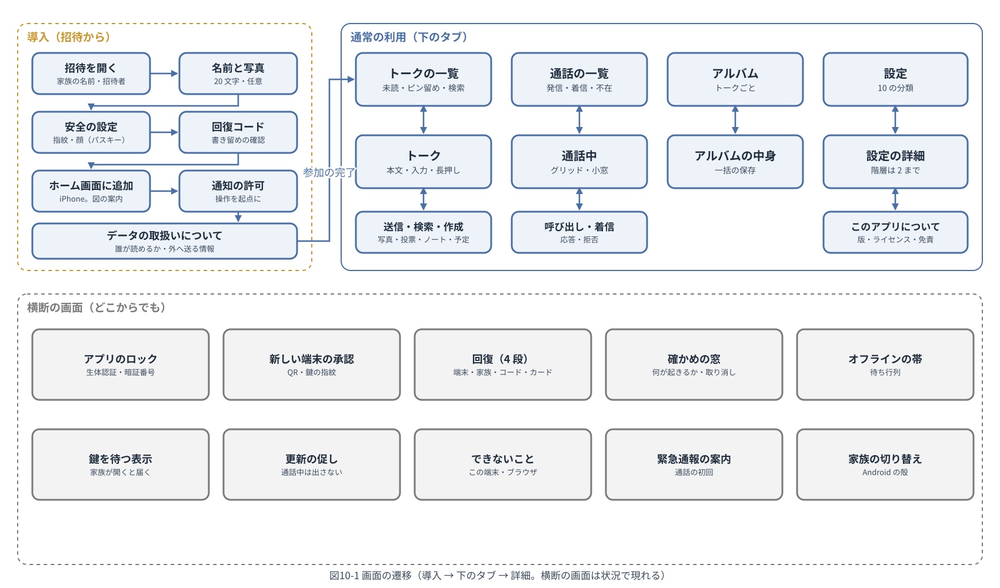
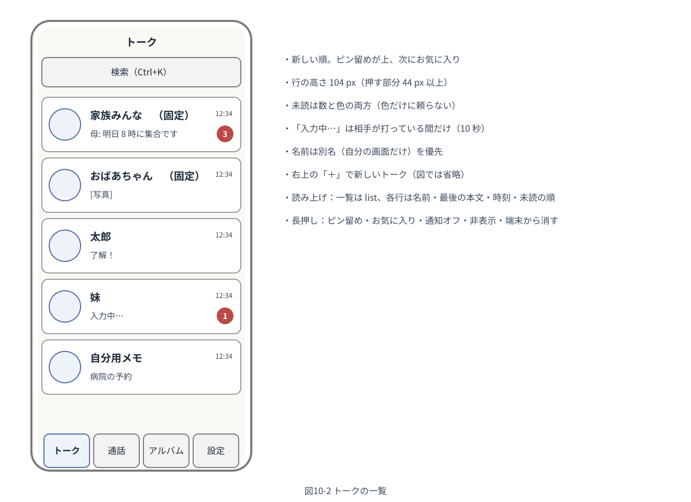
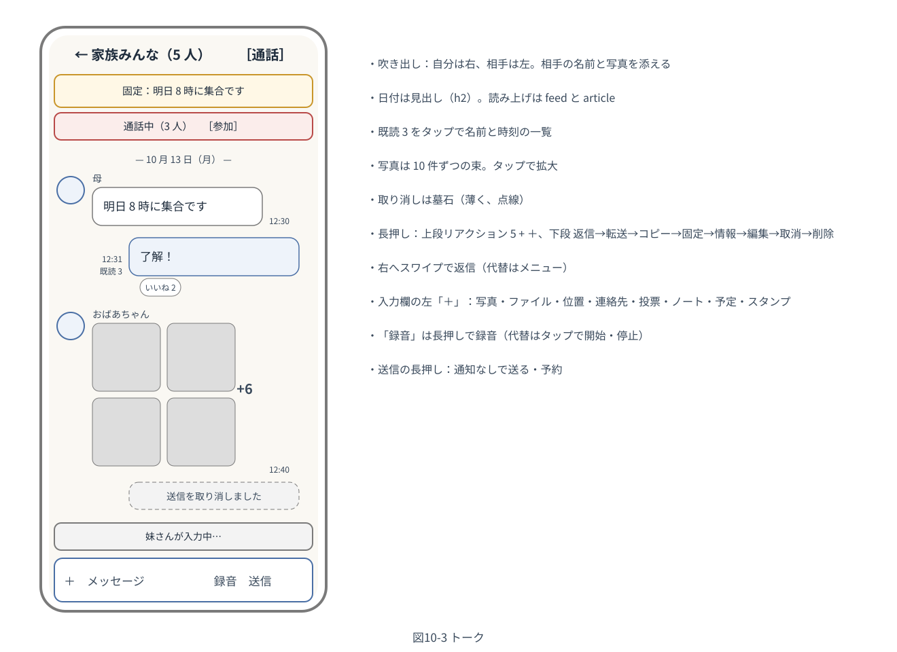
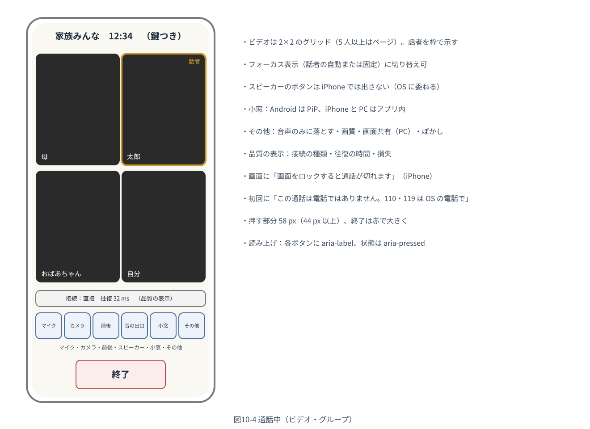
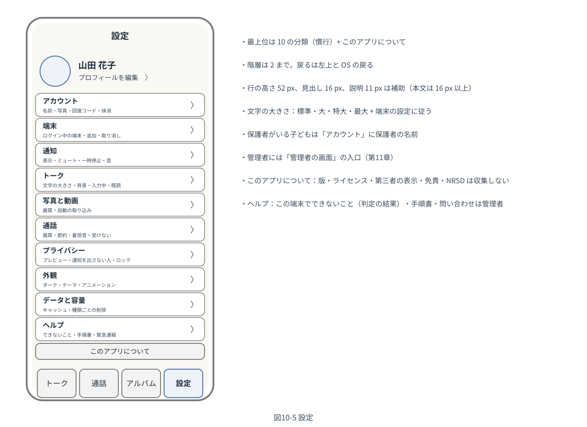

# 基本設計書 第10章 画面とデザイン（構成員向け）

家族専用の通信アプリ　第1版（案）　2026-10-13 · 石川宗  
株式会社流山ソフトウェア開発（NRSD）

© 2026 株式会社流山ソフトウェア開発（NRSD）担当開発者　石川宗　本書の著作権は、株式会社流山ソフトウェア開発（NRSD）に帰属します。本書が参照する第三者の規格、ソフトウェア、法令の解説等の権利は、各権利者に帰属します。

---

## 本書の位置付け

- 概要設計書 第10章「画面とデザイン（構成員向け）」を詳細化する。全章の利用者の操作を画面が受けるため最後に設計した。定めるものは 2.2 の「扱う」に挙げる。
- 画面ごとの詳細（部品の一覧、全文言）は全体実装設計書とブロックのページが持つ。本章は規則と一覧と主要な画面の図（5 枚）を持つ。管理者の画面の機能は第11章 8、見た目の規則は本章が共通に適用される。
- 準拠：
  - 見やすさの規格：WCAG 2.2（AA）、WAI-ARIA 1.2 と APG、JIS X 8341-3
  - 指針：デジタル庁のデザインの指針、OS の提供者の見やすさの指針（ともに調査 I-14）
  - 一般的な通信アプリの画面と操作の慣行（調査資料 準拠の調査 2 の 1・4・6、準拠の調査 3 の 1・4・7・8・9・10）
  - 法務調査 L-1、L-2、L-9、L-10、L-16

## 1. 設計上の決定の一覧

|番号|決定|理由|退けた案|
|---|---|---|---|
|DD-10-1|画面の基本の形は慣行に合わせる：吹き出し（自分は右、相手は左）、下の入力欄、一覧は新しい順、下の 4 つのタブ（トーク、通話、アルバム、設定）。配色・アイコン・絵柄・着信音・名称は本システム自身のもの（3）。特定の製品の外観を模倣しない|設計計画書 D-12-1、D-12-2、D-2-5、R-10-1-1、法務調査 L-9|ハンバーガーのメニュー（高齢者が見つけにくい）。特定の製品の配色の流用|
|DD-10-2|数値の最低要件：本文 16 CSS px 以上（14 px 未満は使わない。補助の文のみ 14）、行間 1.6（最低 1.5）、200% の拡大と幅 320 px のリフロー、押す部分 44×44 CSS px（Android 48 dp）、コントラスト 4.5:1（大きな文字 3:1）と部品 3:1、`prefers-reduced-motion` で自動の動きを止める、色だけに頼らない。文字の大きさは標準／大／特大／最大（100/125/150/200%）+「端末の設定に従う」（既定）|設計計画書 D-12-3、D-12-4、R-10-2-1、調査 I-14、WCAG 2.2 1.4.3/1.4.4/1.4.10/1.4.11/1.4.12/2.5.8、法務調査 L-16|WCAG の 24×24（下限であり採らない）|
|DD-10-3|画面の一覧と遷移は 4（図10-1）。導入は、招待を開く、名前と写真、安全の設定（パスキー）、回復コード、ホーム画面に追加（iPhone）、通知の許可、データの取扱い、の順で完結する。横断の画面（ロック、承認、回復、確認ダイアログ、オフラインのバナー、鍵を待つ、更新、できないこと、緊急通報、家族の切り替え）は状況で現れる|R-10-3-1、第3章 3.3、第8章 3.3、第7章 10|導入を 1 画面に（手順が長く、拒否されやすい）|
|DD-10-4|設定は 10 の分類（アカウント、端末、通知、トーク、写真と動画、通話、プライバシー、外観、データと容量、ヘルプ）+「このアプリについて」。階層は 2 まで。項目は各章の設定を分類に割り当てる（8）|R-10-3-2、準拠の調査 3 の 4|3 階層以上。分類なしの一覧|
|DD-10-5|操作の慣行：長押し（上段にリアクションの直近 5 + 全絵文字、下段は返信、転送、コピー、固定、情報、編集、取消、削除の順）、右へのスワイプで返信とその代替（メニュー）、録音は長押しと代替のタップ、送信の画面に画質の 3 択、写真は 10 件ずつの束。PC は右クリックと「…」で同じメニュー|R-10-4-1、第4章 5.3、第5章 4、準拠の調査 3 の 7・9、WCAG 2.2 2.5.7|独自のジェスチャ|
|DD-10-6|読み上げと構造：メッセージの一覧は `feed` と `article`（送信者、時刻、本文の順）、新着は `log`（polite）、送信の状態は `status`、日付は見出し（h2）、アイコンだけのボタンに `aria-label`、フォーカスを奪わない。PC はキーボードで全操作（Tab、Enter、矢印、Esc）、Enter で送信（設定で Shift+Enter）|R-10-5-1、調査 I-14、WAI-ARIA 1.2|`live` の過剰（読み上げが途切れる）|
|DD-10-7|案内と明示の置き場（7）：初回（追加の案内、通知の許可、読める人の明示、データの取扱い）、設定 > ヘルプ（できないこと、iPhone の制約、緊急通報、手順書、問い合わせは管理者）、設定 > このアプリについて（版、ライセンス、第三者の表示、免責、NRSD は収集しない）、通話の初回（緊急通報）|R-10-6-1、設計計画書 D-12-5、D-13-3、第12章 7、第13章 7、法務調査 L-1、L-2、L-10|手順書だけに置く|
|DD-10-8|文言の規則（9）：です・ます、短い文、技術の語を使わない、番号や識別子を見せない（エラーの番号は小さく添える）、確認ダイアログは「何が起きるか」+ 取り消せるか + 動詞のボタン、エラーは「何が起きたか」「どうすればよいか」の 2 文 + 番号。文言は鍵と日本語の表で持ち、後から言語を加えられる|設計計画書 D-12-6、R-10-7-1、第1章 10.3|文言をコードに埋め込む|
|DD-10-9|家族回復鍵のカードの語表（10）：2048 語。ひらがな 3〜4 文字、濁点・半濁点・拗音・促音を含まない、先頭 2 文字が一意、同音異義と不快な語を避ける、一般名詞。NRSD が作り CC0 で公開。検査語 1 語|第12章 DD-12-5、電話口での聞き取り|英語の語表（高齢者が読めない）。数字だけ（聞き違え）|
|DD-10-10|シェル（Android）の画面（11）は本システムの配色の体系に合わせ、家族の切り替え、初回の案内、WebView の案内を持つ。管理者の画面（第11章）も同じ見た目の規則|第9章、第11章 8|シェルの画面を OS の既定の見た目のまま（統一感を欠く）|

## 2. 目的と範囲

### 2.1 受ける要件

概要設計書 第10章の R-10-1-1〜R-10-7-1。対応は 13。

### 2.2 扱うもの・扱わないもの

- 扱う：
  - 見た目の原則と体系、数値の最低要件
  - 画面の一覧と遷移、主要な画面の図、シェルの画面
  - 操作の慣行、読み上げと構造
  - 案内と明示の置き場、設定の分類と項目
  - 文言の規則とエラーの文言、言語、語表
  - 知らせと確認ダイアログ
- 扱わない：管理者の画面の機能（第11章）、画面ごとの全文言（全体実装設計書）、部品の実装（第14章の React Aria）。

## 3. 見た目（DD-10-1）

### 3.1 配色（トークン）

|トークン|明|暗|用途|
|---|---|---|---|
|`bg`|#FAF8F3（生成り）|#15191F|画面の背景|
|`surface`|#FFFFFF|#1E242C|吹き出し（相手）、カード|
|`primary`|#1F3A5F（紺）|#8FB3E6|自分の吹き出しの縁、ボタン、リンク|
|`primary-bg`|#EEF3FA|#243247|自分の吹き出し、選択|
|`accent`|#C8553D（朱）|#F08A74|未読、終了、取消|
|`text`|#1F2D3D|#E6EAF0|本文（コントラスト 4.5:1 以上）|
|`text-sub`|#3A4A5C|#A8B3C2|補助（4.5:1 以上）|
|`border`|#7A7A7A|#5A6472|境界（3:1 以上）|
|`warn`|#C9962B|#E0B35A|注意のバナー|

- 家族の色（manifest と家族のアイコン）は画面の中の部品に使わない（コントラストの保証のため）。
- 名前の色分けはしない。状態（未読、既読、送信中、失敗）は文字と形で示し色は補助。
- `prefers-contrast: more` と `forced-colors` では境界を太くし背景を単色に。

### 3.2 字と形

|項目|値|
|---|---|
|フォント|`"Hiragino Sans", "Hiragino Kaku Gothic ProN", "Noto Sans CJK JP", "Noto Sans JP", "Yu Gothic", "BIZ UDPGothic", sans-serif`（`system-ui` は使わない。第14章 6.1）。外部からの読み込みなし|
|大きさ|本文 16 px（`1rem`）、見出し 20/24 px、補助 14 px（本文には使わない）。`rem` で組み、`html` の大きさを 4 段 + OS で変える（iOS は `font: -apple-system-body` で OS に追従［要実測］、Android は WebView が OS に追従、PC は 4 段）|
|行間|1.6（本文）、1.4（見出し）|
|折り返し|`word-break: normal` + budoux の文節の折り返し（見出しと短い本文）、`overflow-wrap: anywhere`（URL）|
|角と余白|角 12 px（吹き出し 14 px）、余白は 8 の倍数、画面の端 16 px|
|アイコン|NRSD 自作の線のアイコン（24 px の格子、2 px の線。CC0）。意味は文字で添える（タブ、設定）|
|絵柄と音|スタンプ 32 個（第4章 DD-4-11）、着信音 3 種（第6章 4.3）。NRSD 自作、CC0|
|動き|遷移 200 ms 以下。`prefers-reduced-motion` で遷移とアニメーションのスタンプの自動再生を止める。設定「アニメーションを止める」|
|ダーク|`prefers-color-scheme` に従う。設定で固定（明／暗／端末に従う）。トークの背景（全体とトークごと。同梱の数種と自分の写真）|

## 4. 画面の一覧と遷移（DD-10-3）

図10-1 画面の遷移

|区分|画面|経路|章|
|---|---|---|---|
|導入|招待の受け取り、参加 1（名前と写真）、参加 2（安全の設定）、参加 3（回復コード）、ホーム画面の追加の案内、通知の許可、読める人の明示、データの取扱いについて|`/i/<token>`、`/welcome/*`|第3章 3.3、第8章 3.3、第12章 7|
|初回の管理者|家族の名前、管理者の名前と写真、パスキー、回復コード、カードの印刷、明示、2 人目の管理者の案内|`/setup/admin/<token>`|第3章 3.1|
|認証|ログイン（パスキー）、新しい端末の QR とコード（QR の下に自分の鍵の指紋 20 桁）、承認（既存の端末。種類・名前・場所と鍵の指紋 20 桁、「新しい端末の画面の 20 桁と同じか確かめてください」。署名の前の突き合わせが違えば「鍵が一致しません。端末の追加をやり直してください」。断るボタンは置かず、閉じれば 10 分で期限切れ）、新しい端末の待つ画面の終わり（期限切れは「承認されませんでした」と作り直しのボタン、保護者の不承認は「保護者が承認しませんでした」。第3章 4.4）、回復の 4 段、再設定のリンク、アプリのロック、再認証|`/login`、`/d/<code>`、`/recover/*`、`/auth/reset/<token>`|第3章 4、第12章 5.3|
|トーク|一覧、トーク、長押しのメニュー、既読の名前、情報、検索、一覧（写真・動画／リンク／ファイル／ノート／投票／予定）、送信（写真の選択と 3 択と束、加工、ファイル、位置、連絡先、録音、スタンプ、投票・ノート・予定の作成、予約、転送）、グループの作成と構成員、トークの設定（名前、アイコン、通知、背景）、書き出し|`/`、`/r/<id>`、`/r/<id>/search`、`/r/<id>/media`、`/new`|第4章、第5章|
|通話|呼び出し、着信（前面）、通話中（グリッド／フォーカス）、小窓、品質、終了の記録、通話の一覧|`/calls`、`/call/<id>`|第6章|
|アルバム|トークごとの一覧、中身、作成と追加、一括の保存|`/albums`、`/albums/<id>`|第5章 6|
|設定|10 の分類と詳細、プロフィール、端末、保護者、このアプリについて、ヘルプ、できないこと|`/settings/*`|8|
|スタンプ|作成（写真の選択、切り抜き、文字と落書き、名前、パック）、パックの一覧|`/stickers/*`|第4章 5.9|
|地図|全画面の地図、地点の選択|`/r/<id>/map`|第5章 8.2|
|横断|オフラインのバナー、鍵を待つ、更新の促し、確認ダイアログ、知らせ、緊急通報の案内、家族の切り替え（シェル）|—|12|
|管理者|第11章 8 の画面|`/admin/*`|第11章|

- 戻るの規則：左上の「←」と OS の戻るは同じ（1 つ上へ）。タブは直前のタブに戻らず、タブの切り替えは履歴に積まない。
- 深いリンク：通知のタップは `/r/<id>`、招待は `/i/<token>`、端末の追加は `/d/<code>`（第1章 10.10）。

## 5. 主要な画面

### 5.1 トークの一覧

図10-2 トークの一覧

- 行：写真（48 px）、名前（別名を優先。固定の印）、最後の本文の冒頭（種類は「[写真]」等）、時刻、未読の数（数と色）。行の高さ 104 px（文字の拡大で伸びる）。
- 上：検索（全体）。右上：新しいトーク（＋）。
- 長押し：固定、お気に入り、通知オフ（期間）、非表示、端末から消す。
- 並べ替え（受信時刻／未読／お気に入り）は右上のメニュー。
- 入力中は「入力中…」を最後の本文の位置に。
- 空の時：「家族みんな」のトークだけ。案内「右上の＋で始めましょう」。

### 5.2 トーク

図10-3 トーク

- 上：戻る、名前と人数、通話（音声／ビデオ）。アナウンスのバナー（固定。タップで本文へ。5 件は横に切り替え）。通話中のバナー（グループ。参加）。オフラインのバナー。
- 本文：
  - 日付の見出し、時刻
  - 吹き出し（相手は名前と写真を添える。自分は右）
  - 既読（「既読」／「既読 N」。タップで名前と時刻）
  - リアクション（吹き出しの下。タップで名前）
  - 写真の束（10 件ずつ。+n）、動画（ポスターと再生）
  - ファイル（名前と大きさ）、音声（波形と再生の速度）
  - 位置（小さな地図）、投票（選択肢と票）
  - ノート（題と冒頭）、予定（題、日時、出欠）
  - スタンプ、取り消し（削除済みの印）
  - システムの知らせ（中央の薄い文）、「鍵を待っています」（薄いバナー）
- 下：入力中の表示、入力欄（＋、本文、録音、送信）。＋：写真、ファイル、位置、連絡先、投票、ノート、予定、スタンプ。送信の長押し：通知なし、予約。
- 長押し（DD-10-5）。右へスワイプで返信。
- 新着：下にいる時は自動で追従、上にいる時は「新着 n 件」のボタン。

### 5.3 通話中

図10-4 通話中（ビデオ・グループ）

- 上：トーク名、経過時間、「鍵つき」（端から端の暗号化の印。タップで説明）。
- 映像：2×2 のグリッド（5 人以上はページ）／フォーカス（話者の自動または固定）。音声のみはリスト（名前と話者の印）。
- 下：品質（接続の種類、往復、損失。小さく）、操作（マイク、カメラ、前後、音の出口（iPhone では出さない）、小窓、その他）、終了（赤、大きく）。
- その他：音声のみに落とす、画質、節約、画面共有（PC）、ぼかし、参加者。
- 呼び出し（発信）：相手の名前と写真、「呼び出し中」、取消。着信（前面）：名前と写真、応答（緑ではなく `primary`）、拒否（`accent`）、「音声だけで応答」。
- iPhone：「画面をロックするかアプリを閉じると通話が切れます」のバナー（通話の開始時 5 秒）。
- 初回：緊急通報の案内（7）。

### 5.4 設定

図10-5 設定

- 上：自分の写真と名前、「プロフィールを編集」。
- 10 の分類の行（見出しと説明）。最後に「このアプリについて」。管理者には「管理者の画面」の行（分類の上）。
- 子ども区分：「アカウント」の先頭に「保護者：{name}、{name}」。

## 6. 操作の慣行（DD-10-5）

|操作|iPhone / Android|PC|代替|
|---|---|---|---|
|メッセージのメニュー|長押し|右クリック、「…」|キーボード：Enter でメニュー|
|返信|右へスワイプ|メニュー|メニュー（2.5.7）|
|録音|長押しで録音、上へ固定、左で取消|ボタンのタップで開始／停止|タップで開始／停止|
|写真の選択|＋、写真、選択、3 択、送信の順|同じ（ドラッグ＆ドロップも）|—|
|写真の束|10 件ずつ。タップで拡大、横にスワイプ|同じ。矢印キー|矢印|
|リアクション|長押しの上段|同じ|メニューの「リアクション」|
|既読の名前|「既読 N」をタップ|同じ|Enter|
|一覧の操作|長押し|右クリック|Enter でメニュー|
|通話の応答|着信の画面のボタン／通知|同じ|Enter|
|地図の地点|長押し|クリック|検索の欄（住所。端末の地図のデータから。第2巡）|

- 二重の送信の防止：送信のボタンは押した直後に無効化（送信中の表示）。
- 誤操作の防止：取消・削除・退出・抹消・端末の取り消しは確認ダイアログ（12）。

## 7. 案内と明示の置き場（DD-10-7）

|案内|場所|時|章|
|---|---|---|---|
|ホーム画面への追加（iPhone）|参加の後、standalone でない時は起動のたび|図（OS の版ごとに 2 種）|第8章 3.3|
|通知の許可|standalone で最初のトークを開いた時のボタン|—|第7章 10|
|Android の初回（通知、全画面の着信、電池、通知の方式）|シェルの初回|順に 4 画面|第9章 7|
|読める人の明示|参加の後、設定 > プライバシー|第12章 7.1 の文|第12章|
|データの取扱いについて|参加の後（1 操作で到達）、設定 > プライバシー|第12章 7.2|第12章|
|緊急通報|通話の初回（確認ダイアログ）、設定 > 通話、設定 > ヘルプ|「この通話は電話ではありません。110・119 には OS の電話をお使いください」|第6章 DD-6-10|
|免責|設定 > このアプリについて、参加の後の「データの取扱い」の末尾|第13章 7 の文|第13章|
|できないこと（この端末・ブラウザ）|設定 > ヘルプ|判定の結果の一覧（第8章 4、7）|第8章|
|iPhone の制約|設定 > ヘルプ、通話の開始時のバナー|—|第8章|
|ロックダウンモード（iPhone）|起動時に IndexedDB が無い時（アプリの画面の代わりに 1 画面）|「ロックダウンモードではこのアプリを使えません。Safari の設定で、このサイトをロックダウンモードから除外してから、もう一度開いてください」|第8章 3.4、4、H-8-6|
|家族の外への共有|保存・共有・書き出しの初回|「家族の外に出す時は写っている人の了解を」|第4章 DD-4-15|
|回復コードの重要さ|参加 3、設定 > アカウント|「失くすと記録を取り戻せないことがあります」|第3章|
|紙の確認|年 1 回の知らせ|「回復コードとカードの所在を確かめてください」|第7章 9|
|このアプリについて|設定|版、ライセンス、第三者の表示（一覧とリンク）、免責、「NRSD は利用者の情報を収集しません」、手順書への導線|第13章|
|問い合わせ|設定 > ヘルプ|「この家族のサーバーの管理者：{admin}」。NRSD への不具合の報告は手順書の導線（家族の情報を書かない注意）|第13章|

## 8. 設定の分類と項目（DD-10-4）

|分類|項目|章|
|---|---|---|
|アカウント|表示名、写真、背景、ひとこと、誕生日、回復コード（表示・再発行。再認証）、パスキーの一覧、保護者（子ども）、抹消|第3章 6、4.6、8.3、9|
|端末|ログイン中の端末の一覧（名前、最終の利用、場所、承認、鍵の指紋 20 桁。自分の端末の行は端末の鍵とサーバーの記録が違えば「サーバーの記録と端末の鍵が一致しません」）、端末を追加（QR）、取り消し、他のすべてからログアウト|第3章 5、第12章 5.3|
|通知|内容の表示（3 択）、一時停止、通知を出さない人、音と振動（Android は OS の設定へ）、メンションはミュートでも通知、バッジにミュートを含める、子どもの時間帯（保護者）|第7章 5、6|
|トーク|文字の大きさ（4 段 + 端末）、背景（全体）、入力中を知らせる、Enter で送信（PC。既定 ON。Shift+Enter で改行）、URL のプレビュー、履歴の書き出し|第4章、本章 3.2|
|写真と動画|送る画質の既定（3 択）、自動の取り込みの表（Wi-Fi／モバイル × 種類）、動画の自動再生、スタンプのアニメーションの再生|第5章 5.2|
|通話|画質の 3 択、データの節約、着信音（iPhone と PC）、着信を受けない、緊急通報の案内|第6章|
|プライバシー|読める人の明示、データの取扱いについて、外へ送る情報の一覧、既読を相手に知らせる、アプリのロック（方式、時間切れ）、通知を出さない人、安全番号（相手ごと）|第12章 7、第3章 4.7、第4章 5.4|
|外観|明／暗／端末に従う、テーマ（配色の数種）、アニメーションを止める、文字の大きさ（トークと同じ項目への導線）|本章 3|
|データと容量|端末のキャッシュの使用量（種類ごと、トークごと）、削除（種類ごと、トークごと・期間）、キャッシュの上限、地図のキャッシュ|第5章 5.2|
|ヘルプ|できないこと、iPhone の制約、緊急通報、手順書（構成員向け）、問い合わせ（管理者）、紙の確認|7|
|このアプリについて|版、更新の確認、ライセンス、第三者の表示、免責、収集しない旨|第13章|
|（管理者）管理者の画面|第11章 8 への入口|第11章|

- 構成員ごとの設定は `/me/settings`（`ft.settings.user/1`）、トークごとは `/rooms/{id}/me`。端末だけの設定（ロック、文字の大きさ、キャッシュ、外観）は端末に置く。

## 9. 文言（DD-10-8）

### 9.1 規則

1. です・ます調。1 文は 40 文字まで。二重否定なし。敬語は丁寧語のみ。
2. 技術の語を使わない。「鍵」「暗号化」「セッション」「トークン」「同期」「キャッシュ」「サーバー」は、利用者向けの画面では言い換える。例は「安全のため」「あなたの端末だけが読めます」「ログイン」「家族のサーバー」「端末に保存したコピー」。「家族のサーバー」と「端から端の暗号化」は明示の文でのみ使う。
3. 識別子と番号を見せない。エラーの番号は文の末尾に小さく（管理者への相談の手がかり）。
4. 確認ダイアログ：題（何をするか）、本文（何が起きるか、取り消せるか）、ボタン（動詞。「取り消す」「送る」。「OK」は使わない）、取り消しは左、実行は右（赤は取り返しのつかないものだけ）。
5. エラー：「何が起きたか」「どうすればよいか」の 2 文 + 番号。再試行できるものは「もう一度」のボタン。
6. 空の状態：次にすることを 1 文で。
7. 時刻：今日は「12:34」、昨日は「昨日 12:34」、今年は「10月13日」、それ以前は「2025年10月13日」。`Intl.DateTimeFormat`（ja-JP）。
8. 数：全角にしない。数と単位の間に半角の空白を 1 つ置く（「3件」ではなく「3 件」）。

### 9.2 エラーの文言（第2章 9.2 のエラーコード表の全部の番号）

- 規則は 9.1 の 5。1 文目は何が起きたか、2 文目はどうすればよいか（W3C の WCAG 2.2 の 3.3.1「誤りの特定」と 3.3.3「誤りの直し方の提案」）。「（自動）」はアプリが自分で直す時の印であり、利用者の操作は要らない。
- 埋め込みは 9.3 の形（`{name}` は相手の表示名、`{admin}` は管理者の表示名）。
- この表が文言の正本である。文言の表 web/src/ui/i18n/errors.json（鍵は `err.<番号>`。エラーコード表の `user_text_key`）は、道具 `tools/gen_texts` がこの表から作る。値は 1 文目（what）と 2 文目（next）の組。画面の文言の表（9.3）とは別のファイルにし、手で書く表と生成する表を分ける。

|番号|1 文目|2 文目|
|---|---|---|
|AUTH-001|ログインしていません。|ログインしてください。|
|AUTH-002|ログインの期限が切れました。|指紋（顔）でログインし直してください。|
|AUTH-003|確認できませんでした。|もう一度、指紋（顔）で確かめてください。|
|AUTH-004|ログインを続けて間違えました。|しばらく待ってから、もう一度お試しください。|
|AUTH-005|まだ確認されていません。|もう一方の端末で「許可」を押してください。|
|AUTH-006|本人の確認が必要です。|指紋（顔）で確かめてください。|
|AUTH-007|この招待は使えません。|招待した人に新しい招待をもらってください。|
|AUTH-008|最後のログインの方法は消せません。|別の方法を足してから消してください。|
|MEM-001|この人は見つかりません。|家族の一覧を開き直してください。|
|MEM-002|この人は今、使えない状態です。|管理者（{admin}）に確かめてください。|
|MEM-003|最後の管理者は外せません。|ほかの人を管理者にしてから外してください。|
|MEM-004|招待の回数が上限です。|使っていない招待を取り消してください。|
|MEM-005|名前の長さや文字が合っていません。|名前を短くするか、文字を変えてください。|
|MEM-006|保護者の許可が必要です。|保護者に許可を頼んでください。|
|MEM-007|この操作は保護者が行います。|保護者に頼んでください。|
|MEM-008|記録についての説明が新しくなりました。|もう一度読んで「確認した」を押してください。|
|MEM-009|そのカードは{name}さんが持っていることになっています。|管理者に確かめてください。|
|MEM-010|カードは大人（18 歳以上）が持ちます。|大人に渡してください。|
|MEM-011|あなたは別のカードをすでに持っています。|まだカードを持っていない大人に渡してください。|
|MEM-012|誕生日では 18 歳以上なので、子どもの設定は付けられません。|誕生日を確かめてください。|
|KEY-001|この端末は見つかりません。|端末の一覧を開き直してください。|
|KEY-002|この端末はもう確認済みです。|そのまま使えます。|
|KEY-003|この端末では承認できませんでした。|確認済みの端末で行うか、端末の追加をやり直してください。|
|KEY-004|この端末はまだ家族の確認を受けていません。|ほかの端末か家族に確認してもらってください。|
|KEY-005|元に戻すための情報がありません。|別の方法で戻してください。|
|KEY-006|新しい会話の準備が残り少なくなっています。|相手の端末を開いてもらうと戻ります。|
|KEY-007|ほかの人の変更と重なりました。|もう一度行います。（自動）|
|KEY-008|今日はもう試せません。|明日、もう一度お試しください。|
|KEY-009|読み取った内容が合っていません。|もう一度、読み取ってください。|
|KEY-010|相手の端末に届けられる量の上限です。|相手が端末を開くまで、お待ちください。|
|KEY-011|この端末の鍵の情報が古くなっています。|ほかの端末から新しい鍵が届くまで、お待ちください。|
|KEY-012|回復コードが合っていません。|紙の文字を確かめて、もう一度入力してください。|
|KEY-013|このトークの準備をやり直せませんでした。|アプリを更新してから、もう一度お試しください。|
|ROOM-001|このトークは見つかりません。|トークの一覧を開き直してください。|
|ROOM-002|このトークに参加していません。|トークの一覧を開き直してください。|
|ROOM-003|この操作はできません。|トークを作った人か管理者に頼んでください。|
|ROOM-004|この人とのトークはもうあります。|そのトークを開きます。（自動）|
|ROOM-005|この内容は送れません。|長い文は分けて送ってください。|
|ROOM-006|送れませんでした。|もう一度送ります。（自動）|
|ROOM-007|このメッセージは見つかりません。|トークを開き直してください。|
|ROOM-008|このメッセージは取り消されました。|ほかのメッセージは読めます。|
|ROOM-009|変更できる時間を過ぎました。|新しいメッセージを送ってください。|
|ROOM-010|この日時には予約できません。|30 日以内の先の日時を選んでください。|
|ROOM-011|家族全員のトークは抜けられません。|通知を切ることはできます。|
|ROOM-012|別のトークのメッセージには返せません。|同じトークのメッセージを選んでください。|
|MEDIA-001|この写真は大きすぎます。|画質を「標準」にして送ってください。|
|MEDIA-002|送る準備の期限が切れました。|もう一度選んで送ってください。|
|MEDIA-003|送る途中で止まりました。|続きから送ります。（自動）|
|MEDIA-004|写真が壊れていました。|もう一度選んでください。|
|MEDIA-005|この写真は見られません。|トークに参加している人だけが見られます。|
|MEDIA-006|この写真が家族のサーバーにありません。|管理者（{admin}）に知らせてください。|
|MEDIA-010|このリンクの内容は表示できません。|リンクだけを送ります。|
|CALL-001|この通話は終わりました。|かけ直してください。|
|CALL-002|もう通話に参加しています。|そのまま話せます。|
|CALL-003|{name}さんは通話中です。|あとでかけ直してください。|
|CALL-004|通話をつなげませんでした。|少し待ってから、もう一度かけてください。|
|CALL-005|{name}さんは着信を受け付けていません。|メッセージを送れます。|
|CALL-006|通話の人数がいっぱいです。|音声だけで参加できます。|
|PUSH-001|通知を設定できませんでした。|もう一度、通知を許可してください。|
|PUSH-002|通知が届かなくなっていました。|通知を設定し直します。（自動）|
|PUSH-003|この端末への通知がたまっています。|アプリを開くと受け取れます。|
|ADM-001|管理者だけができる操作です。|管理者（{admin}）に頼んでください。|
|ADM-002|この設定はここでは変えられません。|設置の時の設定で変えてください。|
|ADM-003|ほかの作業の途中です。|終わってから、もう一度お試しください。|
|ADM-004|この値は使えません。|表示された範囲の値にしてください。|
|SRV-001|今は読むことだけできます。|しばらく待つか、管理者に知らせてください。|
|SRV-002|家族のサーバーの容量がいっぱいです。|管理者（{admin}）に知らせてください。送ったものは届くまで端末に残ります。|
|SRV-003|思わぬ問題が起きました。|もう一度お試しください。続くときは管理者へ。|
|SRV-004|家族のサーバーの一部が止まっています。|少し待ってから、もう一度お試しください。|
|NET-001|送った内容に誤りがありました。|アプリを更新してから、もう一度お試しください。|
|NET-002|この形式では送れません。|アプリを更新してから、もう一度お試しください。|
|NET-003|この画面からは操作できません。|アプリを開き直してください。|
|NET-004|操作が多すぎます。|少し待ってから、もう一度お試しください。|
|NET-005|しばらく開いていなかったので、最新の状態を取り直します。|そのままお待ちください。|
|NET-006|アプリを更新してください。|新しい版が必要です。|
|NET-007|送り直しの印がありませんでした。|アプリを更新してから、もう一度お試しください。|
|NET-008|同じ操作を別の内容で送りました。|画面を開き直してください。|
|NET-009|一度に送るには大きすぎます。|分けて送ってください。|
|SHELL-001|アプリの中で問題が起きました。|アプリを更新してください。|
|SHELL-002|知らないページからの操作を止めました。|そのまま使えます。|
|SHELL-003|この端末の表示の部品が古いです。|端末の更新で「Android System WebView」を更新してください。|
|SHELL-004|この端末の保存した情報が読めません。|家族に頼んで、新しい端末として確認してもらってください。|
|SHELL-005|更新のファイルが正しくありません。|管理者（{admin}）に知らせてください。|

### 9.3 言語

- 文言は鍵（例：`talk.input.placeholder`）と日本語の表（JSON。web/src/ui/i18n/ja.json）で持つ。埋め込みは `{name}`。読める人の明示と外へ送る情報の表（第12章 7.1、8）は表に持たず、サーバーが返す文を示す（第12章 7.1）。日本語に複数形はないため ICU の形式は使わず、後から言語を加える時に必要なら MessageFormat 2 の部品を加える（第14章）。
- 日時と数は `Intl`。右書きは想定しない。
- シェル（Android）の文言も同じ鍵の表（Kotlin の資源に生成）。

### 9.4 知らせの文言（第7章 9 の表の全部の識別子）

- 規則は 9.1。1 文目は何が起きたか、2 文目は次にすること（無ければ空）。知らせの一覧（設定 > 知らせ）、バナー（warning と error。12）、通知（title は家族の名前、body は 1 文目。第7章 5.1）で同じ文を使う。
- 埋め込みは `notice` の `params` の欄の名（第7章 9）。`{name}`、`{child_name}`、`{from_name}`、`{by_name}` は表示名。`{device_name}` は端末の名前。`{erase_at}`、`{expires_at}`、`{since}` は日時で、端末が 9.1 の 7 の形にする。`{guardian_names}`、`{missing}`、`{cards}` は配列で、端末が「、」で結ぶ。
- この表が文言の正本である。文言の表 web/src/ui/i18n/notices.json（鍵は `notice.<識別子>`。`notice` の `text_key`）は、道具 `tools/gen_texts` がこの表から作る。値は 1 文目（what）と 2 文目（next）の組で、第7章 9 の識別子と 1 対 1 でなければ誤り。

|識別子|1 文目|2 文目|
|---|---|---|
|disk_usage|保存できる量の {percent}% を使っています。|不要な写真や動画を消すか、管理者に相談してください。|
|cert_expiry|安全な接続の証明書が {days} 日後に切れます。|管理者の画面で証明書の状態を確かめてください。|
|cert_expired|安全な接続の証明書が切れました。|管理者の画面で証明書を確かめてください。|
|backup_failed|バックアップに失敗しました。|管理者の画面のバックアップで原因を確かめてください。|
|update_available|新しい版 {version} があります。|管理者の画面の更新から適用できます。|
|update_apply_failed|更新を適用できず、前の版で動いています。|管理者の画面の更新で記録を確かめてください。|
|update_failed|{name}さんの端末でアプリの更新に失敗しました。|手順書の入れ直しの手順を案内してください。|
|recovery_used|{name}さんが回復の手順で記録を開きました。|心当たりがなければ、端末の一覧を確かめてください。|
|family_key_used|家族回復鍵のカードが{name}さんの端末で使われました。|心当たりがなければ、管理者に知らせてください。|
|recovery_requested|{name}さんが新しい端末（{device_name}）で、記録を戻すための承認を求めています。|心当たりがあれば、知らせを開いて承認してください。|
|mls_reinit|{name}さんの端末（{device_name}）が、トークの暗号の準備を作り直しました。|続くときは、その端末のアプリの更新を案内してください。|
|mls_reinit_limit|{name}さんの端末（{device_name}）は、トークの暗号の準備を作り直せなくなりました。|その端末のアプリを更新するよう案内してください。|
|paper_check|回復コードとカードの所在を確かめる時期です。|紙がどこにあるか確かめてください。|
|card_distribution|家族回復鍵のカード {missing} 枚目がまだ配られていません。|別の大人に渡し、受け取った人に記録してもらってください。|
|card_holder_changed|カード {cards} 枚目を持つ{name}さんが使えない状態になりました。|家族の画面でカードを作り直してください。|
|maps_update|地図を更新する時期です。|管理者の画面の地図から更新してください。|
|kek_rotation_due|記録を守る鍵を取り替える時期です。|手順書の「鍵の交代」を行ってください。|
|network_mode_changed|回線の状態が変わりました。|管理者の画面で接続の形を確かめてください。|
|ddns_failed|家族のサーバーの住所の更新に失敗しています。|回線と設定を確かめてください。|
|clock_skew|家族のサーバーの時計が {seconds} 秒ずれています。|機械の時刻合わせを確かめてください。|
|disk_smart|記録を置くディスクに警告が出ています。|バックアップを確かめ、ディスクの交換を考えてください。|
|child_relaxed_16|{name}さんが 16 歳になり、時間帯とリンクの確認が外れました。|端末の追加の承認と招待の設定は残ります。|
|child_released_18|{name}さんが 18 歳になり、子どもの設定が外れました。||
|child_flag_set|{name}さんに子どもの設定が付きました。|保護者は設定の子どもで内容を確かめてください。|
|child_flag_cleared|{name}さんの子どもの設定が外れました。||
|child_flag_suggested|{name}さんの誕生日では 18 歳未満です。|構成員の画面で子どもの設定と保護者を決めてください。|
|age_ask|{child_name}さんはまだ 18 歳未満ですか。|誕生日を入れるか、管理者に設定の解除を頼んでください。|
|new_device|{device_name}で{name}さんとしてログインしました。|心当たりがなければ、端末の一覧から取り消してください。|
|transfer_requested|{from_name}さんがあなたに管理者を引き継ごうとしています。|設定のアカウントから承認か拒否を選んでください。|
|erase_approval_requested|{child_name}さんがアカウントの抹消を求めています。|保護者として承認するか断ってください。|
|device_approval_requested|{child_name}さんが{device_name}を追加しようとしています。|10 分以内に承認するか断ってください。|
|erase_approval_expired|{child_name}さんの抹消の求めは期限が切れ、取り消されました。|必要なら、もう一度求めてください。|
|guardian_settings_changed|{by_name}さんが{child_name}さんの子どもの設定を変えました。|設定の子どもで内容を確かめてください。|
|guardians_changed|{child_name}さんの保護者が変わりました。|保護者は {guardian_names} です。|
|erase_requested|アカウントの抹消を受け付けました。{erase_at} に実行します。|取りやめるなら、それまでに設定のアカウントから取り消してください。|
|erase_cancelled|アカウントの抹消を取り消しました。|そのまま使えます。|

## 10. 語表（DD-10-9）

|項目|値|
|---|---|
|語数|2048（11 ビット）|
|形|ひらがな 3〜4 文字。濁点・半濁点・拗音（ゃゅょ）・促音（っ）・長音（ー）を含まない。「ん」で始まらない|
|一意|先頭 2 文字で一意（2 文字入力で候補が 1 つ）|
|意味|日本語の一般名詞（動物、植物、食べ物、道具、色、地形、天気、体、家）。同音異義、不快・宗教・政治・人名・地名・商標を避ける|
|符号化|家族回復鍵（256 ビット）の 2-of-3 の片（各 256 ビット + 片の番号 2 ビット + しきい値 2 ビット）を 11 ビットずつ 24 語 + 検査語 1 語（25 語）。カードには 5 語ずつ 5 行|
|検査|片の全ビットの検査和（11 ビット）を検査語に。入力の時に誤りの行を示す|
|公開|NRSD が作り CC0 で公開（docs/jp/design/語表.md と api/schemas/wordlist.json）。第2巡で作成|
|入力|入力の欄に候補（先頭 2 文字で絞る）。読み上げ対応|

## 11. シェルの画面（DD-10-10）

|画面|中身|
|---|---|
|家族の切り替え（Android）|上部の家族の名前を押すと一覧（名前、未読の合計）が開き、選んで切り替える。「家族を追加」（URL または招待のリンク）|
|初回の案内（Android）|通知の許可、全画面の着信、電池の最適化、通知の方式（自動の結果と切り替え）の順。各 1 画面、図と 1 文|
|WebView の案内（Android）|138 未満：「システムの部品（WebView）を更新してください」+ OS の更新の経路。なし：「この端末では使えません」|
|更新（Android）|「新しい版があります」の通知と設定の「自動で更新」|
|着信（Android）|OS の全画面の着信（名前、写真、応答、拒否）。本システムの配色|
|管理者の画面|第11章 8。本章の見た目の規則（配色、文字、押す部分）を適用。PC での利用を主に想定し、表は横にスクロールせず折り返す|

## 12. 知らせと確認ダイアログ

|種類|例|形|
|---|---|---|
|確認ダイアログ（取り返しがつく）|端末から消す、退出、通知オフ|題 + 本文 + 取り消す／実行|
|確認ダイアログ（取り返しがつかない。赤）|送信の取消、削除（管理者）、抹消、端末の取り消し、カードの作り直し|題 + 本文（失うもの）+ 再認証（必要なら）+ 取り消す／実行（赤）|
|バナー（画面の上）|オフライン、通話中、アナウンス、鍵を待つ、更新、iPhone の制約、サーバーに接続中|1 行。タップで詳細|
|知らせ（システム）|容量、証明書、バックアップ、更新、管理者の操作、紙の確認、誕生日、16/18 歳|家族全員のトークの中央の文、または通知|
|一時の表示（toast）|送信しました、保存しました、コピーしました|2 秒。`status` で読み上げ。フォーカスを奪わない|
|空の状態|トークがない、検索の結果なし、アルバムなし|1 文 + 次の操作|
|読み込み|履歴の同期、索引の作成、変換、アップロード|進み具合（%）と残り。中断できるものは「中断」|

## 13. 要件との対応

|要件|対応|
|---|---|
|R-10-1-1 基本の形は慣行、配色・アイコン・名称は自分のもの（商標の検索）、ダークとテーマ|3、DD-10-1（名称は第13章 DD-13-10）|
|R-10-2-1 16 px、行間 1.5、200% と 320 px、44×44、4.5:1 と 3:1、reduced-motion、4 段 + 端末|3.2、DD-10-2|
|R-10-3-1 全画面の一覧と遷移、導入の順|4、図10-1、DD-10-3|
|R-10-3-2 設定の 10 分類と慣行の粒度|8、DD-10-4|
|R-10-4-1 長押し、スワイプと代替、録音、3 択、束|6、DD-10-5|
|R-10-5-1 feed/article、log/status、フォーカス、見出し、aria-label|DD-10-6、5.2|
|R-10-6-1 初回の案内、iPhone の制約、緊急通報、読める人、外へ送る情報、免責、このアプリについて|7、DD-10-7|
|R-10-7-1 日本語のみ、後から言語を加えられる|9.3、DD-10-8|

## 14. 失敗の扱い

|失敗|扱い|
|---|---|
|文字を 200% にして部品が重なる|レイアウトは縦に積む（flex-wrap）。横スクロールを出さない。試験（320 px × 200%）|
|フォントがない端末（Windows の古い版）|スタックの末尾 `sans-serif`。見た目の差は許容|
|reduced-motion なのに動画の自動再生|設定の既定を「再生しない」に連動|
|読み上げで新着が途切れる|`log` は polite。連続の新着は「新着 n 件」にまとめる|
|色覚の多様性|未読は数、既読は文字、話者は枠の太さと文字、状態は形|
|長い名前・本文|名前は 20 文字で切り、本文は折り返し。URL は `anywhere`|
|シェルと WebView の見た目の不一致|シェルの配色のトークンを同じ値に|

## 15. 本章で宣言する既知の制約

|番号|既知の制約|理由|緩和|
|---|---|---|---|
|H-10-1|iOS の文字の大きさの追従（`-apple-system-body`）は standalone で未確認|［要実測］|アプリ内の 4 段|
|H-10-2|WebView の文字の拡大が非線形（Android 14 以上）の時の 200% の挙動は未確認|［要実測］|試験|
|H-10-3|語表の作成は第2巡（本章は規則だけ）|作業量|規則を固定し作成を試験の前に|
|H-10-4|アイコン・絵柄・着信音の自作は実装の段で行い、本章は数と規則だけ|同上|CC0 で公開|
|H-10-5|名称が決まるまで仮の名前で画面を作る|第13章 DD-13-10【要確認】|置き換えは文言の表の 1 項目|

［要実測］の事項は次のとおり。

- 文字の大きさ：`-apple-system-body` の standalone、非線形の拡大
- 読み上げ：VoiceOver と TalkBack の feed の読み上げ
- 操作：高齢者の参加の所要（試験設計書）、React Aria の target-size の設定

## 16. 章の依存

- 本章が与える：画面の一覧と規則（全体実装設計書、試験設計書）、文言の表の形（第14章）、語表の規則（第12章）。
- 本章が受ける：全章。

## 17. 他の章・概要設計書への訂正

- 第12章 5.4、DD-12-5：家族回復鍵のカードの語は 20 語ではなく 25 語（24 語 + 検査語）。
- 第13章 7：免責の文の置き場に「データの取扱いの末尾」を加える。
- 第3章 3.3：参加の画面の番号（1〜3）と本章 4 の名前を揃える（変更なし）。
- 第14章 6.1：アイコンと絵柄と着信音は NRSD 自作（CC0）を配布物に。budoux の用途（見出しと短い本文）。
- 第2章 9.2：`user_text_key` をエラーコード表の欄に加える。

改版の記録は次のとおり。

- 2026-10-15 の訂正（鍵の部品の内側の設計の骨の直し。iPhone の前提の資料での確かめ）：9.2 に `KEY-012`（回復コードが合わない）と `KEY-013`（グループの再初期化を許さない）の文言を足した（第2章 9.2、第12章 5.2・5.4）。9.4 に `mls_reinit`、`mls_reinit_limit`（第7章 9）を足した。7 にロックダウンモードの案内の行を足した（第8章 H-8-6）。
- 2026-10-15 の訂正（鍵の部品の外側の設計の骨の直し）：9.2 に `KEY-011`（鍵バンドルの版が古い）の文言を足した（第2章 9.2）。9.4 に `recovery_requested`（家族に頼む時の知らせ）の文言を足した（第7章 9）。
- 2026-10-15 の訂正（鍵の部品の外側の検査）：9.2 の `KEY-003` の文言を改めた。未承認の端末からの承認と、本人の署名鍵で通らない承認（自己承認を含む）の両方で読める文である。第2章 9.2 の意味を広げたため。
- 2026-10-15 の訂正（QR の端末の追加を断る経路の検査）：2 の認証の行に 2 つを足した（第3章 4.4）。承認の画面に断るボタンを置かないことと、新しい端末の待つ画面の終わりの文言（期限切れ、保護者の不承認）の 2 つ。
- 2026-10-14 の訂正（構成員と端末の部品の実装の検査 3。知らせと子ども区分）：9.4 を足した（第7章 9 の全部の識別子の文言。知らせの文言がどこにも無かった）。9.2 に `MEM-012` を足し、`MEM-010` の年齢を 18 歳に正した（子ども区分は 18 歳未満。第3章 9.1）。
- 2026-10-14 の訂正（構成員と端末の部品の内側の設計 2。鍵の指紋）：2 の認証と端末の行に 4 つを足した（第3章 4.4、5.2、第12章 5.3）。新しい端末の QR の画面の指紋、承認の画面の指紋と見比べの文言、突き合わせの失敗の文言、一覧の指紋と自分の端末の警告の 4 つ。
- 2026-10-14 の訂正（構成員と端末の部品の実装の検査 2。カードの持ち主）：9.2 に `MEM-010` と `MEM-011` の文言を足した（第12章 5.4 の受け取りの記録の規則）。
- 2026-10-14 の訂正（設計の芯の監査 A-5。カードの持ち主）：9.2 に `MEM-009` の文言を足した。
- 2026-10-14 の訂正（構成員と端末の部品の設計の検査）：9.2 の文言の表の置き場を、画面の部品の下（web/src/ui/i18n/）に改めた。全体実装設計書の置き場と食い違っていた。明示の版が古い時の `MEM-008` の文言を足した。9.3 に、明示の文はサーバーが返すことを書いた。
- 2026-10-14 の訂正（エラーの文言の表を作る時の検査）：9.2 を例の 12 件から、エラーコード表の 75 件の全部の文言にした。文言の表（web/src/i18n/ja/errors.json）はこの表から道具で作る。
- 2026-10-14 の訂正（文書の検査の規則に合わせる）：矢印を言葉に改め、長い文と列挙を分けた。9.1 の 8 の数と単位の規則を、意味が逆に読めない文へ直した。10 の符号化の行から、第12章が既に第10章 10 を参照している古い注記を外した。
- 2026-10-14 の訂正（画面の文言の埋め込みの書き方）：名前が入る所の白丸 2 つの記号を、第10章 9.3 の埋め込みの形に改めた（意味を明示しない記号を使わない）。形は `{name}`、`{admin}`、`{device}`、`{provider}`。
- 2026-10-14 の訂正（境界の正本 api/ を作る時の検査）：8 のプライバシーに「既読を相手に知らせる」を足した（第2章 5.3、第4章）。8 の「Enter で送信」の既定を ON と定めた（既定が無かった）。
- 2026-10-13 第1版（案）。
