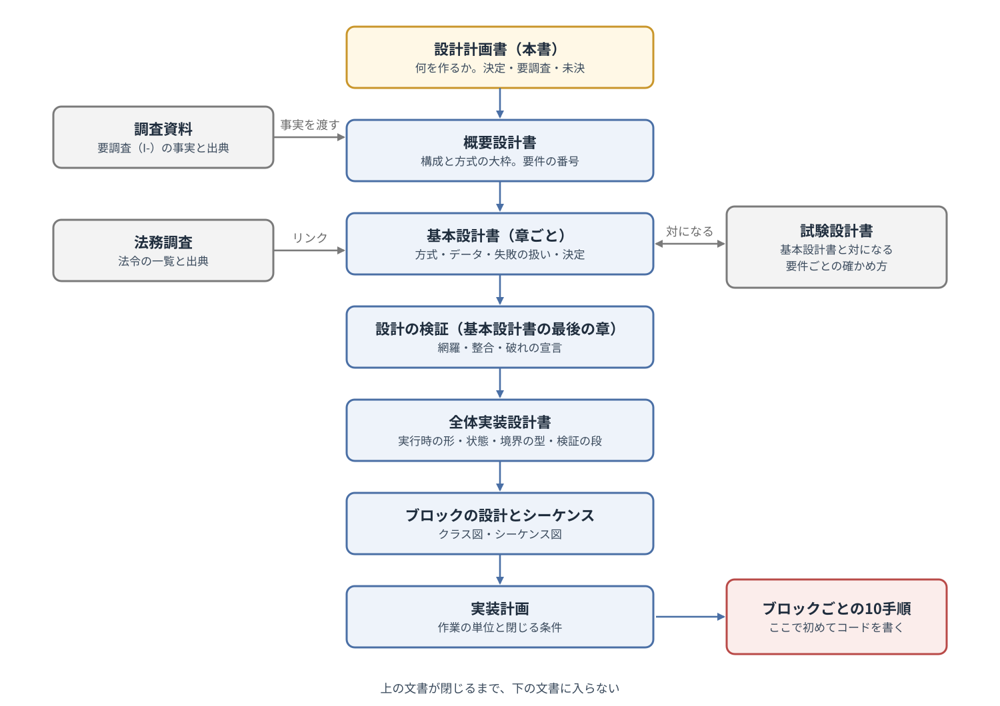
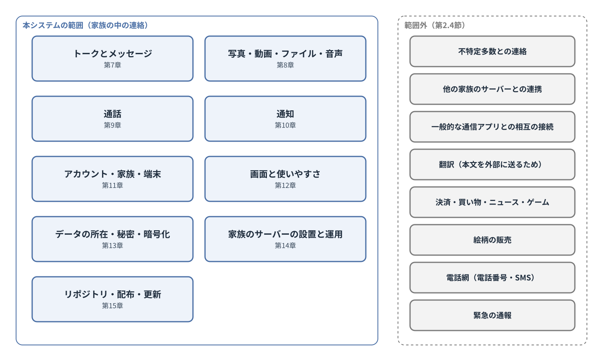
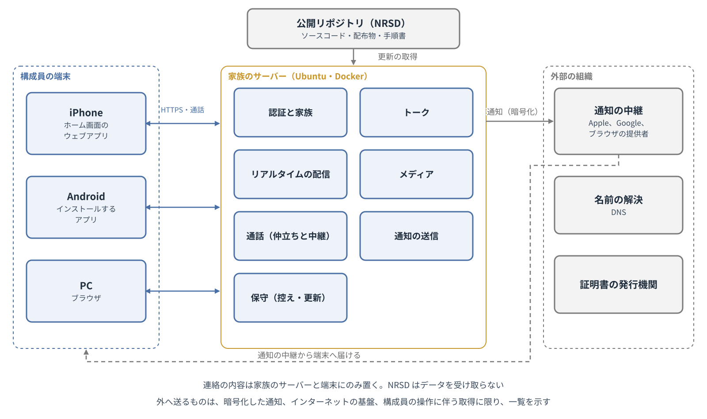
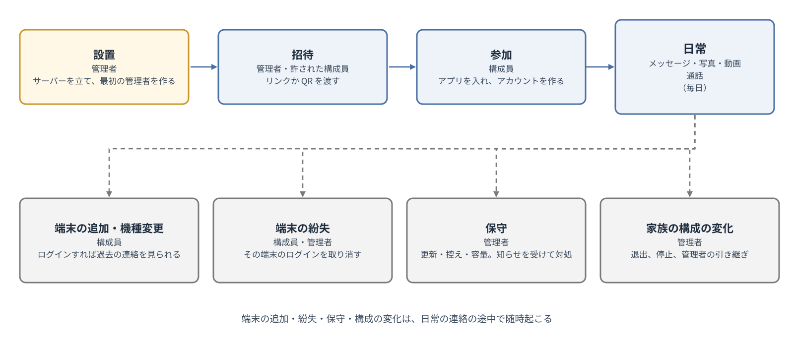

# 家族専用の通信アプリ 設計計画書

第4版（案）　2026-10-13 · 石川宗  
株式会社流山ソフトウェア開発（NRSD）

© 2026 株式会社流山ソフトウェア開発（NRSD）担当開発者　石川宗　本設計計画書と、これに基づいて開発するソフトウェアの著作権は、株式会社流山ソフトウェア開発（NRSD）に帰属します。ただし、本設計計画書において採用を検討する第三者の規格、プロトコルおよびソフトウェアの権利は、各権利者に帰属します（第19章参照）。

---

## 改訂履歴

|版|日付|内容|作成|
|---|---|---|---|
|第1版（案）|2026-10-13|NRSD の指示（2026-10-13）を起案として新規作成|石川宗|
|第2版（案）|2026-10-13|NRSD の追加の指示（他の標準的なアプリケーションの仕様と設計に準拠すること、準拠した元の名称を記さないこと）を受けた（第1.3節、第1.5節、第18章）。調査資料 第1版（I-01〜I-10、I-12〜I-15）の結果を反映した：地図の取得を家族のサーバーの中で閉じる（第2.2節、第7.2節、第13.4節、D-2-3）、Android のアプリの形を定めた（第5.2節、D-5-7、O-03 を解消）、通話の基盤を定めた（第9.5節、D-9-5、I-07 を解消）、Android の通知の経路の方向を定めた（第10.2節、D-10-2）、ストアを通さない配布の口座の登録を要確認とした（第15.3節、D-15-6）、証明書・家庭の回線・機械の目安・写真と動画の変換・見やすさの数値を各章に反映した（第5.4節、第8.2節、第12.2節、第14.1節、第14.2節）、部品の候補を加えた（第6.2節、第19章、第20章）|石川宗|
|第3版（案）|2026-10-13|法務調査 第1版（L-1〜L-17）の「設計への要求」を反映した：管理者の画面に他人の記録を読む機能を置かず、読める人の明示の中身を定めた（第13.3節、D-13-6）、外へ送る情報の一覧の欄を定めた（第13.4節）、NRSD は家族のサーバーに接続する手段を持たないとした（D-3-7）、スタンプの素材の写真の扱い（第7.3節）、認証なしの公開 URL を設けない（第2.4節、D-2-7）、ライセンスの表示・免責の文・security.txt（第15.1節、D-15-7）、動画の変換の部品の配布の構成（第19章）、子どもの利用の指針（第11.6節）|石川宗|
|第4版（案）|2026-10-13|基本設計 第1〜16 章の第1版（案）の第2巡（基本設計 第16章 7）を反映した：開発基盤を固定（第6章、D-6-1、O-02）、端から端の暗号化を採用（第13.3節、O-01）、写真と動画の変換を送る端末に移した（第8.2節、D-8-2）、Android の署名は v2 と v3（第15.3節、D-15-4）、Android の画面の共有は第1版で提供しない（D-9-4）、回線の 4 形（第14.2節）、開発者の確認の制度の限定配布（第15.3節）、未決事項 O-01〜O-11 の解消（第17章）、部品の採否（第6.2節、第19章）|石川宗|
|第4版（案）の訂正|2026-10-14|第1.6節の「イベント」の定義を、サーバーから端末へ届く変化の 1 件とし、トークに記録されるものを「トークのイベント」と呼ぶことにした。第13.3節の表の途中にあった段落を表の後ろへ移した（最後の行が表として表示されていなかった）|石川宗|
|第4版（案）の訂正（2）|2026-10-14|第6.2節、第19章、第20章から、採らないと決めた候補の部品の名前を外し、一般名に改めた（本書 第1.5節の名称の扱いに合わせた）。第19章の表から採らない候補の 8 行を外し、参考文献の 8 件を欠番にした|石川宗|
|第4版（案）の訂正（3）|2026-10-14|第8.2節の本文を D-8-2（写真と動画の変換は送る端末が行う）に合わせた（第4版で表だけを改め、本文が家族のサーバーでの変換のままだった）。第5.4節の推奨の機械から動画の変換の能力を外した。「バックアップ（バックアップ）」の重複を直した（第13.1節の表、第14.3節）。文書の検査の規則（基本設計 第14章 14 の 11）に合わせて長い文を分けた（決定の中身は変えない）|石川宗|

## 第1章　本書の位置付け

### 1.1　本書の目的

本書は、家族専用の通信アプリ（以下「本システム」といいます）について、設計書を書く前に、何があれば本システムを作れるかを定義するものです。

本書は、次の事項を項目ごとに並べて確定させます。利用者は誰か。利用者はどのように、いつ本システムを使うのか。どのプラットフォームで動作させるのか。何を開発基盤とするのか。公開、配布および運用をどのように管理するのか。

本書は、実現方法を定めるものではありません。実現方法は設計書に譲るものとし、本書は、設計書が前提とすべき事項、および設計書の段階で精細に調査すべき事項を明らかにするものとします。

### 1.2　文書体系

本システムの文書は、次の順序で編成します。上の文書が閉じるまで、下の文書には入りません。本書と各文書の関係を図1に示します。

図1　文書体系

|文書|役割|
|---|---|
|設計計画書（本書）|何を作るかを確定する。決定、要調査および未決を定める|
|調査資料|本書の要調査事項（第16章）を一次資料により調べ、事実と出典、および設計への帰結を記す|
|法務調査|本システムに関係する法令を、出典とともに一覧にする。NRSD は法律家ではなく、法的な判断を保証しない|
|概要設計書|システム全体の構成と方式の大枠を定め、範囲を定義する。要件に番号を付ける|
|基本設計書|章ごとに、方式、データ、失敗の扱いおよび設計上の決定を定める。最後の章で設計を検証し、既知の制約を宣言する|
|試験設計書|基本設計書と対になる別の文書群。要件ごとに、それを何で確かめるかを定める|
|全体実装設計書|ソースコードを系として組むための決定（実行時の形、状態、境界の型、検証の段、配布物）を定める|
|ブロックの設計およびシーケンス|ブロックごとの型と操作（クラス図）、入口ごとの処理の流れ（シーケンス図）を定める|
|実装計画|作業の単位と、閉じる条件を定める|

### 1.3　起案との関係

本システムには企画草案がありません。本書は、2026年10月13日に NRSD が示した指示（以下「指示」といいます）を起案として作成します。指示の要旨は次のとおりです。

> 1. 家族向けの通信アプリを作る。iPhone と Android に対応する。どのような方法を用いるかは検討する。
> 2. スマートフォンにアプリをインストールし、家族だけで使う、一般的な通信アプリのようなものとする。
> 3. サーバーは Ubuntu 上で Docker のコンテナを立てて構築する。
> 4. Apple Developer Program のアカウントは1つも使わない。
> 5. テキスト、写真、動画、通知および通話のすべてに対応する。これらのすべてに対応しないものは、一般的な通信アプリのようなものとはいえない。
> 6. 一般的な通信アプリの標準の仕様を調べ上げてから、仕様を確定する。
> 7. 資料に他社の社名、製品名その他の名称を書かない。
> 8. 文書は日本語で作成する。
> 9. 設置、構成員の追加、設定その他、ありとあらゆる領域に仕様と設計がある。領域ごとに、他の標準的なアプリケーションの仕様と設計を調べ、それに準拠する。
> 10. 準拠した元の社名およびアプリケーション名は、公開する資料に記さない。
> （NRSD の指示、2026-10-13。要旨。9 と 10 は同日の追加の指示）

指示の各項目が本書においてどのように扱われるかは、第18章の対照表に示します。

### 1.4　記述の区分

本書は、各事項を次の区分により記述します。

|区分|意味|
|---|---|
|決定|本書において確定した事項。設計書は、これを前提とする|
|【要設計】|要件のみを本書で定め、その実現方法を設計書で必ず定めなければならない事項。現時点において対策がないもの|
|要調査|設計書の段階で事実を調査し、その結果により実現方法を定める事項（第16章に一覧を示す）|
|未決|本書の段階で結論を保留した事項、および採否の定まっていない候補（第17章に一覧を示す）|
|設計書へ|計画の段階では項目の存在のみを確認し、内容を設計書で定める事項|

各章の決定事項には、「D-章番号-連番」の形式で番号を付し、設計書から参照できるようにします。要調査事項には「I-連番」、未決事項には「O-連番」の番号を付します。

### 1.5　他社の名称の扱い

本書および本システムの文書、ソースコード、画面の文言その他の成果物には、他社の社名、製品名、サービス名および機能の名称（商標であるか否かを問いません）を記しません（指示の7）。

本書は、国内外で広く使われている通信アプリが共通して備える機能を「一般的な通信アプリの標準の機能」と呼び、特定の製品を指しません。標準の機能を調べた結果は、一般的な名詞により調査資料にまとめ、本システム自身の仕様として定めます。本システムは、特定の製品の外観、配色、画面の構成および名称を模倣しません。

本システムは、設置、構成員の追加、設定その他のあらゆる領域について、同種のソフトウェア（自分で立てる同種のサーバー、一般的な通信アプリ）の仕様と設計を調べ、それに準拠します（指示の9）。準拠した元の社名およびアプリケーション名は、オープンソースのものを含めて、公開する資料に記しません（指示の10）。同種のソフトウェアは「自分で立てる同種のサーバー」「一般的な通信アプリ」と呼びます。名指しで引くのは次の 3 つに限ります。公開の標準規格（IETF、W3C、WHATWG、ISO、JIS）。OS およびブラウザの提供者の公式文書。本システムが実際に採用して同梱または依存する部品（第19章。ライセンスの表示の義務があるもの）。

### 1.6　用語の定義

本書において使用する用語の意味は、次のとおりとします。

|用語|意味|
|---|---|
|本システム|本書が対象とするシステムの全体。家族のサーバー、アプリおよび公開リポジトリからなる|
|家族|本システムを一緒に使う人の集まり。同居しているかを問わない。範囲は管理者が決める|
|構成員|家族に招待され、本システムを使う者|
|管理者|構成員のうち、家族のサーバーを設置および保守し、構成員を招待する者|
|家族のサーバー|管理者が用意する Ubuntu の機械の上で、Docker のコンテナとして動かす本システムのサーバー。1つの家族に1つを置く|
|アプリ|構成員の端末において動作する、本システムのソフトウェア。端末の種類ごとの形は第5章で定める|
|ホーム画面のウェブアプリ|ウェブの技術で作り、ブラウザの機能によりホーム画面に追加して、アプリと同様に起動するもの（一般に PWA と呼ばれる）|
|端末|構成員がアプリを使う機器（スマートフォン、タブレットおよび PC）|
|トーク|構成員が連絡を取り合う場。1対1、グループおよび自分用メモの種類がある|
|メッセージ|トークに送る1件の発言。テキスト、スタンプ、写真、動画、ファイル、音声その他を含む|
|既読|メッセージを受け取った者がそれを表示したことを、送った者に示す表示|
|通話|構成員の間の音声またはビデオによる会話|
|着信|通話の呼び出しを受けること、およびその表示|
|通知|アプリを開いていない構成員に、新しいメッセージ、着信その他を知らせる、端末の表示|
|プッシュ配信サービス|端末の OS の提供者その他が運営する、サーバーから端末へ通知を届ける仕組み。本システムの外にある|
|招待|管理者その他の許された者が、新しい構成員を家族に加えるための手続|
|一般的な通信アプリ|国内外で広く使われている、家族や友人の間の連絡に用いられる通信アプリの総称。特定の製品を指さない（第1.5節）|
|標準の機能|一般的な通信アプリが共通して備える機能。調査資料にまとめる|
|公開リポジトリ|本システムのソフトウェアを公開する GitHub のリポジトリ|
|NRSD|本システムのソフトウェアを作り、公開する者。家族のサーバーを運営しない|
|シェル|アプリのうち、OS と画面の間に立つ外枠の部分。Android では Kotlin で作るネイティブのアプリ（WebView を中に持つ）、iPhone と PC ではブラウザとホーム画面のウェブアプリの仕組み（manifest、Service Worker）を指す。コマンドを打つ「シェル」ではない|
|JS ブリッジ|Android のシェルの中で、WebView に表示したウェブアプリとネイティブの部分が互いに呼び出すための仕組み（命令とイベントの往復）|
|公開操作|設計の各ブロックが、他のブロックに使わせるために公開する関数・型・API。ブロックのページで「B-番号」を振って一覧にする|
|イベント|家族のサーバーから端末へ届く変化の 1 件（メッセージ、既読、構成員の変化、通話の記録、端末の変化その他）。家族のサーバーは利用者ごとに順番を付けて、その利用者の全端末に配る。このうちトークに記録されるもの（メッセージ、通話の記録、削除済みの印その他）を「トークのイベント」という|
|バックアップ／復元|家族のサーバーの記録を別の場所に保存すること／保存したものから戻すこと|
|コピー（鍵の）|鍵を失った時に取り戻すため、暗号化してサーバーに置く鍵の複製。(a)〜(e) の 5 種類がある（基本設計 第12章 5.4）|
|鍵バンドル|構成員ごとに 1 つ持つ、鍵の元になる秘密の値の束。ここから署名の鍵などを導く|
|削除済みの印|送信の取り消しなどで消したメッセージの代わりに残す、「消した」という記録（tombstone）|
|エラーコード表|エラーの番号（例：AUTH-002）、意味、利用者に見せる文言の対応の一覧|
|エンベロープ暗号化|データを暗号化した鍵を、さらに別の鍵（KEK）で暗号化して保管する方式|
|秘密分散の断片|1 つの秘密を家族の複数人に分けて持たせ、決めた人数が集まると元に戻せるようにした、その 1 片|
|端末宛メールボックス|サーバーに置く、特定の端末だけが開ける暗号化した届け物の置き場|
|常時接続|Android のシェルが通知を受けるために家族のサーバーとつなぎ続ける接続|
|ビルド証明|配布物が公開リポジトリの CI で作られたことを示す署名つきの記録（provenance）|
|既知の制約|設計で取り除けず、利用者や管理者に明示する限界|
|最低要件|対応する端末・OS・ブラウザの下限|
|平文検査|試験で、サーバーの記録とログにメッセージの本文が暗号化されずに残っていないことを確かめる検査|

## 第2章　目的および範囲

### 2.1　目的

本システムの目的は、家族が日常の連絡を取り合える状態を作ることです。連絡の内容は外部の事業者に預けず、使い勝手は一般的な通信アプリと同じとし、文字、写真、動画および通話を使えるものとします。

本システムが守るものは、次の2つとします。

- 家族の連絡の内容：メッセージ、写真、動画、ファイル、音声、通話、ならびに、誰がいつ誰と連絡したかという記録。
- 家族がいつでも連絡を取り合えること：構成員の端末から、必要な時に、遅れなく相手に届くこと。

### 2.2　基本方針

本システムは、次の4つの方針に従います。

|方針|内容|
|---|---|
|家族だけで閉じる|本システムは、招待された構成員だけが使える。知らない者から連絡が届くことはない|
|自分のサーバーで完結する|連絡の内容は、家族のサーバーと構成員の端末にのみ置き、外部の事業者に預けない。家族のサーバーと端末の外へ送るものは、OS の仕様により避けられないプッシュ配信サービスへの通知（中身は暗号化する）、インターネットの基盤（名前の解決、証明書の発行）、および構成員の操作に伴う取得（URL のプレビュー）に限り、その一覧を構成員に示す（第13.4節）|
|一般的な通信アプリと同じ使い勝手|構成員の多くは、既に一般的な通信アプリに慣れている。同じ操作で使えなければ、構成員は本システムを使わず、家族の連絡は元の通信アプリに戻る。標準の機能を、本システムが備える機能の最低要件とする|
|継続的な費用を前提としない|有料の開発者登録（Apple Developer Program その他）および有料の外部サービスを前提としない。管理者が負担するのは、家族のサーバーの機械、回線、および必要な場合のドメイン名に限る（第14章、I-06「ドメイン名と証明書」）|

「一般的な通信アプリと同じ使い勝手」の方針は、標準の機能を網羅することを求めるものであり、特定の製品を模倣することを求めるものではありません（第1.5節）。

一般的な通信アプリには、有料の会員に限って提供される機能があります（調査資料）。本システムは家族の中で使うものであり、有料と無料の区別を設けません。標準の機能は、有料の会員に限られるものも含めて、本システムが備える機能の最低要件とします。

### 2.3　本書の範囲

本書が対象とする範囲は、家族の中の連絡とします。具体的には、次の事項を範囲とします。本システムの範囲を図2に示します。

- トークとメッセージ（第7章）
- 写真、動画、ファイルおよび音声（第8章）
- 通話（第9章）
- 通知（第10章）
- アカウント、家族および端末（第11章）
- 画面および使いやすさ（第12章）
- データの所在、秘密および暗号化（第13章）
- 家族のサーバーの設置と運用（第14章）
- リポジトリの管理、配布および更新（第15章）

図2　システムの範囲

### 2.4　範囲外

次の事項は、本書の範囲外とします。

|範囲外の事項|理由|扱い|
|---|---|---|
|不特定多数との連絡（公開のアカウント、友だちの検索、公開のグループ）|家族だけで閉じる方針（第2.2節）に反するため|扱わない|
|他の家族のサーバーとの間の連絡|家族だけで閉じる方針の範囲を超えるため。ただし、1人が複数の家族に属することは起こり得る（第11章）|1人が複数の家族のサーバーを使う場合の扱いは未決とする（O-04「複数の家族に属する者」）。サーバーの間の連携は扱わない|
|一般的な通信アプリとの相互の接続|他社の仕組みとの接続は、他社の利用規約および名称の扱い（第1.5節）に関わるため|扱わない|
|翻訳|翻訳を行うには、本文を外部の事業者に送る必要があり、自分のサーバーで完結する方針（第2.2節）に反するため|扱わない|
|決済、買い物、ニュース、ゲームその他の連絡以外の機能|本システムの目的（第2.1節）は家族の連絡であるため|扱わない|
|スタンプその他の絵柄の販売|同上|扱わない。家族が自分で作るスタンプは第7章で扱う|
|通話中の外部の動画サービスの同時視聴|外部の事業者の動画サービスと、その利用規約に依存するため。画面の共有（第9.3節）で、同じものを見る用途は満たせる|扱わない|
|電話番号による通話（携帯電話網、固定電話網との接続）および SMS|本システムはインターネットの上で完結する。電話網への接続は事業者の契約を要するため|扱わない|
|緊急の通報|電話網による通報の代わりにならないため|扱わない。画面に、緊急の通報には電話を使う旨を示す（設計書へ）|
|業務での利用|本システムの目的は家族の連絡であるため|想定しない。業務に使うことを妨げる仕組みも設けない|
|認証なしの公開 URL による共有（誰でも開けるリンク）|家族だけで閉じる方針に反し、公開すれば「不特定の者が受信する」通信として法の扱いが変わり得るため（法務調査 L-4、L-5）|扱わない。すべての内容を認証の内側に置く|

### 2.5　本章の決定事項

|番号|決定事項|
|---|---|
|D-2-1|本システムが守るものは、家族の連絡の内容と、家族がいつでも連絡を取り合えることとする|
|D-2-2|本システムは、家族だけで閉じ、招待された構成員だけが使える|
|D-2-3|連絡の内容は、家族のサーバーと構成員の端末にのみ置き、外部の事業者に預けない。外へ送るものは、プッシュ配信サービスへの暗号化した通知、インターネットの基盤、および構成員の操作に伴う取得（URL のプレビュー）に限り、一覧を示す（第13.4節）|
|D-2-4|一般的な通信アプリの標準の機能を、本システムが備える機能の最低要件とする。有料の会員に限られる機能も含める|
|D-2-5|特定の製品の名称、外観、配色および画面の構成を模倣しない。成果物に他社の名称を記さない|
|D-2-6|有料の開発者登録および有料の外部サービスを前提としない|
|D-2-7|不特定多数との連絡、サーバーの間の連携、一般的な通信アプリとの相互の接続、翻訳、決済その他の連絡以外の機能、絵柄の販売、外部の動画サービスの同時視聴、電話網との接続、緊急の通報および認証なしの公開 URL による共有は扱わない|

## 第3章　登場人物および利用者

### 3.1　登場人物

本システムに関係する者を、人の種類により整理すると、次のとおりとなります。

|種類|本システムとの関係|本システムの内外|
|---|---|---|
|構成員|家族の連絡に本システムを使う|内（利用者）|
|管理者|構成員の1人。家族のサーバーを設置および保守し、構成員を招待する。構成員の端末への導入を手伝う|内（利用者）|
|NRSD|本システムのソフトウェアを作り、公開リポジトリで公開する。家族のサーバーを運営せず、家族のデータを受け取らない|システムの中で定義しない|

このほか、プッシュ配信サービスを運営する者（端末の OS の提供者、ブラウザの提供者）、ドメイン名の登録事業者、証明書の発行機関、回線の事業者、GitHub その他の組織が関係します。これらは人ではなく、本システムの外部にある組織として扱います。

### 3.2　利用者の定義

本システムの利用者は、構成員とします。管理者も構成員の1人です。

構成員になれるのは、管理者または管理者が許した構成員から招待を受けた者に限ります。家族の範囲（同居の家族に限るか、離れて住む親族を含むか）は、管理者が決めます。

### 3.3　利用者の実像

利用者は、次の特徴を有するものとして扱います。

- 構成員の多くは技術者ではありません。サーバー、ドメイン名、証明書その他の技術を理解していることを前提とせず、構成員がそれらを見ずに本システムを使えることを要します。
- 構成員の多くは、既に一般的な通信アプリを日常的に使っています。同じ操作で使えなければ、本システムは使われません（第2.2節）。
- 構成員には高齢者がいます。小さな文字は読めず、手順が多い操作は覚えられません。
- 構成員には子ども（未成年者）がいます。
- 構成員の端末は、iPhone と Android が混在します。PC から使う構成員もいます。
- 管理者は、Ubuntu と Docker を扱える技術者です。管理者は家族の中で1人であることが多く、家族全員の端末の導入と、困った時の相談を1人で受けます。

#### 3.3.1　利用者の例

次は、本書が想定する家族の例です。実在の家族を調べたものではなく、本書の各章の検討の手がかりとします。

- 管理者（技術者）、その配偶者、小学生と中学生の子ども、離れて住む管理者の両親（高齢者）の6人です。
- 管理者と配偶者は Android、子どもと両親は iPhone を使っています。管理者は PC からも使います。
- 家族の連絡は、これまで一般的な通信アプリのグループで行っていました。写真と動画を頻繁に送り、祖父母とはビデオ通話をします。
- 家族のサーバーは、管理者の自宅に置いた Ubuntu の小型の PC です。

### 3.4　前提

次の事項は、前提として本システムを作るものとします。

- 管理者は、Ubuntu と Docker を扱い、手順書に従ってサーバーを設置できます。
- 管理者は、構成員の端末への導入（iPhone のホーム画面への追加、Android のアプリのインストール）を手伝えます。ただし、本システムは、構成員が1人で導入できることを目指します（第12章）。

### 3.5　意図しない登場人物

第3.1節に挙げた者のほかに、本システムに関わり得る者として、次の者があります。

|者|起こり得る行為|本書の扱い|
|---|---|---|
|招待のリンクを手に入れた第三者|家族に入り込む|第11章で扱う（招待の期限、1回限り、管理者の承認）|
|端末を拾った者、盗んだ者|構成員の連絡を読む、構成員になりすます|第11章で扱う（アプリのロック、端末のログインの取り消し）|
|インターネットから家族のサーバーを攻撃する者|連絡の内容を盗む、サーバーを止める|第13章、第14章で扱う|
|家族のサーバーの記録を読める者（管理者を含む）|他の構成員の連絡を読む|第13章で扱う（O-01「端から端の暗号化」）|
|家族の中の他の構成員|見せたくない連絡を見る|第7章、第11章で扱う（1対1のトーク、端末のロック）|

### 3.6　本章の決定事項

|番号|決定事項|
|---|---|
|D-3-1|利用者は構成員とする。管理者は構成員の1人とする|
|D-3-2|構成員になれるのは、管理者または管理者が許した構成員から招待を受けた者に限る|
|D-3-3|家族の範囲は管理者が決める|
|D-3-4|構成員が技術を理解していることを前提とせず、技術を見ずに使えることとする|
|D-3-5|高齢者および子どもが構成員にいることを前提とする|
|D-3-6|管理者は Ubuntu と Docker を扱えることを前提とする|
|D-3-7|NRSD は家族のサーバーを運営せず、家族のデータを受け取らない。家族のサーバーに接続する手段（遠隔の操作、隠れた管理の口、NRSD の設備への自動の送信）を持たない。更新は管理者が明示的に行うか、管理者が有効にした自動の更新に限る|

## 第4章　システムの全体像

### 4.1　構成要素

本システムは、次の要素により構成します。構成を図3に示します。

|構成要素|役割|置き場所|
|---|---|---|
|家族のサーバー|構成員の認証、トークとメッセージの保存と配信、写真と動画の保存と変換、通話の仲立ちと中継、通知の送信、バックアップの作成を行う。連絡の内容を保存する|管理者が用意する Ubuntu の機械（自宅の機械、または借りたサーバー）|
|アプリ|構成員が連絡を読み書きし、通話し、通知を受ける|構成員の端末|
|公開リポジトリ|ソースコード、配布物（サーバーのコンテナイメージ、Android のアプリ）、手順書を置く|GitHub|
|外部の組織|プッシュ配信サービス、名前の解決、証明書の発行|本システムの外|

図3　システムの構成

### 4.2　システムブロック

本システムの内部を、機能のまとまり（ブロック）ごとに示します。これは本書の段階で考えられる限りの構成を示すものであり、各ブロックの方式は設計書で定めます。

|ブロック|置き場所|機能|関連章|
|---|---|---|---|
|認証と家族|サーバー|構成員の登録、招待、ログイン、端末の管理、権限|第11章|
|トーク|サーバー|トークの作成、メッセージの保存、既読、検索|第7章|
|リアルタイムの配信|サーバー|開いているアプリへ、メッセージ、既読、着信その他のイベントを即時に届ける|第7章、第9章|
|メディア|サーバー|写真、動画、ファイルおよび音声の受け取り、保存、変換、縮小|第8章|
|通話|サーバー|通話の呼び出しと応答の仲立ち、音声と映像の中継（家庭の回線の越え方を含む）|第9章|
|通知の送信|サーバー|プッシュ配信サービスへの送信、届かなかった場合の扱い|第10章|
|保守|サーバー|設定、バックアップと復元、更新、記録（ログ）、容量の管理|第14章|
|画面|アプリ|トーク、通話、設定その他の画面|第12章|
|端末の保存|アプリ|表示の速さのためのコピー、下書き、送信の待ち|第7章、第13章|
|通知の受信|アプリ|通知の表示、バッジ、通知からの返信|第10章|
|端末の統合|アプリ|着信を OS の着信として鳴らす、通話を続ける（できる端末に限る）|第5章、第9章|

### 4.3　利用の場面

本システムが使われる場面は、次のとおりとします。各場面の流れを図4に示します。

|場面|作業する者|作業|実施時期|
|---|---|---|---|
|設置|管理者|家族のサーバーを設置し、最初の管理者のアカウントを作る|初回|
|招待|管理者、許された構成員|新しい構成員を招待する|家族が増える都度|
|参加|構成員|招待を受け、端末にアプリを入れ、アカウントを作る|招待を受けた時|
|日常の連絡|構成員|メッセージ、写真、動画を送り合う|毎日|
|通話|構成員|音声またはビデオで話す|随時|
|端末の追加、機種変更|構成員|新しい端末でログインし、それまでの連絡を見る|随時|
|端末の紛失|構成員、管理者|失くした端末のログインを取り消す|紛失の時|
|保守|管理者|更新、バックアップの確認、容量の確認|定期、および知らせを受けた時|
|家族の構成の変化|管理者|構成員の退出、アカウントの停止|随時|

図4　利用の場面

## 第5章　プラットフォームおよび配布の制約

### 5.1　iPhone

指示は、Apple Developer Program のアカウントを1つも使わないことを定めています（指示の4）。これにより、iPhone で使える配布の手段は、次のとおり限られます（2026年10月13日に確認した事実。出典は第20章）。

|手段|Apple Developer Program を要するか|本システムでの扱い|
|---|---|---|
|App Store|要する|使えない|
|TestFlight（試験版の配布）|要する|使えない|
|代替のアプリマーケットプレイス（日本では、スマートフォンにおいて利用される特定ソフトウェアに係る競争の促進に関する法律（以下「スマホソフトウェア競争促進法」といいます）に対応した iOS 26.2 から。2025年12月）|要する（配布の手続に App Store Connect を用い、Apple による公証を受けたアプリに限る）［11］［12］|使えない|
|開発者の Web サイトからの直接の配布（EU に限る制度）|要する（EU の法人、会員の期間その他の条件）［13］|日本では制度がなく、使えない|
|無料の Apple ID による署名とインストール|要しない|7日ごとに署名をし直す必要がある。通知の機能（Push Notifications）を使えない［14］。日常の利用に耐えないため、使わない|
|ホーム画面のウェブアプリ|要しない|**使う**|

したがって、本システムの iPhone のアプリは、ホーム画面のウェブアプリとします。

ホーム画面のウェブアプリは、Web Push による通知を受けられます（iOS 16.4 以降。ホーム画面に追加し、そこから起動した場合に限ります）［6］［7］。この通知は Apple のプッシュ配信サービスを経由しますが、Apple Developer Program を要しません［6］。

一方、ホーム画面のウェブアプリには、OS の仕様による次の制約があります（2026年10月13日時点の事実。詳細は I-01「iPhone のホーム画面のウェブアプリの能力と制約」で調べます）。

|制約|内容|本システムへの影響|
|---|---|---|
|鳴り続ける着信|OS の着信の仕組み（CallKit、PushKit）を使えない。アプリを閉じている時、および画面のロック中に、着信画面を出して鳴らし続けることはできない。届くのは通知1回分である|一般的な通信アプリと同じ着信を実現できない|
|画面のロック中の通話|画面をロックし、または他のアプリに切り替えると、音声とマイクが止まり得る|通話は、アプリを前に出している間に限られ得る|
|通知の音|通知の音を指定できない|着信と通常のメッセージを音で区別できない|
|通知を出さない受信|通知を表示しない受信を繰り返すと、通知の購読が取り消される［8］|通知を表示しない形で、端末にデータを届けられない|
|導入の手順|構成員が Safari の共有メニューから「ホーム画面に追加」を選ぶ必要がある。追加する前は通知を受けられない|一般的な通信アプリのインストールより手順が多い|
|背景の処理|アプリを閉じている間に、データの同期その他の処理を行えない|アプリを開いた時に最新の状態を取り直す|

本システムは、これらの制約を技術的に解消できないものとして受け入れます。そのうえで、制約による不便を、本システムの側でできる限り小さくするものとします【要設計】。設計書で定めるべき補い方の例は、次のとおりです。

- 着信の通知を、間を空けて繰り返し送ること。
- 通知を開いたら、すぐに着信の画面を出すこと。
- 応答がなかった着信を、不在着信としてトークに残し、かけ直しを1回の操作でできること。
- iPhone の構成員に、ホーム画面への追加の手順を、図で案内すること。
- 既知の制約を、構成員と管理者に明示すること（設計の検証の章で、既知の制約として宣言します）。

なお、日本では iOS 26.2（2025年12月）以降、スマホソフトウェア競争促進法への対応として、iPhone で WebKit 以外のブラウザのエンジンを使えるようになりました［11］。そのブラウザから追加したホーム画面のウェブアプリにおける通知と通話の振る舞いは、確認できていません（I-01「iPhone のホーム画面のウェブアプリの能力と制約」）。

### 5.2　Android

Android では、アプリの配布に、公式のアプリストア（以下「ストア」といいます）を要しません。アプリの配布ファイル（APK）を、構成員が直接インストールできます。

本システムの Android のアプリは、端末にインストールするアプリとし、ストアを通さずに配布するものとします。

Android には、ホーム画面のウェブアプリもあります。しかし、ホーム画面のウェブアプリでは、着信を OS の着信として扱うこと（画面のロック中に全画面の着信画面を出し、鳴らし続けること）ができません。ウェブの規格（Push API、Notifications API）には、OS の通話の仕組みと全画面の着信に当たる機能がないためです［1］。インストールするアプリは、OS の通話の仕組みと全画面の着信を使えます［17］［18］。一般的な通信アプリと同じ着信を実現できるのはインストールするアプリだけであるため、Android ではこちらを採ります。

インストールするアプリの形は、調査 O-03 の結果により、OS の部品で作ったネイティブのシェル（Kotlin）とします（D-5-7）。トークの画面は、シェルの中の OS の WebView に置きます。着信、通知の受信、通話の統合、音声の経路、常時接続、自己更新はネイティブで作ります。ウェブの画面を包む汎用の部品は採りません。本システムの Android 固有の要件（全画面の着信、OS の通話の統合、通知の配布元、自己更新）のいずれにも既製の部品がなく、版の周期に縛られるだけだからです。公開のメッセージングのプロトコルのネイティブのクライアントが同じ形（ネイティブのシェル + WebView の通話）で作られていることを先例とします。

Android のストアを通さない配布については、次の事項を調べる必要があります。

- Google は、開発者の確認を受けていないアプリのインストールを制限する制度を、2026年9月から一部の国で始め、日本を含む他の国に順次広げる予定としています［15］。調査 I-03 の結果、この制度の施行後は、登録のないパッケージ名のアプリはインストールと更新ができません（利用者が24時間の待機を伴う手順を踏む場合を除く）。無料の口座は20台までの限定の配布にしか使えません。そのため NRSD が有料の口座（25 ドル。法人の身元の確認）でパッケージ名と署名鍵を登録する必要があります（第15.3節、D-15-6）。
- ストアを通さないアプリが、全画面の着信の許可（Android 14 以降に制限された権限）を得られるか（I-04「Android の着信の画面」）。
- アプリへの通知を、どの経路で届け、その経路の鍵を誰が持つか（I-02「Android の通知の経路と鍵の持ち主」）。

### 5.3　PC

PC からは、ブラウザで本システムを使えるものとします。PC のブラウザでもホーム画面のウェブアプリと同じ画面を使い、ブラウザの機能によりインストールもできるものとします。

### 5.4　家族のサーバー

家族のサーバーは、Ubuntu の上で、Docker のコンテナとして動かします（指示の3）。

家族のサーバーを置く機械は、管理者の自宅の機械、および借りたサーバー（VPS）のいずれでもよいものとします。どちらも Ubuntu の上の Docker であり、本システムの側で区別する必要がないためです。家庭の回線に置く場合の到達性（I-05「家庭の回線と通話の到達性」）は、設計書で扱います。

対応する Ubuntu の版は設計書で定めます。機械の能力の目安は、調査 I-12 の結果により、3段階（最小、推奨、余裕）で手順書に示します。推奨は、低消費電力の4コアの小型 PC（16GB、NVMe 1TB、バックアップ用の外付けの HDD、初期の費用 3〜6万円）です。同時のビデオ通話 5〜8人を支えられます（写真と動画の変換は送る端末が行うため、サーバーに変換の能力は要りません。D-8-2）。家庭の回線の上りの帯域（30〜50Mbps 以上）が通話の人数を決めます。

### 5.5　端末の種類による違いの扱い

構成員が使う画面は、iPhone、Android および PC で同じものとします。端末の種類による違いは、OS の仕様により避けられないもの（第5.1節の制約、着信の扱い、導入の手順）に限ります。

### 5.6　要調査

- iPhone のホーム画面のウェブアプリの能力と制約（I-01）
- Android の通知の経路と鍵の持ち主（I-02）
- Android のストアを通さない配布（I-03）
- Android の着信の画面（I-04）
- 家庭の回線と通話の到達性（I-05）
- 家族のサーバーの機械の目安（I-12）
- PC のブラウザにおける通知と通話（I-13）

### 5.7　本章の決定事項

|番号|決定事項|
|---|---|
|D-5-1|iPhone のアプリは、ホーム画面のウェブアプリとする。App Store、TestFlight、代替のアプリマーケットプレイスおよび無料の Apple ID による署名は使わない|
|D-5-2|iPhone のホーム画面のウェブアプリの制約（鳴り続ける着信、画面のロック中の通話、通知の音、通知を出さない受信、導入の手順、背景の処理）は、技術的に解消できないものとして受け入れ、本システムの側で不便を小さくする補い方を設計書で定める【要設計】|
|D-5-3|Android のアプリは、端末にインストールするアプリとし、ストアを通さずに配布する。着信を OS の着信として鳴らせるものとする|
|D-5-4|PC はブラウザで使えるものとする|
|D-5-5|家族のサーバーは Ubuntu の上の Docker のコンテナとし、自宅の機械と借りたサーバーのいずれにも置けるものとする|
|D-5-6|構成員が使う画面は端末の種類によらず同じとし、違いは OS の仕様により避けられないものに限る|
|D-5-7|Android のアプリは、ネイティブのシェル（Kotlin）の中に OS の WebView でトークの画面を置き、着信、通知の受信、通話の統合、音声の経路、常時接続および自己更新をネイティブで作る。ウェブの画面を包む汎用の部品は採らない|

## 第6章　開発基盤

### 6.1　開発基盤の扱い

開発基盤は、本書において特定のライブラリに固定しないものとします。計画の段階で実装のライブラリを固定しても、選択肢を狭めるのみであり、得るものがないためです。

開発基盤は、次の条件を満たすものから、設計書において選定します。

|条件|理由|
|---|---|
|iPhone、Android および PC で同じ画面を作れること|第5.5節による|
|ホーム画面のウェブアプリの機能（Web Push、通知の表示、バッジ、ホーム画面への追加）を扱えること|第5.1節による|
|Android で、OS の通話の仕組み、全画面の着信および通知の受信を扱えること|第5.2節による|
|音声とビデオの通話を、1対1およびグループで、家族のサーバーの上で中継できること。家庭の回線の越え方（中継の仕組み）を備えること|第9章による|
|Ubuntu の上の Docker のコンテナとして動かせること|第5.4節による|
|写真と動画を変換し、縮小できること|第8章による|
|日本語の全文の検索ができること|第7章による|
|部品のライセンスが、本システムのライセンス（Apache License 2.0）と両立し、再配布を許すこと|第15章、第19章による|
|部品の保守が続いていること|家族の連絡は長く続くため|

### 6.2　開発基盤の候補

2026年10月13日に確認した各構成要素の状況は、次のとおりです。

|構成要素|確認した事実|
|---|---|
|LiveKit|音声とビデオの中継（SFU）のサーバーと、ウェブ、Android その他の端末向けの部品。サーバーは1台で動かせ、家庭の回線を越える中継の仕組み（TURN）を内蔵する。Apache License 2.0［22］|
|既製のシェルの枠組み|ウェブの技術で作った画面を、Android その他のインストールするアプリとして包む部品。MIT License。調査 O-03 により採らない（D-5-7）|
|Caddy|HTTPS の入口となるサーバー。証明書を自動で取得し、更新する。Apache License 2.0［24］|
|PostgreSQL|データベース。PostgreSQL License［25］|
|PostgreSQL の全文検索の拡張|PostgreSQL で日本語を含む全文の検索を行う拡張。PostgreSQL License 系の許諾|
|動画の変換の部品|写真と動画の変換。既定の構成では LGPL 2.1 以降|
|自分で立てるプッシュ配信のサーバー|自分で動かせる通知のサーバー。Android で、Google のプッシュ配信サービスを使わない通知（UnifiedPush）を届けられる。Apache License 2.0 と GPL 2.0 の二重ライセンス|
|JavaScript の実行環境向けの Web Push の部品|サーバーから Web Push を送る部品（Node.js）。Mozilla Public License 2.0|
|Rust の MLS の実装の 1 つ|メッセージの端から端の暗号化の標準（MLS。RFC 9420）の実装。MIT License。O-01 の結論により採否を定める|
|UnifiedPush の connector|Android で通知の配布元から通知を受ける部品。Apache License 2.0［31］|
|androidx Core-Telecom|Android の OS の通話の統合の部品。Apache License 2.0［32］|
|MapLibre GL JS|ベクトルの地図をブラウザで描く部品。BSD-3-Clause［33］|
|PMTiles|地図のタイルを1つのファイルにまとめ、HTTP の Range 要求で配る形式と道具。BSD。地図のデータは Open Database License［34］|
|HEIC の復号の部品、JavaScript の実行環境向けの画像の変換の部品|HEIC のデコード（LGPL-3.0）と、画像の縮小と EXIF の除去（Apache License 2.0）|

これらは候補であり、採否は設計書で定めます（O-02「開発基盤」）。

第4版：採否は基本設計 第14章で確定しました。

- 採用：LiveKit、Caddy、PostgreSQL、UnifiedPush の connector、androidx Core-Telecom、MapLibre GL JS、PMTiles。
- 採用（第14章の表の部品）：Go の部品、React と React Aria、MLS の実装（TypeScript と Rust の WASM）、SQLite の WASM、restic その他。
- 採らない：
  - 既製のシェルの枠組み（調査 O-03）
  - PostgreSQL の全文検索の拡張（検索は端末の中で行う。基本設計 第12章）
  - サーバーの動画と画像の変換の部品（写真と動画の変換は送る端末が行う。基本設計 第5章）
  - 自分で立てるプッシュ配信のサーバー（常時接続の受け口は家族のサーバーの api が内蔵する。基本設計 第7章）
  - JavaScript の実行環境向けの Web Push の部品（サーバーは Go であり別の部品を用いる）
  - Rust の MLS の実装の 1 つ（ブラウザ向けの WebAssembly が実験段階のため、別の MLS の実装を用いる）

### 6.3　本章の決定事項

|番号|決定事項|
|---|---|
|D-6-1|開発基盤は本書で特定のライブラリに固定しない（第4版：基本設計 第14章で固定した。サーバーは Go、ウェブは TypeScript と React、Android は Kotlin と Jetpack Compose。部品は第19章）|
|D-6-2|開発基盤は、第6.1節の条件を満たすものから設計書で選定する|

## 第7章　トークとメッセージ

### 7.1　トークの種類

本システムは、次の種類のトークを備えます。

|種類|内容|
|---|---|
|1対1|2人の構成員の間のトーク|
|グループ|3人以上の構成員のトーク。名前とアイコンを付けられる|
|自分用メモ|自分だけのトーク。メモ、写真の一時の置き場に使う|

家族の構成員は、最初から互いに連絡できるものとします。一般的な通信アプリにおける「友だちの追加」に当たる手続は設けません。家族は招待により閉じているためです（第2.2節）。

### 7.2　メッセージの機能

本システムは、一般的な通信アプリの標準の機能（調査資料にまとめます）を最低要件として、次の機能を備えます。各機能の上限、期限その他の数値は、標準の機能の数値を下回らない範囲で、設計書で定めます。

|機能|内容|
|---|---|
|テキスト|文字と絵文字を送る|
|スタンプ|絵柄を1つ送る。静止画と動きのあるもの|
|返信|特定のメッセージを引用して返信する|
|メンション|グループで、特定の構成員または全員を指定する|
|リアクション|メッセージに絵文字で反応を付ける|
|送信の取消|送ったメッセージを取り消す。相手の画面からも消え、取り消した旨が残る。サーバーからも本文と添付を消す|
|編集|送ったメッセージを直す。直した旨を示す|
|削除|自分の画面からだけ消す|
|転送|メッセージを他のトークに送る。複数をまとめて送れる|
|コピー|本文を写す。全文および一部|
|アナウンス|トークの上部に、特定のメッセージを固定して示す|
|既読|相手がメッセージを表示したことを示す。グループでは、表示した人数を示す|
|URL のプレビュー|本文の URL のページの題と画像を示す|
|検索|トークの中、およびすべてのトークを、言葉と日付で探す。写真・動画、リンクおよびファイルを一覧で示す（日本語の検索の方式は I-09「日本語の全文の検索」）|
|予約送信|日時を指定して送る|
|通知なし送信|相手に通知を出さずに送る|
|投票|選択肢を示し、構成員に選んでもらう|
|ノート|長い文章と写真を、トークの中に残しておく|
|予定|日時と場所を示し、出欠を集め、事前に知らせる。候補の日時から都合を集める|
|位置情報|地図の上の地点を送る。地図は、家族のサーバーに置いた地図のデータ（公開の地図の共同プロジェクトのデータ。帰属の表示を要する）を家族のサーバーから配り、外部の地図の配信を使わない（調査 I-15）|
|連絡先|構成員以外の人の連絡先を送る|

### 7.3　スタンプ

一般的な通信アプリのスタンプは、事業者その他が作った絵柄を販売するものです。本システムは、絵柄の販売を扱いません（第2.4節）。

本システムのスタンプは、家族が自分で作るか、登録するものとします。家族の写真からスタンプを作れることは、家族の中で使う本システムならではの価値となります。素材の写真は、自分が送った写真、または送った人の了解を得た写真とし、写っている構成員に通知して本人が削除を求められるものとします（法務調査 L-6、L-7）。スタンプを家族の外へ書き出す機能は既定で設けません。

本システムに最初から同梱する絵柄を設けるか、設ける場合に誰が作り、どの権利で配布するかは、未決とします（O-06「同梱する絵柄」）。

### 7.4　トークの一覧

トークの一覧は、次の機能を備えます。

- 新しいメッセージの順に並べる。未読の数を示す。
- 特定のトークを上部に固定する（ピン留め）。
- トークと構成員をお気に入りに登録する。
- 並べ替える（受け取った時刻、未読、お気に入り）。
- トークごとに通知を止める。
- トークを一覧から隠す（新しいメッセージが届けば戻る）、および自分の端末から消す。
- すべてを既読にする。
- トークの履歴を、文字の形で書き出す。

### 7.5　既読と入力中の表示

既読は、一般的な通信アプリの標準の機能であり、本システムも備えます。グループにおいて、誰が表示したかまで示すかは、設計書で定めます。家族の中では誰が読んだかを知りたい場面が多い一方、示すことで構成員が負担を感じる場面もあるためです。

特定の構成員からの連絡を受けない機能（ブロック）を備えるかは未決とします（O-11「構成員の間のブロック」）。

入力中の表示（相手が文字を打っていることを示す表示）は、一般的な通信アプリの中でも、国や製品により備えるものと備えないものがあります。本システムで備えるかは未決とします（O-10「入力中の表示」）。

### 7.6　メッセージの順序と届き方

- メッセージは、送った順に、すべての構成員の画面で同じ順に並ぶものとします。
- 回線が切れている間に送ったメッセージは、端末に保持し、つながった時に送るものとします。
- 同じメッセージが二重に届かないものとします。

これらの方式は設計書で定めます。

### 7.7　本章の決定事項

|番号|決定事項|
|---|---|
|D-7-1|トークの種類は、1対1、グループおよび自分用メモとする|
|D-7-2|家族の構成員は最初から互いに連絡できる。友だちの追加に当たる手続は設けない|
|D-7-3|第7.2節の機能を備える。上限、期限その他の数値は、標準の機能の数値を下回らない範囲で設計書で定める|
|D-7-4|スタンプは家族が自分で作り、または登録するものとする。販売は扱わない|
|D-7-5|トークの一覧は第7.4節の機能を備える|
|D-7-6|既読を備える。グループで誰が表示したかを示すかは設計書で定める|
|D-7-7|メッセージは全員の画面で同じ順に並び、回線が切れている間は端末に保持し、二重に届かないものとする|

## 第8章　写真、動画、ファイルおよび音声

### 8.1　送る

本システムは、次のものを送れるものとします。

|種類|内容|
|---|---|
|写真|1回に複数をまとめて送る。画質を選ぶ（縮小したもの、または元のまま）|
|動画|端末で撮った動画を送る。相手の端末の種類によらず再生できる|
|ファイル|形式を問わず送る|
|音声|その場で録音して送る（ボイスメッセージ）|

上限は、種類ごとに数・大きさ・長さについて、標準の機能の数値を下回らない範囲で設計書が定めます。

### 8.2　端末の種類による形式の違い

iPhone は、写真と動画を、他の端末でそのまま開けない形式（HEIC、HEVC 等）で保存することがあります。本システムは、写真と動画を送る端末で、構成員のすべての端末で表示し再生できる形式に変換するものとします（D-8-2）。端から端の暗号化により、家族のサーバーは中身を読めないためです。調査 I-08 の結果、目標の形式は、動画が MP4（H.264、AAC、`faststart`、1080p 上限）、写真が JPEG（EXIF を除き向きを適用）とサムネイルです。写真の「オリジナル」の画質は再符号化せず、撮影の位置などの情報だけを除きます。変換できない端末からは動画を原本のまま送り、受け手の端末の再生に委ねます。HDR の動画は、端末での変換の際、SDR へ落とします（基本設計 第5章）。自分で立てる同種のサーバーは動画を変換しないのが通例であり、本システムはこの点で慣行を超えます（根拠：構成員の端末が iPhone と Android で混在すること）。

### 8.3　写真の加工

- 送る前に写真を加工できるものとします。切り抜き、回転、文字や手描きの追加、一部のぼかしです。写真の中の文字を取り出せるものとします（端末の中で行います。文字を外部に送りません）。
- 写真に記録された撮影の位置その他の情報（Exif）は、送る時に取り除くものとします。構成員は、写真に撮影の位置が記録されていることを知らないことが多いためです。

### 8.4　アルバム

トークの中に、写真と動画をまとめて残すアルバムを作れるものとします。

### 8.5　保存の期間

一般的な通信アプリでは、写真、動画およびファイルは事業者のサーバーに一定の期間だけ置かれ、期間を過ぎると開けなくなります（調査資料）。

本システムでは、写真、動画およびファイルを、家族のサーバーの容量が続く限り残すものとします。家族の写真と動画は、後から見返すことに価値があるためです。管理者は、容量の上限と、古いものを消す規則を設定できるものとします。既定の値は未決とします（O-07「保存の期間と容量の既定」）。

### 8.6　受け取る

- 写真の縮小版は、自動で端末に取り込むものとします。
- 動画と元の大きさの写真は、回線の種類（Wi-Fi か携帯電話の回線か）に応じて、自動で取り込むかを構成員が選べるものとします。
- 受け取った写真、動画およびファイルを、端末に保存できるものとします。

### 8.7　本章の決定事項

|番号|決定事項|
|---|---|
|D-8-1|写真、動画、ファイルおよび音声を送れる。上限は標準の機能の数値を下回らない範囲で設計書で定める|
|D-8-2|写真と動画は、送る端末で、すべての端末で表示し再生できる形式に変換する。変換できない端末からは原本のまま送り、受け手の端末の再生に委ねる（第4版。端から端の暗号化により家族のサーバーは中身を読めないため。基本設計 第5章、第12章）|
|D-8-3|写真の撮影の位置その他の情報は、送る時に取り除く|
|D-8-4|送る前に写真を加工できる|
|D-8-5|アルバムを作れる|
|D-8-6|写真、動画およびファイルは、家族のサーバーの容量が続く限り残す。管理者は上限と消す規則を設定できる|
|D-8-7|動画と元の大きさの写真の自動の取り込みは、回線の種類に応じて構成員が選べる|

## 第9章　通話

### 9.1　通話の種類

本システムは、次の通話を備えます。

|種類|内容|
|---|---|
|1対1の音声通話|2人の音声の通話|
|1対1のビデオ通話|2人の映像と音声の通話|
|グループの音声通話|グループのトークの構成員による音声の通話|
|グループのビデオ通話|同じく映像と音声の通話|

グループの通話に参加できる人数の上限は、家族の人数の範囲で、設計書で定めます（I-07「通話の基盤」、I-12「家族のサーバーの機械の目安」）。

### 9.2　着信

着信は、一般的な通信アプリと同じく、相手が気付き、応答できるものでなければなりません。端末の種類ごとに、次のとおりとします。

|端末|着信の扱い|
|---|---|
|Android|OS の着信として扱う。画面のロック中は全画面の着信画面を出し、鳴らし続ける（第5.2節）|
|iPhone|通知により知らせる。鳴り続ける着信はできない（第5.1節）。補い方を設計書で定める【要設計】|
|PC|ブラウザを開いている間は、画面と音で知らせる。閉じている間は通知により知らせる|

- 呼び出しは一定の時間で打ち切り、応答がなければ、発信した側と着信した側の両方のトークに、その旨を残すものとします。
- 通話中の構成員に別の着信があった場合の扱いは、設計書で定めます。
- グループの通話を始めた時に、構成員をどのように呼ぶか（着信として鳴らすか、通知で知らせて参加を待つか）は、設計書で定めます。
- 構成員は、通話の着信を受けない設定にできるものとします（メッセージは受け取ります）。
- 着信音を選べるものとします（できる端末に限ります。iPhone のホーム画面のウェブアプリでは通知の音を指定できません。第5.1節）。

### 9.3　通話中の操作

通話中は次の操作ができるものとします。マイクを切る。スピーカーを切り替える。カメラを切り替える（前後）。カメラを切る。通話の画面を小さくして他の画面を使う。

ビデオ通話の画質（高い画質を使うか、Wi-Fi の時だけ使うか）を、構成員が選べるものとします。

画面の共有、および背景をぼかす機能を備えるものとします。ただし、OS およびブラウザの仕様によりできない端末があることを前提とします（I-01「iPhone のホーム画面のウェブアプリの能力と制約」、I-13「PC のブラウザにおける通知と通話」）。

### 9.4　通話の記録

- 通話が終わったら、その旨と通話の時間をトークに残すものとします。
- 応答がなかった通話、取り消した通話は、その旨をトークに残すものとします。
- 通話の一覧（かけた、受けた、出られなかった）を見られるものとします。

### 9.5　家庭の回線を越える接続

構成員の端末は、家庭の Wi-Fi、携帯電話の回線その他、さまざまな回線から通話します。家族のサーバーも家庭の回線に置かれることがあります。端末どうしが直接につながらない場合にも通話が成立するよう、家族のサーバーで音声と映像を中継するものとします。調査 I-07 の結果、1対1とグループは同じ中継の仕組み（SFU）で扱い、端末どうしの直接の経路（P2P）は設けません。SFU は TURN を内蔵します。TLS の待ち受けは 443 か、家庭の回線が使えるポートとします。資格情報は、共有の秘密と有効期限による一時のものです。自分で立てる同種のサーバーは「少人数は P2P、それ以上は SFU」が通例です。しかし iPhone のホーム画面のウェブアプリの制約と回線の多様性を考えると、経路を2つ持つ負担に見合わないため、本システムは SFU に統一します。家庭の回線の方式（I-05「家庭の回線と通話の到達性」）により、中継を借りたサーバー（VPS）に置く分岐を設けます（第14.2節）。

### 9.6　本章の決定事項

|番号|決定事項|
|---|---|
|D-9-1|1対1およびグループの、音声およびビデオの通話を備える|
|D-9-2|Android の着信は OS の着信として鳴らし続ける。iPhone の着信は通知により知らせ、補い方を設計書で定める【要設計】|
|D-9-3|応答がなかった通話、取り消した通話および通話の時間をトークに残す。通話の一覧を見られる|
|D-9-4|通話中の基本の操作、画質の選択、画面の共有および背景のぼかしを備える。できない端末があることを前提とする。Android の画面の共有は第1版では提供しない（第4版。基本設計 第6章）|
|D-9-6|着信を受けない設定、および着信音の選択（できる端末に限る）を備える|
|D-9-5|1対1もグループも、家族のサーバーの中継の仕組み（SFU。TURN 内蔵。一時の資格情報）で扱い、端末どうしの直接の経路は設けない。回線の方式により中継を VPS に置ける|

## 第10章　通知

### 10.1　通知の経路

アプリを開いていない端末に通知を届けるには、OS の仕様により、プッシュ配信サービスを経由する必要があります（第2.2節）。端末の種類ごとの経路は、次のとおりです。

|端末|経路|
|---|---|
|iPhone（ホーム画面のウェブアプリ）|Web Push。Apple のプッシュ配信サービスを経由する［6］［7］|
|Android（インストールするアプリ）|未決（I-02「Android の通知の経路と鍵の持ち主」）|
|PC（ブラウザ）|Web Push。ブラウザの提供者のプッシュ配信サービスを経由する［3］|

Web Push の通知の中身は、規格（RFC 8291）により暗号化され、プッシュ配信サービスは中身を読めません［4］。ただし、プッシュ配信サービスは、いつ、どの端末に通知が送られたかを知ることができます。この点は、第13章で家族に明示する情報として扱います。

### 10.2　Android の通知の経路の課題

Android のインストールするアプリへ通知を届ける経路には、次の候補があり、それぞれに課題があります【要設計】。

|経路|課題|
|---|---|
|Google のプッシュ配信サービス（Firebase Cloud Messaging）|送る側に、アプリごとの鍵（サービスアカウントの鍵）が要る。NRSD が1つのアプリを配る場合、各家族のサーバーが NRSD の鍵を持つ必要があり、秘密の鍵を配ることになる。各家族が自分でアプリを組む場合、管理者の負担が大きい。NRSD が中継を運営する場合、NRSD が通知の宛先と時刻を知ることになり、D-3-7（NRSD は家族のデータを受け取らない）と両立しない|
|自分で動かす通知のサーバー（UnifiedPush）|Google を経由しない。端末が家族のサーバーとの接続を保ち続ける必要があり、電池の消費と、省電力の状態での届き方を確かめる必要がある|
|ブラウザの Web Push（ホーム画面のウェブアプリ）|鍵を配る必要がない。ただし、全画面の着信にはならない（第5.2節）|

この経路の選択は、次の決定のすべてを満たすものでなければなりません。D-2-3（連絡の内容を外部に預けない。外へ送るものを限る）。D-2-6（有料の外部サービスを前提としない）。D-3-7（NRSD は家族のデータを受け取らない）。D-9-2（Android の着信は鳴らし続ける）。

調査 I-02 の結果、次の方向を採ります。家族のサーバーは Web Push（RFC 8030、8291、8292）の送信路を1本持ちます（iPhone、PC と同じ）。Android のアプリは、通知の配布元の公開の仕様（UnifiedPush）でこれを受けます。配布元はアプリに内蔵し、2系統を持ちます。(i) 家族のサーバーで動かす通知のサーバーへの常時接続。(ii) OS の提供者のプッシュ配信サービスの Web Push のエンドポイント（NRSD の中継のプロジェクトの公開の値だけをアプリに入れ、秘密の鍵は誰にも配らない）。NRSD の秘密の鍵を各家族に配ること、および NRSD が中継を運営することは行いません。各家族が自分で中継のプロジェクトを作る案は、技術的には成立しますが管理者の負担が大きく、(ii) が確かめられれば不要です。常時接続の遅延と電池、(ii) のエンドポイントの扱い（省電力の状態での優先度、降格の規則）は、実装の初期に国内の主な端末で確かめます［要実測］。

### 10.3　通知の内容と設定

- 通知には、送った人の名前（グループではグループの名前）と、本文を示すものとします。本文を示さず、新しいメッセージがあることだけを示す設定を備えるものとします。
- トークごとに通知を止められるものとします。止めたトークでも、自分を指定したメンションは知らせる設定を備えるものとします。
- すべての通知を一時的に止められるものとします。
- アプリのアイコンに、未読の数を示すものとします（できる端末に限ります）。
- 通知から、アプリを開かずに返信できるものとします（できる端末に限ります）。
- 同じトークの通知はまとめて示し、通知が積み重ならないものとします。

### 10.4　届かない時

プッシュ配信サービスは、端末の電源、回線、OS の省電力の状態その他により、通知を遅らせ、または落とすことがあります。本システムは、通知が届かなかった場合にも、アプリを開いた時に、すべての新しいメッセージと着信の記録を示すものとします。

### 10.5　本章の決定事項

|番号|決定事項|
|---|---|
|D-10-1|iPhone と PC への通知は Web Push とする|
|D-10-2|Android への通知は、家族のサーバーの Web Push の送信路と、通知の配布元の公開の仕様（UnifiedPush）で行う。配布元はアプリに内蔵し、家族のサーバーへの常時接続と、OS の提供者の中継の Web Push のエンドポイントの2系統を持つ。NRSD の秘密の鍵を配ること、NRSD が中継を運営することは行わない。遅延、電池およびエンドポイントの扱いは実装の初期に確かめる【要設計】|
|D-10-3|通知に本文を示さない設定、トークごとの通知の停止、メンションの扱い、一時的な停止、未読の数の表示、通知からの返信および通知のまとめを備える|
|D-10-4|通知が届かなかった場合も、アプリを開いた時にすべての新しいメッセージと着信の記録を示す|

## 第11章　アカウント、家族および端末

### 11.1　家族の作り方

- 管理者が家族のサーバーを設置した最初の時に、最初の管理者のアカウントを作るものとします。
- 新しい構成員は、招待により加わるものとします。招待には期限を設け、1回限りとします。
- 招待は、端末で読み取れる形（リンク、QR コード）で渡せるものとします。
- 招待の発行を管理者に限るか、許された構成員にも認めるかは、管理者が設定できるものとします。

### 11.2　アカウント

- アカウントを作るのに、電話番号およびメールアドレスを要しないものとします。家族のサーバーは外部に連絡先を確かめる手段を持たず、確かめる必要もないためです（家族は招待により閉じています）。
- 構成員は、表示名、アイコン、背景の画像、ひとことおよび誕生日を設定できるものとします。
- 構成員は、他の構成員の表示名を、自分の画面でだけ変えられるものとします（「おばあちゃん」のように呼ぶため）。

### 11.3　ログインと認証

- 構成員は、一度ログインすれば、長い期間、ログインし直さずに使えるものとします。高齢者がログインの手順を覚えていなくても使い続けられるためです。
- ログインの方式（パスワード、パスキーその他）は、設計書で定めます。
- アプリを開く時に、端末の画面のロックの仕組み（生体認証その他）または暗証番号によるロックをかけられるものとします。

### 11.4　端末

- 1人の構成員が、複数の端末（スマートフォン、タブレット、PC）を同時に使えるものとします。
- 新しい端末でログインすれば、それまでの連絡をすべて見られるものとします。家族のサーバーにすべての記録があるためです（ただし、O-01「端から端の暗号化」の結論により変わり得ます）。
- 構成員は、自分がログインしている端末の一覧を見て、失くした端末のログインを取り消せるものとします。管理者も、構成員の端末のログインを取り消せるものとします。

### 11.5　家族の構成の変化

- 管理者は、構成員のアカウントを停止し、または削除できるものとします。管理者が画面の機能として、ほかに何をできるか（トークの管理、記録の閲覧の可否）は未決とします（O-08「管理者の権限の範囲」）。
- 退出した構成員の過去のメッセージをどう扱うか（残すか、消すか）は、設計書で定めます。
- 管理者を別の構成員に引き継げるものとします。管理者が1人で家族全員の連絡を支える状態を避けるため、管理者を複数置けるものとします。

### 11.6　子ども

構成員に子ども（未成年者）がいることを前提とします（D-3-5）。法務調査（L-4）の結果、フィルタリング等の法令上の義務はアプリの開発者と管理者にはありません。招待制で子のアカウントを親（管理者）が作ることは、事実上の親権者の関与となります。保護者による管理（利用の時間、相手の制限その他）を設けるかは、未決とします（O-09「子どもの利用」）。設ける場合は、誰が保護者として設定されているかを子の画面にも示し、記録の閲覧ではなく制限型を優先します。誰が誰を招待したかの記録は保持し、管理者の画面で見られるものとします。

### 11.7　本章の決定事項

|番号|決定事項|
|---|---|
|D-11-1|最初の管理者は設置の時に作る。構成員は期限付き、1回限りの招待により加わる|
|D-11-2|アカウントを作るのに電話番号およびメールアドレスを要しない|
|D-11-3|一度ログインすれば、長い期間ログインし直さずに使える|
|D-11-4|アプリを開く時のロックを備える|
|D-11-5|1人が複数の端末を同時に使え、新しい端末でそれまでの連絡を見られる|
|D-11-6|構成員と管理者は、端末のログインを取り消せる|
|D-11-7|管理者は構成員を停止、削除でき、管理者を複数置ける|

## 第12章　画面および使いやすさ

### 12.1　使い勝手

本システムの画面は、一般的な通信アプリに慣れた構成員が、説明を受けずに使えるものとします。そのため、画面の基本の形（トークの一覧、トークの画面、自分のメッセージと相手のメッセージを左右に分ける吹き出し、下部の入力欄その他、通信アプリに広く共通する形）は、一般的な通信アプリに合わせます。

一方、本システムは、特定の製品の外観、配色、画面の構成、アイコンおよび名称を模倣しません（D-2-5）。本システムの見た目（配色、アイコン、文字、名称）は、本システム自身のものとして設計書で定めます。

### 12.2　高齢者と子ども

- 文字の大きさを、構成員が選べるものとします。端末の文字の大きさの設定に従えるものとします。
- 押す部分は十分に大きくし、操作の手順を少なくするものとします。
- 見やすさの基準は、ウェブの見やすさの国際的な指針（WCAG 2.2）を基礎として設計書で定めます［21］。調査 I-14 の結果、数値の最低要件を下のとおりとします。これらは、国の行政機関のデザインシステム、iPhone と Android の提供者の指針、および WCAG 2.2 の達成基準に基づきます。
  - 本文の文字 16 CSS px 以上（14 px 未満は不可）、行間 1.5 以上
  - 200% の拡大と幅 320 px のリフロー
  - 押す部分 44×44 CSS px（Android は 48 dp）
  - 文字のコントラスト 4.5:1（大きな文字 3:1）、部品 3:1

### 12.3　導入の案内

iPhone の構成員は、Safari からホーム画面に追加しなければ、通知を受けられません（第5.1節）。本システムは、ホーム画面に追加されていないことを検出し、追加の手順を図で示すものとします。Android の構成員には、アプリのインストールの手順と、着信と通知に要る許可の与え方を示すものとします。

### 12.4　言語

画面の言語は、日本語とします。画面の文言は、後から他の言語を加えられる形で持つものとします。

### 12.5　表示の設定

ダークモード、トークの背景（すべてのトーク、およびトークごと）、アニメーションの停止、動画と GIF の自動再生、写真の自動の取り込みを設定できるものとします。端末に取り込んだコピー（写真、動画、ファイル）を、種類ごとに消して端末の容量を空けられるものとします。

### 12.6　本章の決定事項

|番号|決定事項|
|---|---|
|D-12-1|画面の基本の形は一般的な通信アプリに合わせ、説明を受けずに使えるものとする|
|D-12-2|特定の製品の外観、配色、画面の構成、アイコンおよび名称を模倣しない。見た目は設計書で定める|
|D-12-3|文字の大きさを選べ、端末の設定に従える。押す部分を大きくし、手順を少なくする|
|D-12-4|見やすさの基準は WCAG 2.2 を基礎として設計書で定める|
|D-12-5|iPhone のホーム画面への追加、Android のインストールと許可を、図で案内する|
|D-12-6|画面の言語は日本語とし、後から言語を加えられる形で文言を持つ|

## 第13章　データの所在、秘密および暗号化

### 13.1　データの所在

|データ|置き場所|
|---|---|
|メッセージ、既読、トークの構成|家族のサーバー。端末には表示のためのコピー|
|写真、動画、ファイル、音声|家族のサーバー。端末には表示のためのコピーと、構成員が保存したもの|
|通話の音声と映像|保存しない。家族のサーバーは中継するのみ|
|通話の記録（誰がいつ通話したか）|家族のサーバー|
|アカウント、端末のログイン、設定|家族のサーバー。端末にはログインの状態|
|通知の購読の情報|家族のサーバー|
|バックアップ|管理者が指定する場所（第14章）|

NRSD は、どのデータも受け取りません（D-3-7）。

### 13.2　通信と保存の保護

- 端末と家族のサーバーの間の通信は、すべて暗号化するものとします（HTTPS その他）。
- 通話の音声と映像は、端末と家族のサーバーの間で暗号化するものとします。
- 家族のサーバーの記憶装置の暗号化、およびバックアップの暗号化は、設計書で定めます。

### 13.3　家族のサーバーの記録を読める者

家族のサーバーには連絡の内容が保存されるため、サーバーの機械を操作できる者（管理者）は、技術的には、他の構成員の連絡を読むことができます。これは、一般的な通信アプリの事業者が、端から端の暗号化を行わない場合に連絡の内容を読み得ることと同じ構造です。

一般的な通信アプリの多くは、メッセージと1対1の通話について、端から端の暗号化（送る端末と受ける端末だけが中身を読める暗号化）を行っています（調査資料）。本システムがこれを行うかは、次の利点と課題を比べて定める必要があり、未決とします（O-01「端から端の暗号化」）。

|項目|端から端の暗号化を行う場合|行わない場合|
|---|---|---|
|管理者による閲覧|できない|技術的にはできる|
|新しい端末で過去の連絡を見る|鍵を端末の間で受け渡す仕組みを要する|ログインすれば見られる|
|検索|端末の中で行う必要がある|家族のサーバーで行える|
|通知の本文|端末で復号して示す必要がある|家族のサーバーで作れる|
|URL のプレビュー|端末で作る必要がある|家族のサーバーで作れる|
|ホーム画面のウェブアプリでの実現|鍵を端末に安全に保管する方法を調べる必要がある（I-10「端から端の暗号化の実現性」）|課題はない|

第4版：O-01 は基本設計 第12章で「行う」（MLS（RFC 9420）による端から端の暗号化）に決まりました。上の表の左の列が本システムの形であり、検索は端末の中、通知の本文は端末で復号、URL のプレビューは送る端末が作ります。鍵の管理（端末、本人、家族、紙の 4 段の回復）は基本設計 第12章 5 に定めます。

どちらを採る場合も、本システムは、家族のサーバーの記録を誰が読み得るかを、構成員に明示するものとします。法務調査（L-2、L-7）の結果、明示には次の 3 つを含めます。管理者（名前を示す）がサーバーの機械を操作して記録を直接に読めるかの別（端から端の暗号化の採否で分岐）。通話の音声と映像は保存しないこと。バックアップの鍵の持ち主。明示は初回のログインの時と設定の画面に置きます。本システムの画面の機能として、管理者が他の構成員のトークを閲覧する機能は置きません（D-13-6）。管理者による構成員の停止、削除、端末の取り消しの操作は記録し、本人に通知します。管理者が同意なく記録を読み、または第三者に開示することは、民事の責任（プライバシーの侵害）を生じ得ることを、手順書に書きます。O-08「管理者の権限の範囲」のうち記録の閲覧はこれで解消し、残り（トークの管理）は設計書で定めます。

### 13.4　外部に出る情報

本システムが家族のサーバーと端末の外に送る情報は、次に限ります。

|相手|送るもの|
|---|---|
|プッシュ配信サービス|暗号化した通知の中身、送り先の端末の識別子、送った時刻|
|名前の解決、証明書の発行機関|家族のサーバーの名前|
|URL のプレビューの取得先|構成員が送った URL へのページの取得の要求（家族のサーバーから）|
|NRSD の公開リポジトリ|更新の有無の確認、および配布物の取得の要求|

この一覧は、送られる情報の内容、送信先、利用の目的の3つの欄で構成員に示し、初回の画面から容易に到達できる位置に置きます。これは電気通信事業法施行規則 第22条の2の29 の事項に倣います（法務調査 L-1。同規律の名宛人には当たらないと見込むが、趣旨を任意に満たす）。NRSD の設備はこの一覧にありません（NRSD は家族のサーバーに接続する手段を持たない。D-3-7）。地図は、家族のサーバーに置いたデータを配るため、外へ出ません（第7.2節、調査 I-15）。公開の地図の共同プロジェクトのタイルの配信は、その利用方針（固有の識別、帰属の表示、先読みの禁止、負荷による遮断）により本システムの用途に合わず、使いません。

### 13.5　消すこと

- 送信を取り消したメッセージは、家族のサーバーから本文と添付を消すものとします（第7.2節「送信の取消」）。
- 構成員が退出し、またはアカウントを削除された場合の扱いは、設計書で定めます（第11.5節）。
- バックアップに残った消したはずのデータの扱いは、設計書で定めます。

### 13.6　本章の決定事項

|番号|決定事項|
|---|---|
|D-13-1|連絡の内容は家族のサーバーと端末にのみ置く。通話の音声と映像は保存しない|
|D-13-2|端末と家族のサーバーの間の通信、および通話の音声と映像は暗号化する|
|D-13-3|家族のサーバーの記録を誰が読み得るかを、構成員に明示する|
|D-13-4|家族のサーバーと端末の外に送る情報は第13.4節に限り、その一覧を構成員に示す|
|D-13-5|送信を取り消したメッセージは、家族のサーバーから本文と添付を消す|
|D-13-6|管理者の画面に、他の構成員のトークを閲覧する機能を置かない。読める人の明示は、管理者の名前、直接に読めるか否か、通話は保存しないこと、バックアップの鍵の持ち主を含め、初回のログインと設定の画面に置く。管理者の操作は記録し本人に通知する|

## 第14章　家族のサーバーの設置と運用

### 14.1　設置

- 家族のサーバーは、Ubuntu の機械1台の上で、Docker のコンテナとして動かすものとします（D-5-5）。
- 管理者は、手順書に従い、少ない手順で設置できるものとします。秘密の鍵その他の値は、最初の起動の時に自動で作るものとし、管理者に作らせないものとします。
- 家族のサーバーには、インターネットから届く名前（ドメイン名）と、正式な証明書が要ります。ホーム画面のウェブアプリと Web Push は、HTTPS を要するためです［1］［2］。調査 I-06 の結果、名前は独自のドメイン（年 1,300〜2,000 円程度）か、Public Suffix List に収録された無料の DDNS のサブドメインとします（0 円の道を残す）。証明書は Let's Encrypt の DNS-01 でワイルドカードを1枚取り、アプリ、通話、TURN に使います。自己署名の証明書と IP アドレスの証明書は採りません。DDNS の更新は家族のサーバーのコンテナで行います。証明書の期限の通知メールは提供されなくなったため、家族のサーバーが期限を監視して管理者に知らせます（第14.5節）。

### 14.2　家庭の回線

家族のサーバーを家庭の回線に置く場合、次の事項が問題となり得ます。これらは I-05「家庭の回線と通話の到達性」で調べ、設計書で手順と対処を定めます。

- 回線の事業者が、利用者に固有のインターネットの住所を割り当てない方式（CGNAT 等）では、外から家族のサーバーに届かない。
- IPv6 のみで外から届く場合の扱い。
- ルーターでの転送の設定。

第4版：基本設計 第11章 5 で、回線の形を 4 つ（A 自宅・直接、B 自宅・MAP-E、C 自宅と VPS の中継、D VPS）に確定しました。

調査 I-05 の結果、国内の家庭の回線は次の 3 つに分かれます。グローバルの IPv4 が付くもの。IPv4 over IPv6 で割り当てられた一部のポート（80 と 443 を含まない 240〜1,008 個）だけに着信できるもの（MAP-E）。IPv4 の着信が一切できないもの（DS-Lite、事業者の NAT、携帯電話網のホームルーター）。設置の道具は回線の種別を検出し、手順書で次の分岐を示します。(a) IPv4 で直接。(b) IPv6 のみで公開。(c) 割り当てポートで公開（URL にポート番号が付く。証明書は DNS-01）。(d) 借りたサーバー（VPS）経由の中継（通話のメディアは VPS の TURN）。(e) 固定 IP の購入（月 770〜3,245 円）。IPv4 の着信が一切できない回線の家族は、VPS か固定 IP なしには成立しません。これは設計の検証で既知の制約として宣言します。

### 14.3　バックアップと復元

- 家族のサーバーの記録（メッセージ、写真、動画その他）を、定期的に自動でバックアップするものとします。
- バックアップから、別の機械に家族のサーバーを戻せるものとします。
- バックアップの置き場（同じ機械の別の記憶装置、別の機械その他）は、設計書で定めます。

### 14.4　更新

- 家族のサーバーとアプリは、NRSD が公開する新しい版に更新できるものとします。
- 更新により、家族の記録が失われてはならないものとします。
- 家族のサーバーとアプリの版が食い違う場合の扱いは、設計書で定めます。

### 14.5　監視と知らせ

- 家族のサーバーの容量の不足、証明書の期限、バックアップの失敗、更新の有無その他の、管理者が対処すべき事柄を、管理者に知らせるものとします。
- 家族のサーバーが止まっている間、アプリはその旨を示し、送ろうとしたメッセージを保持するものとします（D-7-7）。

### 14.6　要調査

- 家庭の回線と通話の到達性（I-05）
- ドメイン名と証明書（I-06）
- 家族のサーバーの機械の目安（I-12）

### 14.7　本章の決定事項

|番号|決定事項|
|---|---|
|D-14-1|管理者は手順書に従い少ない手順で設置できる。秘密の値は最初の起動の時に自動で作る|
|D-14-2|家族のサーバーにはドメイン名（独自のドメイン、または無料の DDNS）と、DNS-01 で自動で取得するワイルドカードの証明書を用いる。自己署名と IP アドレスの証明書は採らない|
|D-14-3|家庭の回線に置く場合の到達性の問題と対処を、I-05 の結果により設計書で定める|
|D-14-4|記録を定期的に自動でバックアップに取り、バックアップから別の機械に戻せる|
|D-14-5|家族のサーバーとアプリを、記録を失わずに更新できる|
|D-14-6|管理者が対処すべき事柄を管理者に知らせる|

## 第15章　リポジトリの管理、配布および更新

### 15.1　公開リポジトリ

本システムは、公開リポジトリを設けます（github.com/nrsd-ishikawasou/family-talk-pwa）。ソースコード、手順書および配布物の作り方を公開します。

本システムのライセンスは、Apache License 2.0 とします（公開リポジトリの LICENSE に既に置いています）。

公開リポジトリには、家族のデータ、家族のサーバーの設定その他、特定の家族に関する情報を一切置きません。

配布物（リポジトリ、コンテナイメージ、Android のアプリ、ウェブアプリ）には、LICENSE、NOTICE と、同梱する部品の表示を含めます。部品の表示は THIRD_PARTY_NOTICES として自動で生成します。アプリの「このアプリについて」の画面には、第三者の表示を置きます（Apache License 2.0 第4条。法務調査 L-6）。README、手順書およびアプリ内に、日本語の免責の文を置きます（法務調査 L-10）。中身は、現状有姿であること、保証がないこと、適用される法令により免責が許されない範囲ではこの免責が適用されないことです。公開リポジトリに security.txt（RFC 9116）と、配慮の申出を含む問い合わせの受け口を置きます（法務調査 L-16）。暗号を含む旨と、利用者は自国の法令に従う旨を手順書に書きます（法務調査 L-8）。NRSD は本ソフトウェアの利用者の情報を収集せず、更新の確認は公開リポジトリの運営者の設備へのアクセスとなる旨を説明します（法務調査 L-3）。

### 15.2　配布物

|配布物|中身|配り方|
|---|---|---|
|家族のサーバーのコンテナイメージ|家族のサーバーを構成するコンテナ|設計書で定める（コンテナイメージの公開の置き場）|
|Android のアプリ|インストールするアプリ（APK）|家族のサーバーから構成員に配る。公開リポジトリにも置く|
|ホーム画面のウェブアプリ|iPhone と PC の画面|家族のサーバーから配る（家族のサーバーにアクセスすれば得られる）|
|手順書|管理者向けの設置、保守の手順、構成員向けの導入の手順|公開リポジトリ、および家族のサーバーの画面|

### 15.3　Android のアプリへの署名

Android のアプリには、配布者の鍵で署名する必要があります。同じアプリの更新には同じ鍵の署名が要るため、鍵を失うと、構成員はアプリを入れ直さなければならなくなります。調査 I-03 の結果、署名の鍵は NRSD が1つ持ち（有効 30年）、ハードウェアのトークンに置き、暗号化したバックアップを2か所以上に分けて保管します。署名は v2 と v3 で行います（v1 は Android 8.0 以上では不要。第4版。基本設計 第13章）。鍵の指紋（SHA-256）を公開リポジトリに載せます。家族が自分で組み直す案は、更新と開発者の確認の制度の両方に合わないので採りません。

開発者の確認の制度［37］（第5.2節）には、NRSD が有料の口座（25 ドル。法人の身元の確認）でパッケージ名と鍵の指紋を登録します。これは費用と身元の確認を伴うため、NRSD の確認を要します【要確認：お金・身元・外部】。登録しない場合、2027年以降の日本では、各構成員が24時間の待機を伴う手順を踏まなければアプリを入れられません。

アプリの更新は、家族のサーバーが版の情報（版の番号、取得先、ハッシュ、鍵の指紋）を配り、アプリが OS のインストールの API で自分を更新する形とします。初回に「不明なアプリのインストール」の許可を案内します。公開リポジトリのリリースにも同じ APK を置きます。

### 15.4　更新

- ホーム画面のウェブアプリは、家族のサーバーが更新されれば、その後で開いた時から新しい版を使うものとします。
- Android のアプリは、新しい版があることを示し、構成員が少ない操作で更新できるものとします。
- 家族のサーバーの更新の手順は、設計書で定めます。

### 15.5　名称

本システムの名前、構成員の端末に示す既定の表示名、およびリポジトリの名前（現在の名前は、ホーム画面のウェブアプリだけを想定していた時のものです）は、未決とします（O-05「名称」）。名前は、他社の名称から区別できるものとします（D-2-5）。

### 15.6　本章の決定事項

|番号|決定事項|
|---|---|
|D-15-1|公開リポジトリを設け、ソースコード、手順書および配布物の作り方を公開する。ライセンスは Apache License 2.0 とする|
|D-15-2|公開リポジトリには特定の家族に関する情報を置かない|
|D-15-3|Android のアプリとホーム画面のウェブアプリは、家族のサーバーから構成員に配る|
|D-15-4|Android のアプリへの署名の鍵は NRSD が1つ持ち、ハードウェアのトークンと分散したバックアップで守る。鍵の指紋を公開する|
|D-15-6|開発者の確認の制度に、NRSD が有料の口座でパッケージ名と鍵の指紋を登録する【要確認：お金・身元・外部】。アプリは家族のサーバーから版の情報を受けて自分を更新する|
|D-15-5|名前は他社の名称と紛らわしくないものとする。名前の決定の前に商標を検索する|
|D-15-7|配布物に LICENSE、NOTICE、同梱する部品の表示を含め、アプリに第三者の表示の画面を置く。免責の文、security.txt、問い合わせの受け口を置く|

## 第16章　要調査事項

次の事項は、設計書の段階で事実を調査し、その結果により実現方法を定めるものとします。調査の結果は調査資料にまとめます。

|番号|事項|関連章|調査の内容|結果が影響する事項|
|---|---|---|---|---|
|I-01|iPhone のホーム画面のウェブアプリの能力と制約|第5章、第9章、第10章|最新の iOS における Web Push の条件と届き方（購読が消える条件、宣言型の Web Push）、バッジ、カメラとマイク、通話中の画面のロックと切り替え、保存領域、既知の不具合、WebKit 以外のブラウザのエンジンから追加した場合の振る舞い|iPhone の着信の補い方、通話の続け方、端末の保存|
|I-02|Android の通知の経路と鍵の持ち主|第5章、第10章|Google のプッシュ配信サービス、自分で動かす通知のサーバー（UnifiedPush）、ブラウザの Web Push のそれぞれについて、鍵の持ち主、届き方（省電力の状態、遅れ）、電池の消費、着信を鳴らせるか|Android の通知と着信の方式（D-10-2）|
|I-03|Android のストアを通さない配布|第5章、第15章|開発者の確認の制度の日本での開始の時期と条件、少数の配布向けの扱い、署名の鍵の管理、アプリの更新の方法|配布の手順、署名の鍵の持ち主|
|I-04|Android の着信の画面|第5章、第9章|ストアを通さないアプリが全画面の着信の許可と OS の通話の仕組みを使えるか、許可の得方|Android の着信の方式|
|I-05|家庭の回線と通話の到達性|第9章、第14章|国内の家庭の回線の CGNAT、IPv6 の状況、ルーターの転送、通話の中継（TURN）の要否と置き場|設置の手順、通話の方式|
|I-06|ドメイン名と証明書|第14章|ドメイン名の得方と費用（無料の方法を含む）、証明書の自動の取得の条件|設置の手順、管理者の費用|
|I-07|通話の基盤|第6章、第9章|自分で動かせる中継の部品の比較（ライセンス、人数、端末の部品、保守の状況）|通話の基盤の選定|
|I-08|写真と動画の形式の互換|第8章|各端末が表示、再生できる形式、変換の方法と負荷、変換中の扱い|変換の方式、サーバーの能力|
|I-09|日本語の全文の検索|第7章|日本語の検索の方式と部品|検索の方式|
|I-10|端から端の暗号化の実現性|第11章、第13章|MLS（RFC 9420）その他の方式を、ホーム画面のウェブアプリとインストールするアプリで実現できるか。鍵の保管、複数の端末、新しい端末への鍵の受け渡し、バックアップ、検索と通知との両立|O-01 の結論|
|I-11|法令|第2章、第11章、第13章|家族の中での利用における電気通信事業法の扱い、通信の秘密、個人情報の保護、未成年者の利用、ライセンスの表示その他（法務調査で扱う）|運用の規則、画面の案内|
|I-12|家族のサーバーの機械の目安|第5章、第9章、第14章|家族の人数、通話の人数、動画の変換に対し、必要な計算の能力、記憶、記憶装置の容量|機械の目安、上限の値|
|I-13|PC のブラウザにおける通知と通話|第5章、第9章、第10章|主なブラウザでの Web Push、通話、画面の共有の振る舞い|PC での機能の範囲|
|I-14|見やすさの基準|第12章|WCAG 2.2、高齢者向けの指針、端末の文字の大きさの設定との連動|画面の基準|
|I-15|地図の取得|第7章、第13章|位置情報の地図の画像の取得先（公開の地図の配信の利用条件、家族のサーバーで地図を持つ場合の容量、家族のサーバーを経由させる方法）|位置情報の方式、外へ送る情報の一覧（第13.4節）|

I-01〜I-10 および I-12〜I-15 は、調査資料 第1版（2026-10-13）で調べ、結果を本書第2版の各章に反映しました。I-11 は法務調査 第1版（2026-10-13）で調べ、設計への要求を本書第3版に反映しました。実装して確かめなければ分からない事項は、調査資料に［要実測］として残し、設計の検証の章で実測の一覧に載せます。

## 第17章　未決事項

次の事項は、本書の段階で結論を保留したもの、または採否の定まっていない候補です。

|番号|事項|関連章|現状|
|---|---|---|---|
|O-01|端から端の暗号化|第11章、第13章|行うかを、第13.3節の比較と調査 I-10 の結果（採り得る3つの設計とその限界：送信者鍵の方式 + リカバリーキー必須の暗号化したバックアップ、MLS は時期尚早、暗号化なし）により基本設計で定める。どちらを採る場合も、記録を誰が読み得るかを明示する（D-13-3）。iPhone で改竄された JavaScript を検知する仕組みは作れず、PIN だけでの安全な鍵の復旧も作れない。第4版：基本設計 第12章で解消（MLS を採る）|
|O-02|開発基盤|第6章|第6.2節の候補から、設計書で定める。第4版：基本設計 第14章で解消|
|O-03|Android のアプリの形|第5章|第2版で解消。ネイティブのシェルの中の WebView とする（D-5-7、調査 O-03）|
|O-04|複数の家族に属する者|第2章、第11章|祖父母が子の家庭それぞれに属する場合のように、1人が複数の家族のサーバーを使う場合の扱いを定める。第4版：基本設計 第1章 13.4 で解消|
|O-05|名称|第15章|本システムの名前、既定の表示名、リポジトリの名前を定める。第4版：NRSD の決定事項として基本設計 第13章に手順を定めた【要確認：お金・身元・外部】|
|O-06|同梱する絵柄|第7章|最初から同梱するスタンプその他の絵柄を設けるか、誰が作り、どの権利で配布するかを定める。第4版：基本設計 第4章で解消（NRSD 自作の 1 パック、CC0）|
|O-07|保存の期間と容量の既定|第8章|写真、動画およびファイルの容量の上限と、古いものを消す規則の既定の値を定める。第4版：基本設計 第5章で解消（既定は永久、上限は空きの 80%）|
|O-08|管理者の権限の範囲|第11章、第13章|第3版で一部解消：記録の閲覧の機能は置かない（D-13-6）。残り（トークの管理：グループの作成・削除、アナウンスの管理等を管理者ができるか）を設計書で定める。第4版：基本設計 第4章と第11章で解消|
|O-09|子どもの利用|第11章|保護者による管理を設けるかを、I-11 の結果により定める。第4版：基本設計 第3章で解消（制限型の保護者）|
|O-10|入力中の表示|第7章|入力中の表示を備えるかを定める。第4版：基本設計 第4章で解消（備える）|
|O-11|構成員の間のブロック|第7章、第11章|一般的な通信アプリは、特定の相手からの連絡を受けない機能（ブロック）を標準で備える。家族は招待により閉じているが、家族の中でも連絡を避けたい相手がいる場面はあり得る。備えるか、備える場合に管理者の構成員の管理（第11.5節）とどう分けるかを定める。第4版：基本設計 第4章で解消（設けず、ミュートと停止）|

## 第18章　指示との対照

指示（第1.3節）の各項目が本書においてどのように扱われるかを、次に示します。

|指示|要旨|扱い|本書|
|---|---|---|---|
|1|家族向けの通信アプリを作る。iPhone と Android に対応する。方法は検討する|決定（iPhone はホーム画面のウェブアプリ、Android はインストールするアプリ）|第2章「目的および範囲」、第5章「プラットフォームおよび配布の制約」（D-5-1、D-5-3）|
|2|スマートフォンにアプリをインストールし、家族だけで使う、一般的な通信アプリのようなものとする|決定（家族だけで閉じる、標準の機能を最低要件とする）。iPhone は「ホーム画面に追加」がインストールに当たる|第2章（D-2-2、D-2-4）、第5章、第7章「トークとメッセージ」|
|3|サーバーは Ubuntu 上で Docker のコンテナを立てて構築する|決定|第5章（D-5-5）、第14章「家族のサーバーの設置と運用」|
|4|Apple Developer Program のアカウントを1つも使わない|決定。これにより iPhone の着信その他に制約が生じ、既知の制約として受け入れる|第5章（D-5-1、D-5-2）|
|5|テキスト、写真、動画、通知および通話のすべてに対応する|決定|第7章、第8章「写真、動画、ファイルおよび音声」、第9章「通話」、第10章「通知」|
|6|一般的な通信アプリの標準の仕様を調べ上げてから仕様を確定する|決定（標準の機能を最低要件とし、数値は標準を下回らない範囲で設計書で定める）。調べた結果は調査資料にまとめる|第2章（D-2-4）、第7章（D-7-3）、第8章（D-8-1）|
|7|資料に他社の社名、製品名その他の名称を書かない|決定|第1.5節「他社の名称の扱い」、第2章（D-2-5）、第12章（D-12-2）、第15章（D-15-5）|
|8|文書は日本語で作成する|決定|本書および文書体系の全体|
|9|領域ごとに、他の標準的なアプリケーションの仕様と設計を調べ、準拠する|決定。調査資料の「準拠の調査」に慣行を記し、設計書の各節が何に準拠したかを書く|第1.5節、第2章（D-2-4）、調査資料|
|10|準拠した元の社名およびアプリケーション名を資料に記さない|決定（オープンソースのものを含む。標準規格、OS とブラウザの提供者の公式文書、採用する部品のみ名指し）|第1.5節、第2章（D-2-5）、第19章|

## 第19章　第三者の権利およびライセンス

本書において採用を検討する規格、プロトコルおよびソフトウェアの権利は、それぞれの権利者に帰属します。2026年10月13日に確認した結果を次に示します。

|構成要素|権利者|ライセンス・利用条件|確認結果|参照|
|---|---|---|---|---|
|RFC 8030、8291、8292（Web Push）、RFC 9420（MLS）|IETF Trust|IETF の定める利用条件|—|［3］［4］［5］［20］|
|W3C の勧告その他の文書（Push API、Web Application Manifest、WebRTC、WCAG 2.2）|W3C|W3C の文書の利用条件|—|［1］［2］［19］［21］|
|LiveKit（候補）|LiveKit, Inc. その他の貢献者|Apache License 2.0|保守が続いている|［22］。第4版：採用|
|Caddy（候補）|Caddy の作者その他の貢献者|Apache License 2.0|保守が続いている|［24］。第4版：採用（DNS の提供者のモジュール入りのイメージを自前で組む）|
|PostgreSQL（候補）|PostgreSQL Global Development Group|PostgreSQL License|保守が続いている|［25］。第4版：採用|
|UnifiedPush の connector（候補）|UnifiedPush の貢献者|Apache License 2.0|保守が続いている（3.3.5、2026年8月）|［31］。第4版：採用|
|androidx Core-Telecom（候補）|Android Open Source Project|Apache License 2.0|1.0.1、1.1.0-rc01（2026年10月）|［32］。第4版：採用|
|MapLibre GL JS（候補）|MapLibre の貢献者|BSD-3-Clause|保守が続いている|［33］。第4版：採用|
|PMTiles の形式と道具（候補）|Protomaps の貢献者|BSD。地図のデータは Open Database License 1.0（帰属の表示が要る）|保守が続いている|［34］。第4版：採用|
|OpenStreetMap のデータ|OpenStreetMap の貢献者|Open Database License 1.0|地図の上に「© OpenStreetMap contributors」の帰属の表示が要る|［34］|

第4版：採用する部品の全体の表（版、ライセンス、保守の備え）は基本設計 第14章 5.2、6.1、7.1 にあり、本表はそれを要約しない。採らないと決めた候補の行は本表から外した（第三者の権利は、使う部品にだけ生じる）。基本設計 第14章 9 の方針（許可・条件付き・禁止）に従い、配布物ごとの第三者の表示を自動で生成します。

公開時には、各構成要素のライセンス条項および著作権表示を配布物に同梱し、本システムのライセンス（Apache License 2.0）との両立を確認するものとします。開発基盤の選定（O-02「開発基盤」）により構成要素が加わった場合には、設計書においてこの表に追加するものとします。

## 第20章　参考文献

本文中の［ ］内の番号は、以下の文献に対応します。

### ウェブの規格

［1］W3C, Push API. https://www.w3.org/TR/push-api/（関連：第14章、第19章）

［2］W3C, Web Application Manifest. https://www.w3.org/TR/appmanifest/（関連：第14章、第19章）

［3］IETF RFC 8030, Generic Event Delivery Using HTTP Push. https://www.rfc-editor.org/rfc/rfc8030（関連：第10章、第19章）

［4］IETF RFC 8291, Message Encryption for Web Push. https://www.rfc-editor.org/rfc/rfc8291（関連：第10章、第19章）

［5］IETF RFC 8292, Voluntary Application Server Identification (VAPID) for Web Push. https://www.rfc-editor.org/rfc/rfc8292（関連：第19章）

### iPhone のホーム画面のウェブアプリ

［6］WebKit, Web Push for Web Apps on iOS and iPadOS. https://webkit.org/blog/13878/web-push-for-web-apps-on-ios-and-ipados/（関連：第5章、第10章）

［7］WebKit, Meet Declarative Web Push. https://webkit.org/blog/16535/meet-declarative-web-push/（関連：第5章、第10章）

［8］WebKit, Meet Web Push. https://webkit.org/blog/12945/meet-web-push/（関連：第5章）

［9］WebKit, Badging for Home Screen Web Apps. https://webkit.org/blog/14112/badging-for-home-screen-web-apps/（関連：第10章）

［10］WebKit, Updates to Storage Policy. https://webkit.org/blog/14403/updates-to-storage-policy/（関連：第5章）

### iPhone の配布

［11］Apple, Changes to iOS in Japan（App distribution in Japan）. 代替のアプリマーケットプレイス、ブラウザのエンジンの選択を含む. https://developer.apple.com/support/app-distribution-in-japan/（関連：第5章）

［12］Apple Newsroom, Apple announces changes to iOS in Japan（2025年12月）. https://www.apple.com/newsroom/2025/12/apple-announces-changes-to-ios-in-japan/（関連：第5章）

［13］Apple, Getting started with Web Distribution in the EU. https://developer.apple.com/support/web-distribution-eu/（関連：第5章）

［14］Apple Developer Forums, 無料の開発チーム（Personal Team）で使えない機能についての回答. https://developer.apple.com/forums/thread/718388（関連：第5章）

### Android

［15］Android Developers Blog, Android developer verification（2026年3月）. https://android-developers.googleblog.com/2026/03/android-developer-verification-rolling-out-to-all-developers.html（関連：第5章）

［16］Android Developers, Behavior changes: Apps targeting Android 14. https://developer.android.com/about/versions/14/behavior-changes-14（関連：第5章）

［17］Android Open Source Project, Full-screen intent limits. https://source.android.com/docs/core/permissions/fsi-limits（関連：第5章、第9章）

［18］Android Developers, Telecom（VoIP の通話アプリ）. https://developer.android.com/develop/connectivity/telecom/voip-app/telecom（関連：第5章、第9章）

### 通話と暗号化

［19］W3C, WebRTC: Real-Time Communication in Browsers. https://www.w3.org/TR/webrtc/（関連：第9章、第19章）

［20］IETF RFC 9420, The Messaging Layer Security (MLS) Protocol. https://www.rfc-editor.org/rfc/rfc9420（関連：第13章、第19章）

### 見やすさ

［21］W3C, Web Content Accessibility Guidelines (WCAG) 2.2. https://www.w3.org/TR/WCAG22/（関連：第12章、第19章）

### 開発基盤の候補

［22］LiveKit. https://github.com/livekit/livekit（関連：第6章、第19章）

［23］（欠番。第4版で採らないと決めた候補の出典。基本設計 第14章 5.3、6.2、7.3 の退けた部品の種類）

［24］Caddy. https://github.com/caddyserver/caddy（関連：第6章、第19章）

［25］PostgreSQL. https://github.com/postgres/postgres（関連：第6章、第19章）

［26］（欠番。第4版で採らないと決めた候補の出典。基本設計 第14章 5.3、6.2、7.3 の退けた部品の種類）

［27］（欠番。第4版で採らないと決めた候補の出典。基本設計 第14章 5.3、6.2、7.3 の退けた部品の種類）

［28］（欠番。第4版で採らないと決めた候補の出典。基本設計 第14章 5.3、6.2、7.3 の退けた部品の種類）

［29］（欠番。第4版で採らないと決めた候補の出典。基本設計 第14章 5.3、6.2、7.3 の退けた部品の種類）

［30］（欠番。第4版で採らないと決めた候補の出典。基本設計 第14章 5.3、6.2、7.3 の退けた部品の種類）

［31］UnifiedPush, Android specifications、android-connector. https://unifiedpush.org/developers/spec/android/（関連：第6章、第10章、第19章）

［32］Android Developers, Telecom（androidx Core-Telecom）. https://developer.android.com/develop/connectivity/telecom/voip-app/telecom（関連：第5章、第6章、第9章、第19章）

［33］MapLibre GL JS. https://github.com/maplibre/maplibre-gl-js（関連：第6章、第7章、第19章）

［34］Protomaps, PMTiles. https://docs.protomaps.com/pmtiles/ ／ OpenStreetMap, Copyright and License. https://www.openstreetmap.org/copyright ／ OpenStreetMap Foundation, Tile Usage Policy. https://operations.osmfoundation.org/policies/tiles/（関連：第6章、第7章、第13章、第19章）

［35］（欠番。第4版で採らないと決めた候補の出典。基本設計 第14章 5.3、6.2、7.3 の退けた部品の種類）

［36］（欠番。第4版で採らないと決めた候補の出典。基本設計 第14章 5.3、6.2、7.3 の退けた部品の種類）

［37］Android Developers, Android developer verification. https://developer.android.com/developer-verification（関連：第5章、第15章）
